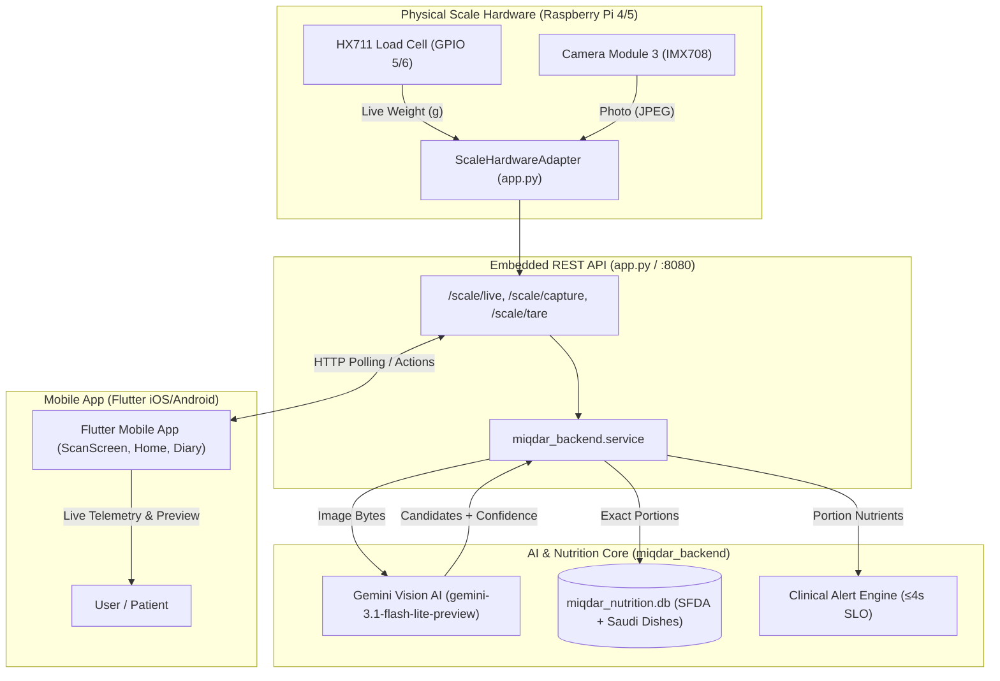

# Miqdar (مقدار) - Complete Agent & Developer Handover Guide

> **Target Audience**: AI Agents, Systems Engineers, and Mobile/Backend Developers continuing development on the Miqdar project.
> **Last Updated**: November 2026
> **Git Repository**: [Abdullah11Kn/Miqdar](https://github.com/Abdullah11Kn/Miqdar.git)
> **Branch**: `main`

---

## 1. Executive Summary & Mission

**Miqdar (مقدار)** is an end-to-end Smart IoT Kitchen Scale and Nutrition Platform tailored for Saudi Arabia and the Middle East. It bridges physical kitchen hardware, multimodal AI vision, authoritative nutritional databases, and a companion mobile application to deliver real-time, automated meal logging and clinical dietary safety alerts.

### The Problem It Solves
Traditional calorie-tracking apps require tedious manual search, volume estimation, and guesswork. Furthermore, they lack localized Middle Eastern dishes (e.g., Kabsa, Mandi, Jareesh, Saleeg, Medjool dates) and do not warn patients with chronic conditions (hypertension, diabetes, kidney disease) before harmful sodium, sugar, or potassium thresholds are breached.

### How Miqdar Solves It
1. The user places food on the **physical smart scale**.
2. The scale's high-precision **HX711 load cell** streams live weight (±1g) to the mobile app in real time.
3. The integrated **Raspberry Pi Camera Module 3** captures a photo of the food from above.
4. The scale publishes the weighed photo. The **Flutter app** sends it to **Google Gemini** using a key held on the app side, and Gemini returns the food plus its estimated nutrition per 100 g.
5. The app multiplies those per-100 g values by the measured grams and evaluates health alerts on the phone. Values are labelled as an AI estimate. The old database pipeline stays available on the scale with `--analyze-on-scale`.
6. The **Flutter mobile app** displays the real-time weight, the captured photo in an interactive zoom viewer, the recognized food with alternative candidate options, and color-coded clinical safety warnings.



---

## 2. Repository Layout & Sitemap

```
├── AGENT_HANDOVER.md              # THIS MASTER HANDOVER FILE
├── README.md                      # Public project overview and quick start
├── app.py                         # Scale hardware daemon + embedded REST server
├── hardware.py                    # Standalone hardware driver (HX711 + picamera2)
├── scale.py                       # CLI test tool for raw load-cell calibration
├── scale_calibration.json         # Persisted scale tare offset & reference units
├── start_scale_app.sh             # Production launcher for hardware scale + API
├── start_server.sh                # Headless API server launcher (mock hardware)
├── run_simulator.sh               # Mac: run the app on the simulator with the key from .env
├── start_all.sh                   # One-click start: tunnel + fullscreen scale (desktop icon)
├── install_pi_desktop.sh          # Pi setup: packages, virtualenv, API key, desktop icon
├── enable_usb_ssh_pi.sh           # Run once on the Pi: USB-C becomes a private network to the Mac
├── connect_pi.sh                  # Run on the Mac: terminal on the Pi over the USB-C cable
├── start_cloudflare_tunnel.sh     # Remote access tunnel launcher (cloudflared)
├── test_recognition.py            # CLI tool to test Gemini recognition on any image
├── run_checks.sh                  # All-in-one verification script (DB + Py + Flutter)
├── requirements.txt               # Top-level Python dependencies
├── .env.example                   # Environment variable template
│
├── backend/                       # Core Python Backend Package
│   ├── miqdar_backend/
│   │   ├── __init__.py
│   │   ├── alert_engine.py        # Clinical alert rules (hypertension, diabetes, CKD)
│   │   ├── database.py            # SQLite schema, queries, meal history, user profiles
│   │   ├── recognition.py         # Gemini multimodal provider, cache, retry cascade
│   │   ├── recommendations.py     # 90-day intake analysis & meal suggestions
│   │   ├── server.py              # Threaded HTTP REST API server
│   │   └── service.py             # Pipeline orchestrator: image + weight -> meal
│   ├── tests/
│   │   ├── test_miqdar.py         # Unit tests for AI, database, alerts, SLOs
│   │   ├── test_scale_integration.py # Integration tests for /scale/ endpoints
│   │   └── test_sfda_import.py    # SFDA data validation tests
│   └── requirements.txt           # Backend-specific requirements
│
├── mobile/                        # Cross-Platform Flutter Mobile Application
│   ├── pubspec.yaml               # Flutter dependencies (http, sqflite, provider, etc.)
│   ├── analysis_options.yaml      # Strict Flutter linting rules (100% clean)
│   ├── lib/
│   │   ├── main.dart              # Flutter application entry point
│   │   ├── app.dart               # Root MaterialApp & theme configuration
│   │   ├── app_controller.dart    # Central state manager (telemetry, meals, goals)
│   │   ├── theme.dart             # Luxury dark/light styling, color tokens
│   │   ├── data/
│   │   │   ├── food_catalog.dart  # Offline fallback food database
│   │   │   └── local_database.dart# On-device SQLite database (meal logs & sync)
│   │   ├── models/
│   │   │   └── nutrition.dart     # Meal, Nutrient, Alert, HealthProfile models
│   │   ├── services/
│   │   │   ├── alert_service.dart # Local clinical alert evaluator
│   │   │   └── api_service.dart   # REST client + ScaleHardwareService
│   │   ├── ui/
│   │   │   ├── home_screen.dart   # Dashboard: calorie gauge, macros, quick log
│   │   │   ├── scan_and_add_screen.dart # Live scale card, tare, capture, photo viewer
│   │   │   ├── diary_and_detail_screen.dart # Meal history log, macro breakdown
│   │   │   ├── insights_and_goals_screen.dart # Weekly charts, micronutrient trends
│   │   │   ├── profile_and_device_screen.dart # Scale pairing, health profile, URL config
│   │   │   ├── auth_screens.dart  # User onboarding and login
│   │   │   └── screens.dart       # UI barrel export
│   │   └── widgets/
│   │       └── charts_and_gauges.dart # Custom circular gauges & progress bars
│   └── test/
│       ├── alert_service_test.dart
│       ├── meal_recommendation_test.dart
│       └── nutrition_values_test.dart
│
├── database/                      # SQLite Database & Build Tools
│   ├── miqdar_nutrition.db        # Seeded production SQLite database
│   ├── schema.sql                 # Complete relational DDL with indexes
│   ├── scripts/
│   │   ├── build_database.py      # Rebuilds and seeds DB deterministically
│   │   ├── sync_sfda.py           # SFDA open data sync tool
│   │   └── sync_usda_fdc.py       # USDA FoodData Central sync tool
│   └── seed/                      # Authoritative CSV seeds (foods, aliases, sources)
│
├── docs/                          # Architectural & Verification Docs
│   ├── API_CONTRACT.md            # Complete REST API payload specifications
│   ├── GEMINI_SERVER_SETUP.md     # AI vision deployment guide
│   ├── VERIFICATION.md            # Acceptance tests & performance SLO metrics
│   ├── FIGMA_TO_FLUTTER.md        # UI design system tokens & Figma mapping
│   └── handover/                  # Hardware & Project Slide Decks
│       ├── Smart_Food_Scale_Handover_Slides.pdf
│       └── Smart_Food_Scale_Hardware_Handover.pdf
│
└── evaluation/                    # Academic Research Benchmark Suite
    ├── evaluation_400_dataset.csv # 400-sample balanced Saudi food benchmark
    ├── evaluate_dataset.py        # Batch vision accuracy evaluation script
    ├── compare_models.py          # Benchmark comparing vision model variants
    ├── compute_metrics.py         # Top-1, Top-3, and dish F1-score calculator
    ├── generate_report.py         # Report generator
    └── sample_images/             # Test photos (kabsa, shawarma, jareesh, burger, pizza)
```

---

## 3. Subsystem Architecture Deep-Dive

### 3.1 Hardware Scale & Drivers (`app.py`, `hardware.py`)
- **Single-Board Computer**: Raspberry Pi 4 Model B or Raspberry Pi 5 running Raspberry Pi OS (64-bit).
- **Load Cell**: 4-wire strain gauge mounted under an acrylic or aluminum weighing platform.
- **Amplifier IC**: HX711 24-bit ADC module:
  - `DT` (Data): Connected to Raspberry Pi **GPIO 6** (Pin 31).
  - `SCK` (Clock): Connected to Raspberry Pi **GPIO 5** (Pin 29).
  - `VCC`: 5V / 3.3V. `GND`: Ground.
- **Tare & Calibration**:
  - Saved to `scale_calibration.json`:
    ```json
    {
      "offset": 125430.0,
      "factor": 421.35,
      "cal_mass_g": 200.0
    }
    ```
  - Formula: $\text{Weight (g)} = \frac{\text{Raw Reading} - \text{Offset}}{\text{Factor}}$, minus the current tare.
- **Camera Module 3 (IMX708 autofocus)**:
  - Mounted on an overhead bracket at approximately 30–40 cm height angled down at the weighing plate.
  - **4-Tier Capture Cascade** in `ScaleHardwareAdapter.capture_photo()` ([app.py](file:///Users/q2q2312345gmail.com/Documents/senior%20project%20api%20test/app.py)):
    1. Python `picamera2` module: Direct in-memory buffer capture.
    2. `rpicam-still` CLI: The official Raspberry Pi OS (Bookworm) command (`rpicam-still -t 800 -o <path> --width 1280 --height 960 -n`).
    3. `libcamera-still` CLI: The official Raspberry Pi OS (Bullseye) command (`libcamera-still -t 800 -o <path> --width 1280 --height 960 -n`).
    4. OpenCV `cv2.VideoCapture(0)`: V4L2 USB camera fallback.
    5. If all of these fail on real hardware the capture fails with `CAMERA_UNAVAILABLE`. A stock photo is never substituted, because it would produce calories for food that is not on the plate. Sample dishes are used only in simulation mode (`--mock`, or off-Pi development), and every such result is flagged `simulated`.
- **No silent simulation on a Pi**: if `lgpio`, the HX711 or the calibration file is unavailable on a Raspberry Pi, `app.py` exits with the fix instead of falling back to fake weights. Pass `--mock` to simulate on purpose.
- **Capture is manual by default**: the touchscreen CAPTURE button or the app's button. `--auto-capture` or `MIQDAR_AUTO_CAPTURE=1` also captures when at least 20 g has been steady for 2 s.
- **One pipeline**: the phone, the touchscreen and auto-capture all run `perform_capture()`, one at a time (a concurrent request gets `409 CAPTURE_IN_PROGRESS`). Results and failures are both published as capture events.

### 3.2 Backend Service & Recognition Engine (`backend/miqdar_backend/`)
> **Default path since this change:** `mobile/lib/services/gemini_service.dart` does recognition and nutrition in the app, and the scale needs no key. The catalog supplies dish names only: without them Gemini misread jareesh as an Iranian dish at 95% confidence. Foods get `ai-` ids and `ai_estimate` status, and are stored only on the phone because the server has no matching record. The backend below runs only with `--analyze-on-scale` or `--server`, or when the app has no key.
>
> **The key must not ship.** `--dart-define` values can be extracted from an installed app, so this suits local simulator testing only. A release must call Gemini through a server that holds the key. Estimates also vary for one dish between photos, so review them before relying on the clinical alerts.

- **Primary AI Vision Model**: **`gemini-3.1-flash-lite-preview`**
  - Configured in [recognition.py](file:///Users/q2q2312345gmail.com/Documents/senior%20project%20api%20test/backend/miqdar_backend/recognition.py).
  - Multimodal prompt instructs Gemini to output structured JSON:
    ```json
    [
      {"label": "chicken kabsa", "confidence": 0.95},
      {"label": "mandi rice", "confidence": 0.82},
      {"label": "biryani", "confidence": 0.65}
    ]
    ```
  - Preprocessing: Image is automatically downsampled using high-quality Lanczos resampling (max 768px) and compressed to JPEG quality 80 to minimize network token transfer while preserving visual clarity.
  - In-memory thread-safe LRU Cache (`RECOGNITION_CACHE`): Repeat captures of identical dishes return instantly (0 ms AI latency).
  - Retry & Fallback Cascade: If the primary model returns 404, 429, 500, 502, 503, or 504, it immediately attempts fallbacks: `gemini-3-flash-preview` $\rightarrow$ `gemini-2.5-flash-image` $\rightarrow$ `gemini-flash-latest`.
- **Sequential Capture Gating** ([service.py](file:///Users/q2q2312345gmail.com/Documents/senior%20project%20api%20test/backend/miqdar_backend/service.py)):
  - Prevents accidental double-logging. A new capture is only processed if the weight changed by $> 5.0\text{ g}$ or the visual hash changed.
- **Clinical Alert Engine** ([alert_engine.py](file:///Users/q2q2312345gmail.com/Documents/senior%20project%20api%20test/backend/miqdar_backend/alert_engine.py)):
  - Strictly evaluated in under $10\text{ ms}$ (exceeding the $\le 4,000\text{ ms}$ clinical requirement).
  - Computes the user's cumulative 24-hour intake including the pending meal against configured limits:
    - **Sodium**: Warns if single meal $> 800\text{ mg}$ or daily total $> 2,300\text{ mg}$ ($1,500\text{ mg}$ for hypertension).
    - **Sugar**: Warns if single meal $> 30\text{ g}$ or daily total $> 50\text{ g}$ ($25\text{ g}$ for diabetes).
    - **Carbohydrates**: Checks diabetic carb allotment.
    - **Potassium & Protein**: Checks renal (CKD) safety thresholds.

### 3.3 Flutter Mobile Application (`mobile/`)
- **State Management**: Built on `ChangeNotifier` and `Provider` via [AppController](file:///Users/q2q2312345gmail.com/Documents/senior%20project%20api%20test/mobile/lib/app_controller.dart).
- **Scale Telemetry Client**: [ScaleHardwareService](file:///Users/q2q2312345gmail.com/Documents/senior%20project%20api%20test/mobile/lib/services/api_service.dart) polls `/scale/live` every 500 ms and goes offline only after 3 missed polls in a row.
  - Automatically detects scale disconnection, renders an "Offline" badge, and offers a one-tap dialog to update the server URL.
  - Automatically receives live capture events pushed from physical button presses on the scale.
- **Review & Logging UI** ([scan_and_add_screen.dart](file:///Users/q2q2312345gmail.com/Documents/senior%20project%20api%20test/mobile/lib/ui/scan_and_add_screen.dart)):
  - Hero image card displays the real camera photo captured by the scale.
  - **Tap-to-Expand**: Tapping the photo opens a full-screen `InteractiveViewer` with pinch-to-zoom and pan.
  - Ranked Candidates Carousel: Displays Top-3 candidate foods recognized by Gemini. Tapping another candidate dynamically recalculates nutrients for the measured weight.
- **Offline Resilience**:
  - Local SQLite database on the mobile device ([local_database.dart](file:///Users/q2q2312345gmail.com/Documents/senior%20project%20api%20test/mobile/lib/data/local_database.dart)) retains 90+ days of meal history, allowing full offline browsing and diary inspection.

---

## 4. Complete REST API Contract

All endpoints listen on `http://<scale-ip>:8080` (or through the Cloudflare Tunnel URL).

### 4.1 Hardware Scale Endpoints

#### `GET /scale/live`
Lightweight telemetry polled twice a second (about 2 KB over a tunnel). It never contains the photo.
- **Response `200 OK`**:
  ```json
  {
    "mode": "real",
    "live_weight_g": 245.8,
    "is_stable": true,
    "is_overloaded": false,
    "sensor_ok": true,
    "sensor_error": null,
    "capture_state": "idle",
    "auto_capture": true,
    "battery_pct": 94,
    "latest_capture": {
      "event_id": "cap-1-1730412345",
      "age_s": 2.4,
      "status": "ok",
      "source": "auto",
      "simulated": false,
      "weight_g": 245.8,
      "food": {"food_id": "SA-001", "name_en": "Chicken Kabsa"},
      "nutrients": {"calories_kcal": 385.2}
    }
  }
  ```
  `capture_state` is `idle`, `settling`, `capturing` or `analyzing`. A failed capture has `"status": "error"` plus `error` and `message`.

#### `GET /scale/capture/latest`
The full latest capture event including `image_base64`. Clients fetch it once per new `event_id`.

A photo awaiting analysis in the app has `"status": "photo"`, which is the default.

#### `POST /scale/capture/result`
The app reports `{"event_id", "food": {"name_en"}, "nutrients"}` so the touchscreen can show the calories. Results for an older capture are ignored.

#### `POST /scale/simulate` (simulation mode only, 404 on a real scale)
`{"weight_g": 240, "sample": "jareesh"}` puts food on the simulated plate. Samples: `kabsa`, `shawarma`, `jareesh`, `pizza`, `burger`.

#### `POST /scale/tare`
Resets the scale's current reading to 0.0g.
- **Response `200 OK`**:
  ```json
  {
    "status": "ok",
    "message": "Scale tared successfully",
    "new_offset": 8522300,
    "weight_g": 0.0
  }
  ```

#### `POST /scale/capture`
Triggers an immediate camera capture + Gemini recognition.
- **Request Body (optional)**:
  ```json
  {
    "user_id": "usr_patient_1",
    "hint": "extra sauce",
    "save": false
  }
  ```
  `save` defaults to `true`. The mobile app sends `false` and logs the meal when the user confirms it, so the server never double-counts. Touchscreen and auto-captures are always drafts awaiting that confirmation.
- **Errors**: `{"error": "<code>", "message": "...", "candidates": [], "event_id": "..."}` with `CAMERA_UNAVAILABLE` (503), `EMPTY_SCALE` (422), `NOT_FOOD` (422), `FOOD_NOT_IN_DATABASE` (422), `CAPTURE_IN_PROGRESS` (409) or `AI_PROVIDER_UNAVAILABLE` (502).
- **Response `200 OK`**:
  ```json
  {
    "meal_id": "meal-1730412350",
    "food": {
      "food_id": "SA-001",
      "name_en": "Chicken Kabsa",
      "name_ar": "كبسة دجاج",
      "category": "Rice & Poultry"
    },
    "weight_g": 245.8,
    "nutrients": {
      "calories_kcal": 385.2,
      "protein_g": 28.4,
      "carbohydrate_g": 42.1,
      "fat_g": 11.2,
      "sodium_mg": 680.0,
      "sugar_g": 2.1,
      "fiber_g": 3.4,
      "potassium_mg": 410.0
    },
    "candidates": [
      {"label": "chicken kabsa", "confidence": 0.95, "selected": true},
      {"label": "mandi rice", "confidence": 0.78, "selected": false}
    ],
    "alerts": [],
    "image_base64": "/9j/4AAQSkZJRg...",
    "timing": {
      "recognition_ms": 1420,
      "alert_evaluation_ms": 4,
      "total_ms": 1450
    }
  }
  ```

### 4.2 Application Endpoints

#### `POST /api/analyze`
Direct food recognition endpoint for uploaded image bytes + weight.
- **Request Body**:
  ```json
  {
    "user_id": "usr_patient_1",
    "image_base64": "<base64_jpeg_string>",
    "weight_g": 180.0,
    "hint": ""
  }
  ```
- **Response**: Same structure as `/scale/capture`.

#### `GET /api/meals?user_id=usr_patient_1&days=90`
Returns logged meal history for diary and recommendation engine.

#### `POST /api/save_meal`
Saves or updates a meal log entry with user-adjusted candidates or portion weight.

#### `GET /api/profile?user_id=usr_patient_1` & `POST /api/profile`
Manages clinical profile and condition flags (`hypertension`, `diabetes_type_2`, `ckd_stage_3`).

#### `GET /api/recommendations?user_id=usr_patient_1`
Returns personalized, explainable meal suggestions based on past 90-day intake.

---

## 5. Setup & Running Instructions

### 5.1 Environment Configuration (`.env`)
Create a `.env` file in the project root:
```bash
# Google Gemini API Key from Google AI Studio (https://aistudio.google.com/)
GEMINI_API_KEY="YOUR_GEMINI_API_KEY_HERE"

# Primary & Fallback Models
GEMINI_MODEL="gemini-3.1-flash-lite-preview"
GEMINI_FALLBACK_MODELS="gemini-3-flash-preview,gemini-2.5-flash-image,gemini-flash-latest"

# Server Host & Port
MIQDAR_HOST="0.0.0.0"
MIQDAR_PORT="8080"
MIQDAR_RECOGNITION_PROVIDER="gemini"
```

### 5.2 Running on the Physical Scale (Raspberry Pi)
One-time setup, and again after every `git pull`:
```bash
git clone https://github.com/Abdullah11Kn/Miqdar.git
cd Miqdar
./install_pi_desktop.sh
```
The installer adds the apt packages, cloudflared and a virtualenv created with `--system-site-packages` (a plain virtualenv cannot import the apt-installed `lgpio` and `picamera2`). It also puts a **Miqdar Scale** icon on the desktop. The Pi needs no Gemini key.

After that, **tap the icon**. `start_all.sh` stops any earlier run, starts the tunnel in the background and opens the scale fullscreen. `scale_calibration.json` is tracked in git, so a fresh clone starts with those values rather than asking: check a known weight, and if it reads wrong run `.venv/bin/python scale.py calibrate` once on the Pi. Put the empty plate on before tapping the icon (start-up zeroes the scale) or press ZERO afterwards, otherwise the plate's weight is counted as food.

### 5.3 Connecting the App (Cloudflare Tunnel or Wi-Fi)
The bottom of the scale's weigh screen shows the address to use: the tunnel URL once it is up, otherwise the LAN address.
- **Same network as the Pi**: the LAN address `http://<pi-ip>:8080` is enough and has lower latency. No tunnel is needed unless the network isolates clients.
- **Different networks**: use the `https://<random>.trycloudflare.com` URL.
- Quick-tunnel URLs change on every start. An old one answers HTTP 530 (error 1033), which the app reports as an inactive tunnel URL. A permanent URL needs a named tunnel on a domain you own in Cloudflare.
- On the Mac run `./run_simulator.sh <address>`. It reads `GEMINI_API_KEY` from the git-ignored `.env` and passes both to the app. The address can also be changed in the app by tapping the LIVE/OFFLINE badge on Add Meal.
- **Security**: a tunnel makes the API, including the camera, reachable from the internet. Set `MIQDAR_API_TOKEN` in the Pi's `.env` and run the app with the matching `--dart-define=MIQDAR_API_TOKEN=...`. Only `/health` and `/scale/live` stay public.

### 5.3.1 Controlling the Pi from a Mac over USB-C
Run once on the Pi, then reboot: `./enable_usb_ssh_pi.sh` (`--undo` reverses it; originals are kept as `*.miqdar-backup` in `/boot/firmware`).
Then on the Mac: `./connect_pi.sh` (first run asks for the Pi password once and installs a key), and afterwards `ssh miqdar-pi` or VS Code Remote-SSH.
- The Pi is always `192.168.7.1` on the cable. No gateway is offered, so each machine keeps its own internet.
- The app can use the cable too, with no tunnel: `./run_simulator.sh http://192.168.7.1:8080`.
- USB-C is the Pi 4B's only power input, so on this cable the Mac powers the Pi instead of the battery pack. Shut down before swapping cables, and check `vcgencmd get_throttled` shows `throttled=0x0` under load.
- Gadget mode does not affect running from the battery pack or the USB-A ports.

### 5.4 Running the Flutter Mobile App
```bash
cd mobile
flutter pub get
flutter run
```
To test on a physical iPhone or Android device, ensure the device is on the same local Wi-Fi network as the Raspberry Pi (or use the Cloudflare Tunnel URL).

### 5.5 Running Full Automated Acceptance Tests
```bash
./run_checks.sh
```
This runs:
1. Database build and integrity validation.
2. 15 Python backend tests (Gemini integration, nutrient math, clinical SLO <4s, load-cell REST endpoints).
3. Flutter static analysis (`flutter analyze` -> 0 issues).
4. Flutter test suite (`flutter test` -> 100% pass).

The full flow in the real app, on a simulator, against a freshly started scale in simulation mode:
```bash
./start_scale_app.sh --headless --mock --auto-capture    # terminal 1 (this writes to database/miqdar_nutrition.db)
cd mobile && flutter test integration_test/scale_flow_test.dart -d <simulator-id> --dart-define=GEMINI_API_KEY=<key>    # terminal 2
```

---

## 6. Critical Gotchas & Developer Rules

1. **NEVER Hardcode Raw API Keys in Git-Tracked Files**:
   - GitHub Secret Scanning and Push Protection are active on this repository.
   - Any commit containing string literals resembling Google API keys (`AIza...` or service account keys) will be rejected by GitHub remote hooks.
   - Always load credentials dynamically from `.env` or the runtime environment (`os.environ.get("GEMINI_API_KEY")`).
2. **Gemini Vision Model Naming**:
   - Google AI Studio requires the `-preview` suffix for modern Flash models. Use `gemini-3.1-flash-lite-preview` or `gemini-3-flash-preview`. Using deprecated names without `-preview` results in an immediate **HTTP 404**.
3. **Raspberry Pi Camera Module 3 Drivers**:
   - Raspberry Pi OS **Bookworm** uses `rpicam-still` (the old `raspistill` is obsolete).
   - Raspberry Pi OS **Bullseye** uses `libcamera-still`.
   - [app.py](file:///Users/q2q2312345gmail.com/Documents/senior%20project%20api%20test/app.py) handles both automatically via CLI subprocess if Python `picamera2` is not installed inside the virtualenv.
4. **Scale Calibration**:
   - If the measured weight differs from actual grams, run `python3 scale.py` on the Raspberry Pi to perform zero-tare and calibrate with a known weight (e.g. 100g or 500g). The calibrated values are stored in `scale_calibration.json`.
5. **Database Rebuilding**:
   - The database is built using `python3 database/scripts/build_database.py`.
   - Never edit SQLite binary tables manually. Add new dishes and canonical nutrients to `database/seed/foods.csv` and aliases to `database/seed/aliases.csv`, then run `build_database.py`.

---

## 7. Next Feature Roadmap for the Incoming Agent

1. **Bluetooth Low Energy (BLE) Direct Telemetry**:
   - Support BLE peripheral mode on Raspberry Pi (`bluez`) to stream weight readings directly to the mobile app without requiring Wi-Fi.
2. **Multi-Food Plate Segmentation**:
   - Expand Gemini prompt schema to return multiple bounding-box coordinates for mixed plates (e.g., rice + meat + salad on one plate).
3. **Continuous Zero-Tracking (Auto-Tare)**:
   - Add slow-drift zero tracking algorithm in `ScaleHardwareAdapter` to eliminate thermal drift on the load cell during extended kitchen sessions.
4. **Voice Feedback / Audio Prompts**:
   - Integrate edge text-to-speech on the Raspberry Pi (`espeak-ng` or Piper) to speak the recognized food and calories to the user.
