# Smart Nutrition Scale - Backend API & Integration Guide

A production-grade, low-latency Food Recognition & Nutrition Calculation API powered by **Google Gemini Vision** (`gemini-3.1-flash-lite`, `gemini-3.5-flash-lite`, and `gemini-3.8-flash`).

Built specifically for the **Smart Kitchen Scale Senior Project**:
- **Hardware Scale (Raspberry Pi + Load Cell + Camera)**: Captures authoritative portion weight in grams and overhead dish photo.
- **Backend API (`server.py` + `food_ai.py`)**: Preprocesses image, queries Gemini structured output, validates nutritional facts against USDA/Saudi food composition standards, applies Atwater energy consistency checks, and caches repeat analyses.
- **Mobile Application**: Displays bilingual dish names (Arabic & English), portion calories, macronutrients, and user confirmation dialogs.
- **Instructor Demo Page (`index.html`)**: Interactive dashboard showing end-to-end simulation and live inference side-by-side.

---

## 1. System Architecture

```mermaid
graph TD
    A["Raspberry Pi Scale\n(Camera + HX711 Load Cell)"] -->|"POST /api/recognize\n(image_base64 + weight_grams)"| B["Smart Scale Server\n(server.py)"]
    M["Mobile App\n(iOS / Android / Flutter)"] -->|"GET /api/health\nPOST /api/recognize"| B
    B --> C["Core Food Engine\n(food_ai.py)"]
    C -->|"1. Image downscaling & EXIF orientation"| D["Image Preprocessor"]
    C -->|"2. LRU Hash Cache"| E[("In-Memory Cache\n(TTL 24h)")]
    C -->|"3. Structured Output & Prompt"| F["Gemini Vision API\n(Primary: 3.1-flash-lite)"]
    F -->|"Fallback on 503 / Rate Limit"| G["Fallback Model\n(3.5-flash-lite)"]
    C -->|"4. Nutrition Validation\nAtwater (4P+4C+9F)"| H["Nutrition Integrity\nValidator"]
    B -->|"5. Formatted JSON Response"| M
    B -->|"6. LCD / Screen Display"| A
```



---

## 2. API Endpoints

Base URL: `http://<SERVER_IP>:8085` (Configurable via `HOST` and `PORT` in `.env`)

### `POST /api/recognize`
Analyzes a food image along with the authoritative weight reading from the scale.

#### Headers
| Header | Value | Description |
|---|---|---|
| `Content-Type` | `application/json` | Required |
| `Content-Length` | `<byte_length>` | Required (Max body size: 12 MB) |

#### Request Body Schema
```json
{
  "image_base64": "data:image/jpeg;base64,/9j/4AAQSkZJRgABAQ...",
  "weight_grams": 240,
  "model": "gemini-3.1-flash-lite",
  "bypass_cache": false
}
```
*Alternatively, for local dataset testing: replace `image_base64` with `"image_path": "برجر.jpg"`.*

| Parameter | Type | Required | Description |
|---|---|---|---|
| `image_base64` | string | Either this or `image_path` | Base64-encoded image string (JPEG, PNG, WebP). Prefix `data:image/...;base64,` is optional. |
| `image_path` | string | Either this or `image_base64` | Dataset image filename (safe path traversal validation applied). |
| `weight_grams` | float | **Yes** | Authoritative weight measured by scale load cell (`0 < weight <= 10000`). |
| `model` | string | No | Optional model override (`gemini-3.1-flash-lite`, `gemini-3.5-flash-lite`, `gemini-3.8-flash`). |
| `bypass_cache` | boolean | No | When `true`, ignores cached results and runs live Gemini inference. |

---

#### Success Response (`200 OK`)
```json
{
  "success": true,
  "request_id": "e3d211fca70d",
  "model": "gemini-3.1-flash-lite",
  "latency_seconds": 2.56,
  "cached": false,
  "weight_grams": 240.0,
  "recognition": {
    "is_food": true,
    "best_match_en": "Double Cheeseburger",
    "best_match_ar": "تشيز برجر مزدوج",
    "preparation": "grilled",
    "visible_ingredients": [
      "bun",
      "beef patty",
      "cheddar cheese",
      "pickles",
      "ketchup",
      "mustard",
      "onions"
    ],
    "confidence": 95,
    "requires_user_confirmation": false,
    "alternatives": [
      {
        "name_en": "Double Quarter Pounder with Cheese",
        "name_ar": "دبل كوارتر باوندر بالجبنة"
      },
      {
        "name_en": "Double Hamburger",
        "name_ar": "هامبرجر مزدوج"
      }
    ],
    "nutrition_basis": "USDA FDC: Cheeseburger, double patty, with condiments",
    "calories_per_100g": 260.0,
    "protein_per_100g": 14.0,
    "carbs_per_100g": 20.0,
    "fat_per_100g": 14.0
  },
  "nutrition": {
    "calories": 624,
    "protein": 33.6,
    "carbs": 48.0,
    "fat": 33.6,
    "per_100g": {
      "calories": 260,
      "protein": 14.0,
      "carbs": 20.0,
      "fat": 14.0
    }
  },
  "warnings": [],
  "attempts": [
    {
      "model": "gemini-3.1-flash-lite",
      "attempt": 1,
      "error_code": null,
      "seconds": 2.56
    }
  ]
}
```

---

#### Error Response Format
All errors return consistent JSON with actionable `error_code` strings:
```json
{
  "success": false,
  "error_code": "NOT_FOOD",
  "error": "No food detected in the image.",
  "request_id": "7b82f0c19a2e"
}
```

#### Standard Error Codes
| HTTP Status | `error_code` | Cause & Resolution |
|---|---|---|
| `400` | `INVALID_WEIGHT` | `weight_grams` missing, non-numeric, or `<= 0`. Ensure scale sends positive gram weight. |
| `400` | `INVALID_IMAGE` | Unrecognized or corrupted image format. |
| `400` | `MISSING_IMAGE` | Neither `image_base64` nor `image_path` was provided. |
| `404` | `IMAGE_NOT_FOUND` | Specified `image_path` does not exist in dataset folders. |
| `413` | `PAYLOAD_TOO_LARGE` | Image or payload exceeds maximum allowed size (12 MB body / 8 MB image). |
| `422` | `NOT_FOOD` | Gemini detected non-food item (e.g. keys, phone, empty plate). |
| `429` | `RATE_LIMITED` | Gemini API quota exhausted. Retried automatically; if still failing, back off. |
| `502` | `INVALID_MODEL_OUTPUT` | Upstream model returned physically impossible macros ($P+C+F > 105g$). |
| `503` | `UPSTREAM_UNAVAILABLE` | Gemini server temporary load spike (HTTP 503). Handled via automatic model fallback. |
| `504` | `UPSTREAM_TIMEOUT` | Gemini request exceeded timeout deadline. |

---

### `GET /api/health`
Liveness and configuration status.

#### Response (`200 OK`)
```json
{
  "status": "ok",
  "api_key_configured": true,
  "model": "gemini-3.1-flash-lite",
  "fallback_models": ["gemini-3.5-flash-lite"],
  "image_dirs": ["fooddataset", "sample_images"],
  "cache_entries": 12
}
```

---

### `POST /api/clear_cache`
Flushes the in-memory recognition cache.

#### Response (`200 OK`)
```json
{
  "success": true,
  "cleared": 12
}
```

---

## 3. Nutrition Facts & Accuracy Standards

1. **Authoritative Scale Weight**: The Gemini model is strictly instructed:
   > *"The scale measured X g. This weight is authoritative: do not estimate portion size from the image."*
   Portion calories are calculated deterministically:
   $$\text{Portion Nutrient} = \text{Nutrient per 100g} \times \left(\frac{\text{Weight (g)}}{100}\right)$$
2. **Standard Reference Sourcing**: Per-100g nutrients must reflect standard references (USDA FoodData Central or Saudi/Gulf food composition tables for dishes like Kabsa, Mandi, Jareesh, and Areeka). The exact reference item is returned in `recognition.nutrition_basis`.
3. **Atwater Energy Consistency**:
   $$\text{Expected Calories} = 4 \times \text{Protein} + 4 \times \text{Carbs} + 9 \times \text{Fat}$$
   If reported calories deviate by $>20\%$ or $>25$ kcal from the Atwater calculation, the system flags a warning in `warnings` and triggers `requires_user_confirmation = true`.
4. **Physical Sanity Checks**: If $P + C + F > 105\text{ g}$ per 100g, or if calories are zero while macros are non-zero, the result is rejected and retried with fallback.

---

## 4. Raspberry Pi Client Integration (Python)

Save this on your Raspberry Pi to send photos and scale readings to the backend:

```python
import base64
import requests

SERVER_URL = "http://192.168.1.100:8085/api/recognize"

def send_scale_reading(image_file_path: str, weight_in_grams: float):
    # 1. Read and base64-encode captured camera photo
    with open(image_file_path, "rb") as f:
        image_b64 = base64.b64encode(f.read()).decode("utf-8")

    # 2. Build payload
    payload = {
        "image_base64": image_b64,
        "weight_grams": round(weight_in_grams, 1)
    }

    # 3. POST to server
    try:
        response = requests.post(SERVER_URL, json=payload, timeout=30)
        data = response.json()

        if response.status_code == 200 and data.get("success"):
            rec = data["recognition"]
            nut = data["nutrition"]
            print(f"Dish: {rec['best_match_en']} ({rec['best_match_ar']})")
            print(f"Weight: {data['weight_grams']} g")
            print(f"Calories: {nut['calories']} kcal")
            print(f"Protein: {nut['protein']} g | Carbs: {nut['carbs']} g | Fat: {nut['fat']} g")
            if rec["requires_user_confirmation"]:
                print("⚠️ Please confirm dish on the mobile app!")
            return data
        else:
            print(f"Scale Error [{data.get('error_code')}]: {data.get('error')}")
            return None

    except requests.exceptions.RequestException as e:
        print(f"Network error: {e}")
        return None

# Example invocation:
# send_scale_reading("/tmp/scale_capture.jpg", 240.0)
```

---

## 5. Mobile App Client Integration (Dart / Flutter)

```dart
import 'dart:convert';
import 'package:http/http.dart' as http;

Future<Map<String, dynamic>?> analyzeFood({
  required String imageBase64,
  required double weightGrams,
  required String serverIp,
}) async {
  final url = Uri.parse('http://$serverIp:8085/api/recognize');

  final response = await http.post(
    url,
    headers: {'Content-Type': 'application/json'},
    body: jsonEncode({
      'image_base64': imageBase64,
      'weight_grams': weightGrams,
    }),
  );

  final data = jsonDecode(utf8.decode(response.bodyBytes));

  if (response.statusCode == 200 && data['success'] == true) {
    return data;
  } else {
    throw Exception(data['error'] ?? 'Food recognition failed');
  }
}
```

---

## 6. Command-Line Tools & Benchmarking

The codebase provides three standalone CLI tools:

### 1. Single Image Analysis (`test_food.py`)
```bash
.venv/bin/python test_food.py sample_images/kabsa.jpg 185
.venv/bin/python test_food.py fooddataset/برجر.jpg 240 --model gemini-3.1-flash-lite
.venv/bin/python test_food.py sample_images/kabsa.jpg 200 --json
```

### 2. Multi-Model Benchmark (`compare_models.py`)
Compares speed and accuracy across Gemini models side-by-side in a formatted table:
```bash
.venv/bin/python compare_models.py sample_images/kabsa.jpg 185
```

### 3. Dataset Accuracy Evaluation (`evaluate_dataset.py`)
Evaluates accuracy across the entire Arabic & Gulf food image dataset:
```bash
.venv/bin/python evaluate_dataset.py --model gemini-3.1-flash-lite --limit 10
```
