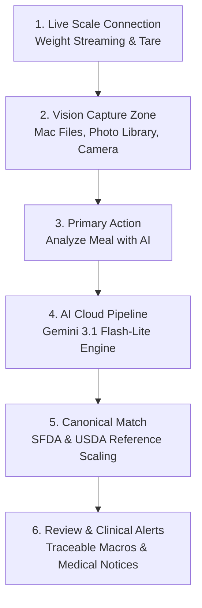

# Miqdar (مقدار) Design System & UI/UX Architecture

**Document:** `DESIGN.md`  
**Project:** Miqdar Smart Nutrition Scale & Mobile System  
**Baseline Date:** 25 October 2026  
**Audience:** Mobile Frontend Engineers, Embedded Engineers, AI/Cloud Backend Contributors, UI/UX Designers  

---

## 1. Product Purpose & Architectural Ground Truth

**Miqdar (مقدار)** is a full-stack, clinically referenced smart nutrition platform. It bridges physical hardware, cloud AI vision, clinical databases, and a mobile client into a unified, traceable pipeline:

$$\text{Smart Scale (Mass)} + \text{Camera / File (Photo)} \xrightarrow{\text{REST API}} \text{Gemini AI Vision} \xrightarrow{\text{Canonical Match}} \text{SQLite Clinical DB} \xrightarrow{\text{Evaluation}} \text{Verified Nutrients \& Clinical Alerts}$$

### Official Tagline & Identity
- **English:** *"Precision Weight • AI Recognition • Traceable Nutrition"*
- **Arabic:** *"قياس دقيق للوزن • تعرّف ذكي • تغذية موثوقة"*
- **Core Value Proposition:** Measuring real portions down to the gram, identifying meals with Gemini AI vision, scaling against Saudi FDA (SFDA) and USDA reference records, and evaluating clinical thresholds in $\le 4\text{ seconds}$.

---

## 2. Core Product Principles (PRD-01 to PRD-10)

1. **Review Before Recording (PRD-01):** AI recognition creates an editable draft. Intake is recorded only when the user explicitly reviews and taps **Save**.
2. **Useful Without Hardware (PRD-02):** If the physical scale is disconnected, food search, manual portion entry, photos, and diary remain 100% functional.
3. **Honest Measurements (PRD-03):** Every logged portion records its honest provenance: `PortionSource.scale`, `PortionSource.manual`, verified serving unit, or estimate. Never label an entered value as measured.
4. **Honest Nutrition (PRD-04):** UI visually distinguishes verified government database records (SFDA/USDA) from AI proposals and user-created custom entries. Missing nutrients are never shown as zero.
5. **User Control (PRD-05):** Users can correct food identity, portion, preparation, meal time, and ingredients before or after saving.
6. **Recoverable Work (PRD-06):** Navigation, camera interruption, connection failure, and app restart must not silently erase an active draft.
7. **Calm Clinical Guidance (PRD-07):** Nutritional warnings (e.g., high sodium for hypertension) use neutral, clinical alerts without alarmist, shame-inducing visuals.
8. **Bilingual Equality (PRD-08):** Arabic and English are first-class release requirements across all screens, metrics, error sheets, and navigation paths.
9. **Production vs. Demo Isolation (PRD-09):** Real user photos and live scale measurements are the primary user flow. Synthetic demo dishes are confined strictly to an optional developer/evaluator drawer.
10. **Capability-Based UI (PRD-10):** Show hardware controls only when the connected device actually supports them.

---

## 3. Visual Identity & Design System Tokens

Inherited directly from `mobile/lib/theme.dart`:

### 3.1 Color Palette

```
Brand Emeralds:
  Primary:        #059669  (Vibrant Modern Emerald)
  Emerald Deep:   #064E3B  (Accent & Header Gradient)
  Emerald Bright: #10B981  (Dark Mode Active Emerald)
  Mint Glow:      #34D399  (Indicators & Highlights)
  Soft Green:     #ECFDF5  (Pill & Card Backgrounds)
  Mint Border:    #A7F3D0  (Delicate Outline)

Neutrals (Light Mode):
  Canvas:         #F4F7F5  (Page Background)
  Surface:        #FFFFFF  (Cards & Sheets)
  Border:         #E2E8F0  (Subtle Dividers)
  Text Primary:   #0F172A  (Deep Slate)
  Text Secondary: #475569  (Muted Slate)
  Text Subdued:   #94A3B8

Neutrals (Dark Mode):
  Dark Canvas:    #0A120E  (Background)
  Dark Surface:   #121F18  (Cards & Sheets)
  Dark Card:      #182920  (Secondary Surfaces)
  Dark Border:    #263E31  (Dark Dividers)
  Dark Text:      #F1F5F9  (Primary Text)
  Dark Muted:     #94A3B8  (Muted Text)

Categorical Nutrient Accents (DES-03):
  Calories:   #059669 (Emerald)     Sugar:     #EC4899 (Pink)
  Protein:    #0D9488 (Teal)        Fiber:     #16A34A (Green)
  Carbs:      #D97706 (Amber)       Sodium:    #6366F1 (Indigo)
  Fat:        #3B82F6 (Blue)        Potassium: #8B5CF6 (Purple)

Semantic Status:
  Warning:    #D97706 (Amber)       Warning Bg: #FFFBEB
  Danger:     #E11D48 (Rose)        Danger Bg:  #FFF1F2
  Info:       #0284C7 (Sky)         Info Bg:    #F0F9FF
```

### 3.2 Typography & Radii
- **Hero / Screen Titles:** 24px, Font Weight `w800`, letter-spacing `-0.5`
- **Section Headers:** 17–18px, Font Weight `w800`
- **Digital Readouts:** 28–32px, Font Weight `w900`, tabular figures
- **Body & Labels:** 13–14px, Font Weight `w600` / `w700`
- **Corner Radii:**
  - Hero Photo / Viewfinder Container: `22px`
  - Cards & Scale Surface: `16px` – `18px`
  - Action Buttons & CTAs: `14px` – `16px`
  - Pills & Badges: `99px` (fully rounded capsule)

### 3.3 Ambient Shadows
- **Light Mode:** Two-tier ambient shadow (`0px 6px 20px rgba(15, 23, 42, 0.04)` + `0px 2px 8px rgba(5, 150, 105, 0.03)`).
- **Dark Mode:** Deep elevation shadow (`0px 8px 24px rgba(0, 0, 0, 0.35)`).

---

## 4. Native Pipeline Shape & Screen Hierarchy

What the README and system architecture lead with is the **Smart Nutrition Scale & AI Vision Engine**. The screen hierarchy directly mirrors the real hardware-to-cloud journey:



---

## 5. UI/UX Rules for the "Log a Meal" Screen (`scan_and_add_screen.dart`)

### 5.1 No Fake Categories or Stock Presets
- The screen opens in an authentic, clean state.
- Hardcoded preset food chips ("Chicken Kabsa", "Shawarma", "Jareesh") are **never** displayed on the primary user screen as fake categories.
- The user is logging *their* meal, so the screen focuses on real photo intake and real scale weight.

### 5.2 Real File Selection from Mac & Devices
- Uses `file_picker` alongside `image_picker`.
- On macOS, iOS Simulator, and mobile devices, users can choose photos directly from their Mac Finder, iCloud Drive, Downloads, or local files.
- Formats supported: `JPG`, `PNG`, `WEBP`, `HEIC`.
- Three clear, distinct photo intake actions:
  1. **Choose from Mac / Files** (`Icons.folder_open_rounded`): Native document/file picker.
  2. **Photo Library** (`Icons.photo_library_outlined`): Native Photos album.
  3. **Camera** (`Icons.camera_alt_outlined`): Device camera snapshot.

### 5.3 Live Smart Scale Integration
- Real-time connected scale telemetry (`scale.deviceId • Live Scale`).
- Dedicated **Tare (Zero)** action with instantaneous reset to `0 g`.
- Tactile step buttons (`-10g` / `+10g`) and direct-edit numeric entry.
- Quick portion preset capsules (`100g`, `150g`, `200g`, `300g`).
- Redundant slider removed to keep the card compact and keep the primary CTA above the fold.

### 5.4 Primary CTA Prominence
- Full-width, high-contrast CTA: **"Analyze Meal with AI"** (`#059669` light / `#10B981` dark).
- Clear feedback: Prompts the user if a photo is needed; displays animated progress state during Gemini cloud inference.
- Secondary fallback: "Instant offline preview" for network-isolated testing.

### 5.5 Isolated Developer & Evaluator Testing
- If evaluators or developers need to test without a physical camera or scale, a discreet option (*"Testing? Try a sample dish photo"*) opens a separate modal bottom sheet.
- This keeps testing tools accessible without compromising the production user experience.

---

## 6. Bilingual & Localization Architecture

- **Locales:** English (`en`) and Arabic (`ar`).
- **Directionality:** Full LTR and RTL support. Icon mirrors and layout alignments respond automatically to `Directionality.of(context)`.
- **Digit Normalization:** `normalizeDigits(String input)` safely converts Arabic-Indic (`٠-٩`) numerals and Arabic comma separators (`٫`) into standard ASCII floats for reliable arithmetic parsing.
- **Strings Provider:** Centralized via `S.of(context).tr('English', 'العربية')`.
