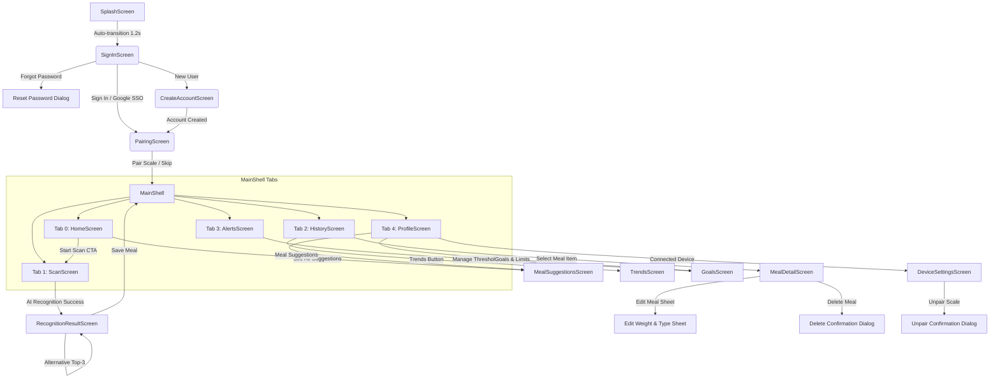

# Miqdar (مقدار) — Front-End Feature Specification & Requirements Document

> **Document Version:** 2.0.0  
> **Target Audience:** Front-End Engineers, UI/UX Designers, Product Architects  
> **Application Type:** Cross-Platform Smart Nutrition & Health Assistant (Mobile & Responsive Web)  
> **Core Modality:** AI Vision Food Recognition + Digital Scale Weight Integration + Real-Time Clinical Health Alerts  

---

## 1. Executive Summary & Vision

**Miqdar (مقدار)** is an intelligent dietary monitoring system designed to bridge the gap between AI food classification and actual physiological intake. Rather than relying on guesswork for portion sizes, Miqdar couples computer vision with precision scale measurements to calculate exact nutrient metrics (calories, protein, carbohydrates, fats, sugar, sodium, and potassium) and evaluate clinical safety thresholds in under 4 seconds.

This document serves as the **exhaustive specification of all existing front-end features, screens, interactive components, state logic, and UI requirements**. It is structured as an actionable blueprint for redesigning, rearchitecting, and elevating the Miqdar client application into a state-of-the-art user experience.

---

## 2. Design System Tokens & Foundations

The new front end must implement a cohesive design token system. Below are the foundational tokens extracted from the current implementation:

### 2.1 Color Palette

| Token Name | Hex Code | HSL Equivalent | Primary Usage |
| :--- | :--- | :--- | :--- |
| `primary` | `#0B7A3E` | `hsl(147, 83%, 26%)` | Primary brand buttons, active navigation, key highlights, progress fills |
| `primary-gradient-start`| `#075D33` | `hsl(150, 86%, 19%)` | Splash screen background gradient start |
| `primary-gradient-end`  | `#42A95F` | `hsl(137, 44%, 46%)` | Splash screen background gradient end |
| `dark` | `#17372B` | `hsl(158, 41%, 15%)` | Primary headlines, title text, dark card overlays, viewfinder backgrounds |
| `muted` | `#486258` | `hsl(158, 15%, 34%)` | Secondary body text, subtitles, captions, inactive icons |
| `background` | `#F7FAF8` | `hsl(140, 25%, 98%)` | Global scaffold & page background |
| `softGreen` | `#E9F7EE` | `hsl(139, 50%, 94%)` | Highlight card surfaces, avatar rings, track backgrounds |
| `border` | `#DDE9E2` | `hsl(143, 21%, 89%)` | Outlined card borders, text field outlines, separators |
| `lime` | `#83C937` | `hsl(89, 58%, 50%)` | Camera viewfinder focus reticle, high-emphasis positive accents |
| `warning` | `#E99A35` | `hsl(34, 80%, 56%)` | Nutrient warning alerts, carbs indicator, unverified seed banners |
| `danger` / `critical` | `#D64B45` | `hsl(3, 63%, 55%)` | Critical health risk banners, delete meal actions, latency SLA misses |
| `macro-fat` | `#5A91D8` | `hsl(214, 62%, 60%)` | Fat macronutrient segment in donut chart and progress indicators |
| `surface-white` | `#FFFFFF` | `hsl(0, 0%, 100%)` | Card surface backgrounds, input field backgrounds |
| `desktop-frame-bg` | `#E7ECE8` | `hsl(130, 9%, 91%)` | Outer backdrop color when running on wide desktop/web viewports |

### 2.2 Typography Scale

The font family defaults to system sans-serif (Inter, Roboto, or SF Pro). Arabic typography requires modern font pairing (e.g. Tajawal, Cairo, or IBM Plex Sans Arabic).

| Role | Weight | Size | Line Height | Usage |
| :--- | :--- | :--- | :--- | :--- |
| **Display Large** | `800` (Extrabold) | 42 px | 48 px | Splash screen English brand title |
| **Display Arabic**| `700` (Bold) | 28 px | 36 px | Splash screen Arabic brand title (`مقدار`) |
| **Headline Medium**| `800` (Extrabold) | 28 px | 34 px | Welcome back, Auth headings |
| **Headline Small** | `800` (Extrabold) | 24 px | 30 px | Screen headers (Home, Scan, History, Alerts, Profile) |
| **Title Large** | `800` (Extrabold) | 20 px | 26 px | Card headers, dish names, sheet titles |
| **Title Medium**| `700` (Bold) | 16 px | 22 px | Section headers, card labels |
| **Body Medium** | `400` (Regular) | 14 px | 20 px | Informational copy, descriptions, subtitles |
| **Label Small** | `700` (Bold) | 11–12 px | 16 px | Chips, badges, timestamps, table column headers |

### 2.3 Geometry & Layout Tokens

- **Border Radius:**
  - Small elements (Tags, Chips, Text Inputs): `14px – 15px`
  - Cards, Buttons, List Tiles: `17px – 18px`
  - Hero Cards, Viewfinder, Modals: `24px – 28px`
- **Container Sizing:**
  - Standard Mobile Frame constraint for web/desktop: Max width `480px`, centered with subtle drop shadow (`elevation: 6`).
  - Button touch target height: Minimum `54px`.
  - Icon sizes: Navigation `24px`, Hero badges `42px – 54px`, Viewfinder reticle `220x160px`.

---

## 3. Global Information Architecture & Navigation

The application uses an authenticated root navigation shell with a persistent 5-tab bottom navigation bar (`MainShell`).



---

## 4. Complete Screen-by-Screen Requirements Catalog

Below is the exhaustive specification for each of the **16 screens and interactive views**.

---

### SCR-01: Splash & Brand Launch Screen (`SplashScreen`)
- **Identifier:** `SCR-01`
- **Route:** Initial entry point (`/`)
- **Purpose:** Brand reinforcement, asset preloading, session initialization, and graceful auto-routing.
- **Layout & Visuals:**
  - Gradient background: `#075D33` (top-left) to `#42A95F` (bottom-right).
  - Center brand card: White rounded card (`142x116px`, radius `28px`) holding the official Miqdar logo asset.
  - English title: "Miqdar" (42px, Extrabold, White).
  - Arabic title: "مقدار" (28px, Bold, `#D7F6DC`).
  - Brand tagline: "SEE IT. TRACK IT. LIVE HEALTHY." (11px, letter-spacing `2px`, bold).
  - Value proposition footer: "Smart nutrition, measured precisely. AI recognition + real weight + health alerts".
- **User Actions & Logic:**
  - Automatically timers 1,200 ms and transitions via replacement to `SignInScreen`.
- **Requirements for Redesign:**
  - Replace static delay with actual asynchronous initialization check (local SQLite readiness + cached token check).
  - Implement smooth entrance fade-in and scale-in micro-animation for the logo and typography.

---

### SCR-02: Sign-In Screen (`SignInScreen`)
- **Identifier:** `SCR-02`
- **Route:** `/sign-in`
- **Purpose:** User authentication, password recovery trigger, demo auto-fill, and social login entry.
- **Layout & Visuals:**
  - Header: Miqdar logo (`48x42px`) + emerald green title text.
  - Headline: "Welcome back" (HeadlineMedium) with descriptive caption.
  - Form Fields:
    - Email field (default: `jehad@example.com`, keyboard type `emailAddress`).
    - Password field (default: `miqdar252`, toggleable obscure text suffix icon).
  - Actions:
    - "Forgot password?" text link right-aligned.
    - "Sign in" filled emerald button (`54px` height).
    - "Continue with Google" outlined secondary button with Google account icon.
    - "New to Miqdar? Create account" footer link.
- **User Actions & Validation:**
  - Password visibility toggle updates icon (`visibility` vs `visibility_off`).
  - Forgot password triggers an interactive `AlertDialog` confirming a mock reset link will be sent to the entered email.
  - "Sign in" and "Continue with Google" advance to `PairingScreen`.
- **Requirements for Redesign:**
  - Add client-side email format regex validation.
  - Support biometric login option (FaceID / Fingerprint) when credentials are saved locally.
  - Add real OAuth2 / Supabase / Firebase authentication flow hooks.

---

### SCR-03: Create Account Screen (`CreateAccountScreen`)
- **Identifier:** `SCR-03`
- **Route:** `/create-account`
- **Purpose:** Onboarding new users, collecting health objectives, and terms acceptance.
- **Layout & Visuals:**
  - Navigation bar: Standard back arrow + "Create account" title.
  - Subtitle: "Set up your personalized nutrition profile."
  - Form inputs:
    - Full Name input field.
    - Email address input field.
    - Password input field (obscured).
  - Objective selector:
    - Section header: "Primary goal".
    - ChoiceChips: `['Lose weight', 'Maintain', 'Build muscle']` with single-selection active state.
  - Consent row: CheckboxListTile with "I agree to the privacy policy and terms."
  - Primary button: "Create account" (enabled only when consent checkbox is `true`).
- **User Actions & Validation:**
  - Submit button disabled if `accepted == false`.
  - On submit, routes to `PairingScreen`.
- **Requirements for Redesign:**
  - Add input validation for minimum 8-character password with strength indicator.
  - Expand onboarding to capture age, biological sex, baseline weight, and daily activity factor to dynamically calculate default nutritional targets.

---

### SCR-04: Scale Hardware Pairing Screen (`PairingScreen`)
- **Identifier:** `SCR-04`
- **Route:** `/pairing`
- **Purpose:** Hardware setup onboarding, Bluetooth Low Energy (BLE) / Wi-Fi scale pairing simulation.
- **Layout & Visuals:**
  - Subtitle: "Connect once for hands-free meal logging."
  - Center illustration: Large circular mint container (`224x224px`) with digital scale icon (`108px`).
  - Hardware discovery indicator: "Miqdar-015 found" (or "Pairing securely…" when active).
  - Connection metrics: "Signal strength: Excellent" in bold primary green.
  - Network information tile: `_InfoRow` showing `KFU-Lab-WiFi` ("Secure network").
  - Primary action: "Pair device" (shows loading state "Pairing…" with 650ms delay).
  - Secondary action: "I’ll do this later" text button (skips directly to `MainShell`).
- **User Actions & Logic:**
  - Clicking "Pair device" sets loading flag, waits 650ms, then replaces route with `MainShell`.
  - Clicking skip immediately advances to `MainShell`.
- **Requirements for Redesign:**
  - Support real Bluetooth Low Energy scanning via Flutter reactive BLE / Web Bluetooth API.
  - Provide a fallback manual pairing code entry or QR code scanner on the physical scale bottom.

---

### SCR-05: Bottom Navigation Shell (`MainShell`)
- **Identifier:** `SCR-05`
- **Route:** `/app`
- **Purpose:** Persistent container managing navigation state across the primary 5 application domains.
- **Layout & Visuals:**
  - `IndexedStack` to preserve scrolling position and active sub-views across tab switches.
  - Material 3 `NavigationBar` with 5 items:
    1. **Home**: `Icons.home_outlined` / `Icons.home`
    2. **Scan**: `Icons.center_focus_weak` / `Icons.center_focus_strong`
    3. **History**: `Icons.history`
    4. **Alerts**: `Icons.notifications_outlined` / `Icons.notifications`
    5. **Profile**: `Icons.person_outline` / `Icons.person`
- **Requirements for Redesign:**
  - Add red notification badge counter on the **Alerts** tab whenever unacknowledged or critical alerts exist.
  - Provide haptic feedback on tab changes on iOS and Android.

---

### SCR-06: Home Dashboard Screen (`HomeScreen`)
- **Identifier:** `SCR-06`
- **Route:** `MainShell` Tab 0
- **Purpose:** Daily high-level nutrition summary, active scale/server health status, quick scan launch, and personalized meal recommendations preview.
- **Layout & Visuals:**
  - **Greeting Header:** "Good morning, Jehad" with a circular monogram avatar badge (`J`).
  - **System Connection Badge:** Mint capsule container with green/amber dot displaying backend connectivity (`API online • gemini-2.5-flash` or `Offline demo mode`) and paired scale (`Miqdar-015`).
  - **Daily Progress Card (`_SurfaceCard`):**
    - Radial Progress Ring (`_ProgressRing`): Today's consumed calories vs target limit (e.g. `1420 / 2200 kcal`) with percentage arc.
    - Linear Progress Bars (`_ProgressLine`):
      - **Protein**: Consumed g / Target g.
      - **Carbohydrates**: Consumed g / Target g.
      - **Sugar**: Consumed g / Target g.
  - **Quick-Scan Hero Banner:**
    - High-quality food imagery with dark gradient overlay.
    - Headline: "Ready to measure?"
    - Copy: "Place food on the scale and capture a clear photo."
    - CTA Button: "Start scan" with viewfinder icon (triggers navigation to Tab 1).
  - **Meal Ideas Preview Section:**
    - Header: "Meal ideas for you" with "See all" text button navigating to `MealSuggestionsScreen`.
    - Loading State: `LinearProgressIndicator` when suggestions are calculating.
    - Populated State: Displays Top-2 personalized `_SuggestionCard` items.
    - Empty State: Informative banner prompting user to configure health profile.
  - **Recent Meals Section:**
    - Header: "Recent meals" with total meals count in the 90-day window.
    - Populated State: Renders the 3 most recent meals as `_MealRow` components.
- **Requirements for Redesign:**
  - Add quick date-switcher to view past days' home dashboard totals.
  - Add interactive micro-chart for hourly caloric distribution (Breakfast, Lunch, Dinner, Snacks).

---

### SCR-07: Live Camera & Scale Weight Viewfinder (`ScanScreen`)
- **Identifier:** `SCR-07`
- **Route:** `MainShell` Tab 1
- **Purpose:** Capturing or picking food imagery, setting/reading portion weight from the scale, and executing AI recognition.
- **Layout & Visuals:**
  - Screen Header: "Live scan" with explanatory subtitle "Photo + scale weight are evaluated together."
  - **Camera Viewfinder Container (`290px` height):**
    - Background: Displays active picked photo (via `MemoryImage` / `XFile`) or high-res demo asset fallback (`assets/demo/kabsa.jpg`).
    - Status Chip (top-left): "Sample dish: Kabsa" or "Your photo is ready" with check icon.
    - Aiming Reticle: Centered rounded bounding box (`220x160px`) with 3px vibrant lime border (`#83C937`).
    - Capture Toolbar (bottom): Two tonal buttons side-by-side:
      - "Camera" (`Icons.photo_camera_outlined`) -> Triggers device camera capture.
      - "Gallery" (`Icons.photo_library_outlined`) -> Triggers photo library picker.
  - **Scale Measurement Card (`_SurfaceCard`):**
    - Header row: Scale icon, "Scale weight" title, and prominent green value readout (e.g. `120 g`).
    - Weight Slider: Range `10 g` to `500 g`, 98 discrete divisions, real-time value updates.
    - Contextual Server / Model Notice:
      - **When Online:** Displays AI model notice (`Photo is analysed by gemini-2.5-flash; nutrients come from the Miqdar database scaled to this weight.`).
      - **When Offline:** Displays dropdown selector for demo food items (`medjool dates`, `white rice`, `chicken breast`, `hummus`, `banana`) with clear offline warning.
  - **Primary Action Button:**
    - "Recognize food" with sparkle icon (`Icons.auto_awesome`).
    - While loading: Replaced with circular spinner and text "Recognizing…".
- **User Actions & Error Handling:**
  - Lost data restoration check via `picker.retrieveLostData()` on initialization.
  - If camera permission is denied or camera fails: Shows `SnackBar` alerting user to use gallery or demo image.
  - On recognition error: Catches `RecognitionException` and displays specialized banner with error code title and message. If server is unreachable, offers direct action button: "Offline Demo".
- **Requirements for Redesign:**
  - Real-time live WebRTC / Camera preview stream rather than static photo capture.
  - Auto-tare button and live Bluetooth weight streaming directly from the scale hardware.
  - Multi-item detection bounding boxes on a single plate.

---

### SCR-08: AI Recognition Results & Nutrient Breakdown (`RecognitionResultScreen`)
- **Identifier:** `SCR-08`
- **Route:** Pushed from `ScanScreen` upon successful recognition
- **Purpose:** Presenting top identified dish, verification badge, comprehensive 8-nutrient breakdown, alert SLA latency verification, and alternative candidate selection.
- **Layout & Visuals:**
  - **Top-1 Dish Hero Banner:**
    - Deep emerald background (`#0B7A3E`) with white rounded border (`radius: 24px`).
    - Centered large checkmark icon.
    - English food name (25px, Extrabold, White).
    - Arabic food name (18px, `#D7F6DC`).
    - Portion weight & confidence readout (e.g. `120 g • 94% confidence`).
  - **Verification Status Banner (`_VerificationBanner`):**
    - Shows whether data is an official verified nutritional record (`verified_official_record`) or an experimental seed (`reference_seed`).
    - Shows badge with active provider / model name (e.g. `gemini-2.5-flash`).
  - **Macronutrient & Micronutrient 2x4 Grid (`_NutrientGrid`):**
    - 8 white cards displaying:
      1. **Calories** (kcal)
      2. **Protein** (g)
      3. **Carbs** (g)
      4. **Fat** (g)
      5. **Sugar** (g)
      6. **Sodium** (mg)
      7. **Potassium** (mg)
      8. **Fiber** (g)
  - **Performance / SLA Latency Card:**
    - Bolt icon with latency readout: `Local alert evaluation: 18 ms • requirement ≤ 4,000 ms`.
    - Shows "Alert timing passed" in green or "Alert timing missed" in crimson red.
  - **Health Risk Alert Section:**
    - If incoming food causes any threshold overflow, renders `_AlertCard` with severity level and warning text.
  - **Alternative AI Matches (Top-3):**
    - If alternative candidates from the Gemini response exist in the database, displays an interactive list.
    - Each item displays the candidate dish name (EN/AR), confidence percentage, and a "Select" button.
    - Clicking a candidate recalculates nutrients and updates the screen instantly without losing the weight scale context.
  - **Action Buttons:**
    - Primary: "Save meal" (saves to local database and syncs to backend `/meals`, then routes back to Home).
    - Secondary: "Scan again" text button (pops back to viewfinder).
- **Requirements for Redesign:**
  - Add visual confidence score gauge (e.g. circular radial gauge with color shift: Green >85%, Yellow 60-84%, Red <60%).
  - Add meal category picker before saving (Breakfast, Lunch, Dinner, Snack).
  - Add button to manually search database if the dish was not in the Top-3 candidates.

---

### SCR-09: Nutrition History & Timeline (`HistoryScreen`)
- **Identifier:** `SCR-09`
- **Route:** `MainShell` Tab 2
- **Purpose:** Browsing historical meal logs, filtering by time windows, and launching longitudinal trends.
- **Layout & Visuals:**
  - Header: "Nutrition history" with subtitle "Review meals for at least 90 days."
  - Action Icon: Tonal button launching `TrendsScreen` (`Icons.query_stats`).
  - **Time Window Filter (`SegmentedButton`):**
    - Three segments: `7 days`, `30 days`, `90 days`.
    - Clicking a segment re-queries SQLite/Web database and updates list reactively.
  - **Window Summary Card:**
    - Calendar icon, count of loaded meals (e.g. `24 meals loaded`), and active window label.
  - **Meal Timeline List:**
    - List of `_MealRow` items.
    - Each row displays: food icon, English name, formatted date & time (`d MMM • h:mm a`), portion weight in grams, and total kcal.
    - Tapping any row navigates to `MealDetailScreen`.
- **Requirements for Redesign:**
  - Group meals by calendar day with daily subtotal headers (Total Daily kcal, Protein, Carbs, Fat).
  - Add swipe-to-delete gesture with undo snackbar.
  - Add search bar to quickly filter meals by name or meal type.

---

### SCR-10: Meal Details & Adjustment (`MealDetailScreen`)
- **Identifier:** `SCR-10`
- **Route:** Pushed from `HistoryScreen` or `HomeScreen`
- **Purpose:** In-depth breakdown of a single logged meal, portion weight editing with automatic nutrient rescaling, and meal deletion.
- **Layout & Visuals:**
  - **Dish Header Card:** Mint surface (`#E9F7EE`) with initial letter avatar, meal type tag (e.g. `Breakfast`), English & Arabic dish names, and total kcal.
  - **Metadata Row:** Formatted timestamp (`EEE, d MMM yyyy • h:mm a`), portion weight (`g`), and recognition confidence percentage.
  - **Nutrition Facts Section:** Full 8-item `_NutrientGrid` showing the exact nutrients consumed for that meal.
  - **Actions:**
    - "Edit meal" outlined button (opens modal bottom sheet).
    - "Delete meal" text button in crimson red (`MiqdarColors.danger`).
- **Interactive Modals:**
  1. **Edit Meal Bottom Sheet (`_showEditMealSheet`):**
     - Meal Type dropdown: `Breakfast`, `Lunch`, `Dinner`, `Snack`, `Meal`.
     - Weight input field (numeric with decimals).
     - "Save changes" button: Dynamically scales all 8 nutrients proportional to the new weight (`factor = newWeight / oldWeight`) and updates local DB and reactive state.
  2. **Delete Confirmation Dialog (`_confirmDelete`):**
     - Title: "Delete this meal?"
     - Content: "This removes the entry from nutrition history."
     - Actions: "Cancel" and "Delete" (executes deletion, pops back to history).
- **Requirements for Redesign:**
  - Add photo thumbnail preview if an image was stored during recognition.
  - Add meal notes field (e.g. "Restaurant food", "Homemade", "Extra sauce").

---

### SCR-11: Longitudinal Trends & Analytics (`TrendsScreen`)
- **Identifier:** `SCR-11`
- **Route:** Pushed from `HistoryScreen`
- **Purpose:** Visualizing caloric trends against goals, analyzing macronutrient distribution, and viewing per-meal averages.
- **Layout & Visuals:**
  - Header: "Nutrition trends" with subtitle "Patterns across your nutrition history."
  - **KPI Cards Row:**
    - `Average calories` (`_MetricCard`): e.g. `642 kcal / meal`.
    - `Goal consistency` (`_MetricCard`): Percentage score comparing actual per-meal average to goal reference (`target = dailyGoal / 3`).
  - **Weekly Calorie Trend Chart (`_WeeklyTrendChart`):**
    - Custom Canvas Painter (`_WeeklyTrendPainter`).
    - Smooth connected green curve plotting calorie values for recent meals.
    - Amber dashed reference line indicating per-meal calorie goal threshold.
    - Grid lines and day-of-month X-axis labels.
  - **Macronutrient Balance (`_MacroBalance`):**
    - Custom Canvas Donut Painter (`_MacroDonutPainter`).
    - 3-segment donut chart displaying ratio of caloric energy:
      - Protein (4 kcal/g) -> Primary Green (`#0B7A3E`)
      - Carbohydrates (4 kcal/g) -> Amber (`#E99A35`)
      - Fat (9 kcal/g) -> Blue (`#5A91D8`)
    - Accompanying legend with exact percentages.
  - **Per-Meal Average Breakdown:**
    - Five `_TrendBar` widgets comparing actual average against per-meal target limit:
      1. Calories (`kcal`)
      2. Protein (`g`)
      3. Carbohydrates (`g`)
      4. Sugar (`g`)
      5. Sodium (`mg`)
  - **Data Retention Footnote:**
    - Informational card confirming 90-day local persistence.
- **Requirements for Redesign:**
  - Add interactive touch tooltip on the trend chart displaying exact date and meal name on touch.
  - Add timeframe toggles (Last 7 Days, Last 30 Days, Last 90 Days) for the trend chart.
  - Add PDF/CSV export button for sharing reports with nutritionists or physicians.

---

### SCR-12: Health Alerts & Threshold Monitoring (`AlertsScreen`)
- **Identifier:** `SCR-12`
- **Route:** `MainShell` Tab 3
- **Purpose:** Real-time log of health warnings triggered by excessive nutrient intake, SLA verification, and threshold settings navigation.
- **Layout & Visuals:**
  - Header: "Health alerts" with subtitle "Sugar, sodium, potassium, carbs and calories".
  - Action Icon: Tonal button launching `GoalsScreen` (`Icons.tune`).
  - **SLA Timing Card:**
    - Bolt icon with last evaluation speed (e.g. `12 ms`) and standard benchmark notice (`SLO ≤ 4 s`).
  - **Alert Feed:**
    - **Empty State:** `_InfoRow` with green checkmark: "No active alerts • Your current meal totals are within configured thresholds."
    - **Populated State:** Chronological feed of `_AlertCard` components.
      - **Warning Level (`severity: warning`):** Amber background, warning icon, message explaining projected threshold overflow (e.g. `Sodium would reach 2450 mg, above your 2300 mg daily limit.`).
      - **Critical Level (`severity: critical`, overflow >= 125%):** Crimson red background, alert icon, emphasized risk text.
      - Execution stamp: `Evaluated in X ms`.
- **Requirements for Redesign:**
  - Allow users to dismiss or acknowledge individual alerts.
  - Add actionable advice chip on alerts (e.g. "High Sodium detected: Drink water and balance with potassium-rich dinner").

---

### SCR-13: Nutritional Goals & Safety Thresholds (`GoalsScreen`)
- **Identifier:** `SCR-13`
- **Route:** Pushed from `AlertsScreen` or `ProfileScreen`
- **Purpose:** User customization of daily nutrient ceilings and macronutrient targets.
- **Layout & Visuals:**
  - Subtitle banner: "These are user-configurable prototype thresholds, not medical recommendations."
  - **Six Interactive Sliders (`_GoalSlider`):**
    1. **Calories**: `1,000` to `4,000 kcal` (Default: `2,200`)
    2. **Sugar**: `10` to `150 g` (Default: `50`)
    3. **Sodium**: `500` to `5,000 mg` (Default: `2,300`)
    4. **Potassium**: `1,000` to `6,000 mg` (Default: `3,500`)
    5. **Carbohydrates**: `50` to `500 g` (Default: `275`)
    6. **Protein**: `30` to `250 g` (Default: `120`)
  - **Action Button:** "Save thresholds" (persists to local database and updates active state).
- **Requirements for Redesign:**
  - Add preset profiles: "Standard Healthy Adult (WHO/FDA)", "Low-Carb / Keto", "Heart Healthy (DASH / Low Sodium)", "Diabetic Friendly", "High-Protein Athletic".
  - Add visual warnings when sliders are set to clinically dangerous levels.

---

### SCR-14: Personalized Meal Suggestions Engine (`MealSuggestionsScreen`)
- **Identifier:** `SCR-14`
- **Route:** Pushed from `HomeScreen` or `ProfileScreen`
- **Purpose:** Intelligent recommendation engine generating safe, balanced meal ideas tailored to clinical conditions, dietary preferences, and recent 14-day history.
- **Layout & Visuals:**
  - **Clinical Disclaimer Card:** Amber border and background:
    > "Miqdar uses your selected considerations, configured nutrition targets, and the last 14 days of meals. Suggestions are general planning support, not diagnosis or medical advice."
  - **Health Considerations (Filter Chips):**
    - `diabetes`: "Diabetes / blood-sugar awareness"
    - `hypertension`: "Hypertension / sodium awareness"
    - `high_cholesterol`: "High cholesterol"
    - `weight_management`: "Weight management"
    - `kidney_disease`: "Kidney condition (clinician targets required)"
  - **Dietary Preferences (Filter Chips):**
    - `vegetarian`: "Vegetarian"
    - `vegan`: "Vegan"
  - **Exclusion Text Fields:**
    - "Allergens or foods to exclude" (e.g. `nuts, dairy, fish`).
    - "Disliked foods" (e.g. `tomato, egg`).
  - **Action Button:** "Save and refresh suggestions" with sparkle icon (shows spinner while waiting for server recommendation endpoint).
  - **Suggested Next Meals List:**
    - List of `_SuggestionCard` items.
    - Each card displays: dish avatar, English name, Arabic name, recommended portion weight (`g`), calorie badge, protein badge, sodium badge, and clinical justification tags (e.g. `Controlled carbohydrates • High fiber • Aligns with hypertension goals`).
    - Offline chip indicator if generated via local rule engine.
- **Requirements for Redesign:**
  - Direct "Log this suggestion" CTA button on each card that pre-populates a meal entry.
  - Recipe card expansion showing preparation steps and ingredients.

---

### SCR-15: User Profile & Preferences (`ProfileScreen`)
- **Identifier:** `SCR-15`
- **Route:** `MainShell` Tab 4
- **Purpose:** User account details, navigation hub for settings, and system-wide notification preferences.
- **Layout & Visuals:**
  - **User Profile Banner:**
    - Emerald card with large white avatar circle (`J`).
    - User Name: `Jehad Hasan Alharbi`.
    - User Email: `jehad@example.com`.
    - Member Status Badge: `Miqdar member`.
  - **Account & Device Settings Section:**
    - `Personal information` tile -> Shows account owner name.
    - `Goals & limits` tile -> Navigates to `GoalsScreen`.
    - `Smart meal suggestions` tile -> Navigates to `MealSuggestionsScreen`.
    - `Connected device` tile -> Shows `Miqdar-015 • Online` and navigates to `DeviceSettingsScreen`.
    - `Wi-Fi network` tile -> Shows current connected scale network (`KFU-Lab-WiFi`).
  - **Push Notification Toggle (`_PreferenceSwitch`):**
    - Switch tile with title "Push notifications" and subtitle "Alerts and meal summaries".
- **Requirements for Redesign:**
  - Add dark mode theme toggle switch.
  - Add language selector (English / العربية) with full right-to-left (RTL) layout switching.
  - Add "Sign out" button with session clearing.

---

### SCR-16: Connected Scale Hardware Management (`DeviceSettingsScreen`)
- **Identifier:** `SCR-16`
- **Route:** Pushed from `ProfileScreen`
- **Purpose:** Managing digital scale connection, firmware status, display brightness, tare / calibration, and unpairing.
- **Layout & Visuals:**
  - **Scale Status Card:**
    - Scale icon inside mint container.
    - Title: `Miqdar-015 • Online` (or `Unpaired`).
    - Firmware version: `Firmware 0.9.2`.
    - Sync status: `Last sync: just now`.
  - **Wi-Fi Details Tile:** `KFU-Lab-WiFi` (Signal: Excellent).
  - **Hardware Toggles & Sliders:**
    - `Auto-sync meals` (SwitchListTile).
    - `Display brightness` (Slider: 0% to 100% with real-time numeric trailing readout).
    - `Recognition sound` chime (SwitchListTile).
    - `Firmware` version check tile (`Version 0.9.2 is current`).
  - **Destructive Action Button:**
    - "Unpair device" outlined button.
    - Triggers confirmation dialog: "Unpair Miqdar-015? You can pair the scale again from the connection screen."
    - Upon unpairing, updates UI state and displays confirmation snackbar.
- **Requirements for Redesign:**
  - Add "Zero / Tare Scale" button directly in hardware settings.
  - Add real battery percentage indicator (e.g. `Battery: 88%`).

---

## 5. Reusable Component & Canvas Painter Specifications

The front-end architecture relies on 15 custom modular widgets and custom canvas painters that must be preserved or enhanced:

| Component Identifier | Widget Class | Key Properties | Visual & Behavioral Description |
| :--- | :--- | :--- | :--- |
| **CMP-01** | `_SurfaceCard` | `child: Widget` | White rounded card (`radius: 24px`) with 1px border (`#DDE9E2`) and 18px inner padding. |
| **CMP-02** | `_InfoRow` | `icon, title, subtitle` | List tile with circular soft-green avatar, bold title, muted subtitle, and right chevron. |
| **CMP-03** | `_ProgressRing` | `value: double, center: String` | Circular radial meter (`112x112px`, 11px stroke width, rounded caps) with centered calorie readout. |
| **CMP-04** | `_ProgressLine` | `label, value, target, unit` | Horizontal linear progress bar (`8px` height, rounded) with title and fraction counter (`e.g. 45/120 g`). |
| **CMP-05** | `_MealRow` | `meal: MealEntry` | Tap-responsive row showing food avatar, English name, formatted date, weight, and bold kcal. |
| **CMP-06** | `_NutrientGrid` | `values: NutritionValues` | 2-column, 4-row grid rendering 8 distinct nutrients with tailored icons and units. |
| **CMP-07** | `_VerificationBanner` | `result: RecognitionResult` | Status banner indicating whether data is an official verified record or an experimental seed. |
| **CMP-08** | `_AlertCard` | `alert: HealthAlert` | Color-accented warning/critical container displaying alert message and evaluation latency. |
| **CMP-09** | `_SuggestionCard` | `suggestion, compact: bool` | Recommendation card featuring portion weight, calories, protein, sodium, and rationale tags. |
| **CMP-10** | `_TrendBar` | `label, value, target, unit` | Progress bar comparing longitudinal per-meal average against daily target ceiling divided by 3. |
| **CMP-11** | `_GoalSlider` | `label, value, min, max, unit` | Slider container with title, target value readout, and continuous step adjustments. |
| **CMP-12** | `_MetricCard` | `label, value, detail` | High-emphasis primary green card (`#0B7A3E`) presenting headline KPI figures with mint labels. |
| **CMP-13** | `_WeeklyTrendChart` | `meals: List<MealEntry>, target` | Container hosting the custom line chart painter. |
| **CMP-14** | `_WeeklyTrendPainter` | `meals, target` | `CustomPainter` rendering smooth multi-point calorie intake curves and dashed goal reference lines. |
| **CMP-15** | `_MacroBalance` | `values: NutritionValues` | Container pairing the donut chart painter with an interactive 3-row macro legend. |
| **CMP-16** | `_MacroDonutPainter` | `values: List<(double, Color)>` | `CustomPainter` rendering an energy-distribution donut chart (Protein 4kcal/g, Carbs 4kcal/g, Fat 9kcal/g). |

---

## 6. State Management & Reactive Data Contract

The front end is managed by a centralized controller (`MiqdarController`) exposed down the widget tree via an `InheritedNotifier` (`MiqdarScope`).

### 6.1 Reactive State Fields

```dart
class MiqdarController extends ChangeNotifier {
  // Configured daily nutrient ceiling limits
  NutritionGoals goals;

  // Meal logs loaded for the active history window (7, 30, or 90 days)
  List<MealEntry> meals;

  // Active health warnings generated during intake evaluation
  List<HealthAlert> alerts;

  // Clinical profile (conditions, dietary preferences, allergens, dislikes)
  HealthProfile healthProfile;

  // Suggested dishes tailored to the profile and 14-day history
  List<MealSuggestion> mealSuggestions;

  // Active connection status string (e.g. 'API online • gemini-2.5-flash' or 'Offline demo mode')
  String connectionStatus;

  // Active or most recent AI recognition output
  RecognitionResult? lastRecognition;

  // Stopwatch duration of the local alert evaluation in milliseconds
  int alertEvaluationMs;

  // Asynchronous progress flags
  bool busy;
  bool recommendationsBusy;
}
```

### 6.2 Key Controller Methods & Workflows

1. `initialize()`: Initializes local SQLite/Web database, loads cached goals, profile, meals (90-day retention), and alerts. Asynchronously checks server health and refreshes recommendations.
2. `recognize({image, weightG, hint})`: Encodes photo to base64, dispatches to `POST /recognize`, updates connection status, and runs local alert evaluation. Throws `RecognitionException` on failures.
3. `chooseCandidate(candidate)`: Updates the current recognition result when the user picks one of the Top-3 alternative AI candidates, dynamically re-scaling nutrients without re-uploading the photo.
4. `saveLastRecognition()`: Commits the recognized meal to local storage, syncs to backend `POST /meals`, and triggers recommendation recalculation.
5. `updateMeal(meal)` & `deleteMeal(id)`: Modifies or deletes logged meals in local DB and re-sorts timeline.
6. `updateGoals(goals)`: Persists new nutrient limits to local DB and triggers recommendation recalculation.
7. `updateHealthProfile(profile)`: Saves clinical conditions and food dislikes locally and syncs to backend `PUT /health-profile`.

---

## 7. Backend API Contracts Consumed by the Front End

The front-end communicates with the FastAPI backend at `http://127.0.0.1:8080` (or `http://10.0.2.2:8080` on Android emulator):

### 7.1 Health Check
- **Endpoint:** `GET /health`
- **Response Schema:**
```json
{
  "status": "ok",
  "database": "connected",
  "recognition": {
    "provider": "gemini",
    "model": "gemini-2.5-flash",
    "ready": true
  }
}
```

### 7.2 Food Recognition & Nutritional Analysis
- **Endpoint:** `POST /recognize`
- **Request Payload:**
```json
{
  "user_id": "demo-user",
  "image_base64": "<base64_encoded_jpeg_or_png>",
  "weight_g": 120.0,
  "hint": "optional user hint"
}
```
- **Response Schema:**
```json
{
  "event_id": "rec-1792641261005",
  "food": {
    "food_id": "food_dates_medjool",
    "name_en": "Medjool dates",
    "name_ar": "تمر مجدول",
    "verification_status": "verified_official_record"
  },
  "weight_g": 120.0,
  "confidence": 0.94,
  "nutrients": {
    "calories_kcal": 332.4,
    "protein_g": 2.17,
    "carbohydrate_g": 89.96,
    "fat_g": 0.18,
    "sugar_g": 79.76,
    "fiber_g": 8.04,
    "sodium_mg": 1.2,
    "potassium_mg": 835.2
  },
  "candidates": [
    {
      "rank": 1,
      "label": "medjool dates",
      "confidence": 0.94,
      "selected": true,
      "food": { "food_id": "food_dates_medjool", "name_en": "Medjool dates", "name_ar": "تمر مجدول" },
      "nutrients": { ... }
    },
    {
      "rank": 2,
      "label": "rutab dates",
      "confidence": 0.04,
      "selected": false,
      "food": { "food_id": "food_dates_rutab", "name_en": "Rutab dates", "name_ar": "رطب" },
      "nutrients": { ... }
    }
  ],
  "timing": {
    "recognition_ms": 1420,
    "alert_evaluation_ms": 18,
    "alert_slo_met": true
  },
  "recognition_provider": "gemini",
  "recognition_model": "gemini-2.5-flash",
  "recognition_cached": false
}
```

### 7.3 Log Meal Entry
- **Endpoint:** `POST /meals`
- **Request Payload:**
```json
{
  "user_id": "demo-user",
  "food_id": "food_dates_medjool",
  "weight_g": 120.0,
  "confidence": 0.94,
  "meal_type": "Meal"
}
```

### 7.4 Save Health Profile
- **Endpoint:** `PUT /health-profile`
- **Request Payload:**
```json
{
  "user_id": "demo-user",
  "conditions": ["hypertension", "diabetes"],
  "dietary_preferences": ["vegetarian"],
  "allergens": ["nuts"],
  "disliked_foods": ["egg"]
}
```

### 7.5 Smart Meal Recommendations
- **Endpoint:** `POST /recommendations`
- **Request Payload:**
```json
{
  "user_id": "demo-user",
  "profile": {
    "conditions": ["hypertension"],
    "dietary_preferences": [],
    "allergens": ["peanuts"],
    "disliked_foods": []
  },
  "limit": 5
}
```

---

## 8. Strategic Feature Enhancement Recommendations for the New Front End

To transform Miqdar into an exceptional, award-winning health application, the following enhancements should be implemented during the redesign:

### 8.1 Visual & UX Modernization
1. **Glassmorphism & Depth:** Incorporate subtle background blurs (`backdrop-filter: blur(16px)`), frosted glass card surfaces, and elevated floating action buttons.
2. **Smooth Micro-Interactions:** Animate progress ring fills with staggered elastic easing; add subtle pulse animations to the camera viewfinder reticle.
3. **Comprehensive Dark Mode:** Implement an OLED-friendly dark theme utilizing deep obsidian (`#0F1914`), muted sage borders, and glowing emerald accents.
4. **Bilingual RTL Polish:** Perfect Right-to-Left (RTL) mirroring when switching to Arabic, ensuring typography, icons, and chart labels align naturally with Arabic reading habits.

### 8.2 Vision & Camera Intelligence
1. **Live Augmented Reality (AR) Overlay:** Display real-time bounding boxes and confidence flags directly over detected foods on a plate prior to taking a snapshot.
2. **Multi-Dish Plate Parsing:** Allow the AI to identify multiple items on a single plate (e.g. grilled chicken + white rice + salad) and prompt for individual portion weights.
3. **Barcode & Packaging Scanner:** Integrate a secondary scanner tab for packaged foods using standard UPC/EAN barcodes.

### 8.3 Hardware & IoT Connectivity
1. **Direct WebBluetooth / BLE Scale Streaming:** Replace the manual weight slider with an auto-updating live weight stream from the physical load cell.
2. **Zero / Tare Gesture:** Allow tapping the screen or physical scale button to zero out the plate weight automatically.

### 8.4 Health Intelligence & Personalization
1. **Clinician & Caregiver Portal:** Generate a shareable, password-protected PDF nutrition report summarizing 30-day macro compliance, sodium spikes, and alert frequencies.
2. **Water & Hydration Tracker:** Complement macronutrient tracking with a quick-tap water intake tracker on the home dashboard.
3. **Smart Reminders:** Push notifications reminding users to weigh and log upcoming meals (Breakfast 8:00 AM, Lunch 1:00 PM, Dinner 7:30 PM).
