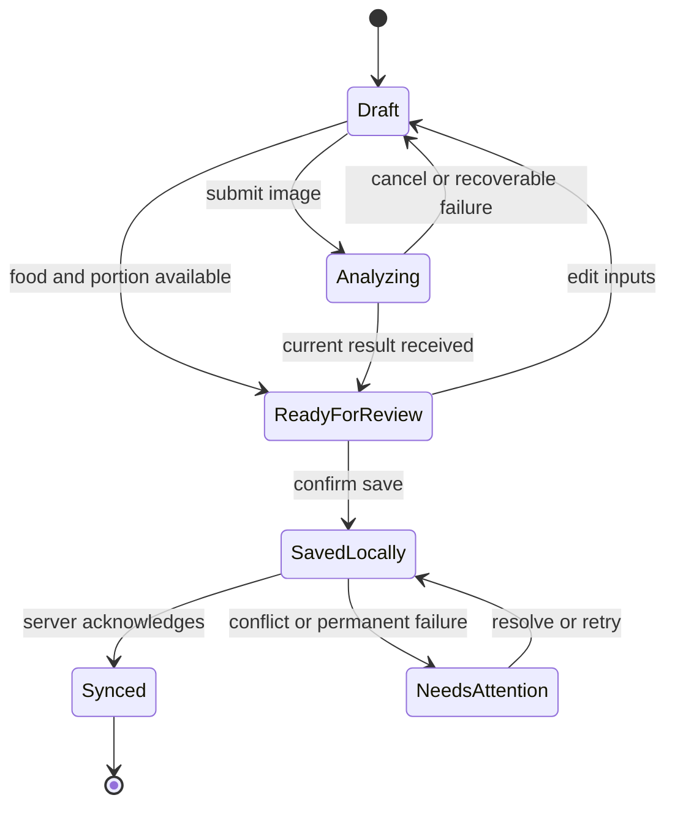

# Miqdar (مقدار) — Complete Front-End Requirements

**Version:** 3.0 · **Date:** 22 October 2026  
**Status:** Proposed implementation baseline; not a claim that features already exist.  
**Audience:** Miqdar front-end, backend/cloud AI, embedded systems, UI/UX, and QA contributors.  
**Source:** The supplied `FRONTEND_REQUIREMENTS.md` v2.0.0 and the project context provided in this conversation. No application source code, hardware protocol, test results, or institutional rubric was supplied for this revision.

## Contents

1. [Product purpose and scope](#1-product-purpose-and-scope)
2. [Release priorities and platform coverage](#2-release-priorities-and-platform-coverage)
3. [Changes from version 2](#3-changes-from-version-2)
4. [Navigation and information architecture](#4-navigation-and-information-architecture)
5. [Complete screen catalog](#5-complete-screen-catalog)
6. [Shared dialogs, sheets, and global states](#6-shared-dialogs-sheets-and-global-states)
7. [End-to-end user journeys](#7-end-to-end-user-journeys)
8. [Measurement and capture requirements](#8-measurement-and-capture-requirements)
9. [Recognition and nutrition requirements](#9-recognition-and-nutrition-requirements)
10. [Meal records, dates, and calculations](#10-meal-records-dates-and-calculations)
11. [Goals, nutrient notices, and suggestions](#11-goals-nutrient-notices-and-suggestions)
12. [Offline operation and synchronization](#12-offline-operation-and-synchronization)
13. [Accounts, privacy, and permissions](#13-accounts-privacy-and-permissions)
14. [Design system and responsive behavior](#14-design-system-and-responsive-behavior)
15. [Arabic, English, and accessibility](#15-arabic-english-and-accessibility)
16. [Front-end architecture and data models](#16-front-end-architecture-and-data-models)
17. [Backend and device integration contracts](#17-backend-and-device-integration-contracts)
18. [Error handling and recovery](#18-error-handling-and-recovery)
19. [Performance, reliability, and observability](#19-performance-reliability-and-observability)
20. [Acceptance scenarios and release gates](#20-acceptance-scenarios-and-release-gates)
21. [Delivery sequence and ownership](#21-delivery-sequence-and-ownership)
22. [Open decisions and recommended defaults](#22-open-decisions-and-recommended-defaults)
23. [Future product boundaries](#23-future-product-boundaries)
24. [Original requirement traceability](#24-original-requirement-traceability)
25. [References and terminology](#25-references-and-terminology)

## 1. Product purpose and scope

Miqdar helps people record food intake using a measured portion weight, a food photograph, food identification, and traceable nutrition data. The central experience is: **weigh → identify → review → save → understand daily intake**. Users can also log food through search and manual entry when a scale, camera, or cloud connection is unavailable.

The scale measures mass. AI proposes a food identity. Software scales the selected food record to the portion. Nutrient values remain estimates because identification, recipes, preparation methods, and food composition vary. The interface must make these distinctions understandable without overwhelming the user.

### 1.1 Product principles

- **PRD-01 — Review before recording.** Recognition creates a draft; only an explicit save records intake. A photograph or detected object does not establish that food was eaten.
- **PRD-02 — Useful without hardware.** Search, manual portions, history, and goals remain usable when the scale is absent.
- **PRD-03 — Honest measurements.** Every portion identifies its source: scale, manual grams, verified serving conversion, or estimate. Never label an entered value as measured.
- **PRD-04 — Honest nutrition.** Distinguish database values, package labels, user entries, and AI estimates. Missing values are not zero.
- **PRD-05 — User control.** Users can correct food identity, portion, preparation, meal time, and ingredients before or after saving.
- **PRD-06 — Recoverable work.** Navigation, camera interruption, connection failure, and app restart must not silently erase a saved draft.
- **PRD-07 — Calm guidance.** Use neutral nutrient notices. Avoid shame, emergency styling for ordinary goal overruns, and unsupported claims that a meal is safe for a medical condition.
- **PRD-08 — Arabic and English together.** Both are release requirements, including errors, permissions explanations, exported labels, and right-to-left layouts.
- **PRD-09 — Production and demonstration are separate.** Simulated devices, seed data, and fake recognition are confined to an explicit demo environment.
- **PRD-10 — Capability-based UI.** Show hardware controls only when the connected device actually supports them.

### 1.2 Users and boundaries

Primary users are adults logging daily food and reviewing nutrition patterns. The core product is a personal nutrition tracker. A user may enter a target supplied by a clinician, but the app does not diagnose disease, prescribe treatment, determine medication or insulin doses, or establish allergy safety from images.

The initial account owns its meal records and paired devices. Shared-family profiles, clinician accounts, and organizational administration require additional authorization and are future modules. A shared physical scale must never silently assign another person's meal to the current account.

**Front-end responsibility:** screens, interactions, local drafts, accessible presentation, preliminary validation, cached data, and synchronization feedback. **Backend responsibility:** authentication enforcement, data authorization, recognition orchestration, nutrition-source resolution, authoritative calculations, storage, and job processing. **Embedded responsibility:** calibrated measurements, device identity, telemetry, supported commands, and physical feedback. Requirements below identify the user-visible contract; they do not imply that the front end can implement all dependencies alone.

## 2. Release priorities and platform coverage

### 2.1 Priority definitions

| Priority | Meaning | Expected scope |
|---|---|---|
| **P0 — Core release** | Required for a trustworthy first usable Miqdar release | Authentication, bilingual navigation, real capture/measurement, food correction, manual fallback, meal CRUD, goals/notices, history, basic trends, offline drafts/outbox, privacy, accessibility |
| **P1 — Product completion** | Build after the core journey works end to end | Recipes, barcode/label entry, richer insights, meal ideas, advanced reminders, PDF reports, supported device extras |
| **P2 — Optional expansion** | Explicit backlog; exclude from first-release estimates | Meal planning, hydration, body-weight tracking, external health integrations, recurring sharing |
| **Conditional** | Required when a corresponding capability is shipped | BLE, Wi-Fi provisioning, firmware updates, optional sign-in providers, remote scale capture |

“Must” applies to the requirement's release priority. Unmarked cross-cutting requirements are P0 for every shipped feature. A P1 screen inherits P0 security, error handling, accessibility, and data-integrity rules once enabled. No incomplete optional feature should appear as a functioning production button.

### 2.2 Platform strategy

Retain Flutter as the default direction because the supplied specification uses Flutter; verify the actual repository before changing frameworks. Design requirements remain independent of a particular state-management package.

| Capability | Android / iOS application | Responsive web |
|---|---|---|
| Account, diary, search, goals, insights | Required | Required |
| Phone camera and photo selection | Native capability with permissions | Browser capability detection and file-upload fallback |
| Scale via backend | Required when device is online | Required when device is online |
| Direct BLE | Conditional on chosen hardware transport | Optional enhancement; never the only pairing path |
| Wi-Fi provisioning | Conditional on firmware/OS support | Instructions or backend-assisted setup where direct setup is unavailable |
| Local data | Account-scoped local database | Account-scoped browser storage; explain when unavailable or not durable |
| Notifications | In-app required; system push conditional | In-app required; browser push conditional |
| Biometric unlock | P1, secure OS-backed local unlock | Do not imitate native biometrics; supported passkeys can be a separate integration |
| Background transfer | Best effort within OS limits | Best effort; recover on next foreground session |

Web Bluetooth has limited browser availability; detect support and provide cloud/manual alternatives [R5]. Android Bluetooth permissions depend on platform version and requested operation [R3]. Pin the supported OS/browser matrix during implementation rather than promising every device.

## 3. Changes from version 2

| Original approach | Required improvement |
|---|---|
| Fixed 480 px phone frame on desktop | Responsive application with wider diary, review, and analytics layouts |
| Hard-coded user, network, device, model, and sign-in defaults | Real account/device state; all sample content confined to demo mode |
| Timed splash and simulated pairing success | Initialization and pairing states driven by actual results |
| Calories and nutrients called “exact” | Measured portion with estimated nutrients and visible data provenance |
| Weight slider limited to 10–500 g | Numeric entry plus device-advertised capacity/resolution; optional stepper |
| Top-three confidence percentages presented as certainty | Candidate review; show calibrated scores only when meaning is defined |
| All goals treated as ceilings | Target, range, minimum, maximum, and tracking-only goal types |
| 125% over target labeled clinically critical | Neutral “above your limit” notice; no medical severity inferred from a percentage |
| Medical presets and “drink water / add potassium” advice | User-defined targets and general planning; no automated disease treatment advice |
| Per-meal goal = daily goal ÷ 3 | Actual daily aggregation; meal allocations only if deliberately configured |
| Repeatedly rescale rounded meal values | Recalculate from immutable source basis and portion |
| Offline mode switches to sample food | Real cached/manual logging with sync status; demo is a separate workspace |
| Latency and model names dominate normal screens | Human-readable status; technical metrics in diagnostics |
| One global busy flag and controller | Separate operation states for account, capture, device, diary, and sync |
| Mixed-plate bounding boxes imply solved nutrition | Identify items separately and require defensible portion allocation |

## 4. Navigation and information architecture

### 4.1 Main navigation

Use **Home, Diary, Add, Insights, Profile** on compact screens. “Add” is a prominent action that opens the logging flow; it is not a persistent blank tab. Return to the prior tab when it closes. Devices are accessible from Home and Profile. An inbox button is present on Home and Profile, with a badge for unread notices. This keeps alerts accessible while giving daily records and insights permanent navigation.

On wider screens, use a navigation rail or sidebar and an Add meal button. Preserve logical destinations across platforms. The exact icon set and placement can change after usability testing; names and behavior should remain consistent.

### 4.2 Navigation rules

- **NAV-01:** Preserve selected date, filters, scroll position, and route state when switching tabs.
- **NAV-02:** A logged-in returning user reaches Home or the intended deep link, without repeating pairing or onboarding.
- **NAV-03:** Protect authenticated routes and resolve deep links after authentication. Validate ownership before displaying the destination.
- **NAV-04:** Support system back, browser back/forward, refresh, direct URLs, and restored app state. Back from a modal closes it before leaving its page.
- **NAV-05:** Autosave meal drafts locally. When leaving edits that cannot be autosaved, offer Keep editing / Save draft / Discard.
- **NAV-06:** Opening another Add flow while one draft exists offers Resume draft or Start new; starting new must not silently overwrite it.
- **NAV-07:** Route IDs are stable, opaque identifiers. Do not place email addresses, health conditions, photos, tokens, or passwords in URLs.
- **NAV-08:** Notification deep links handle deleted meals, revoked device access, expired sessions, and stale alerts with a meaningful destination.
- **NAV-09:** Missing routes show a recovery page with Home and Back. Service maintenance shows retry and access to available local records.

### 4.3 Naming

Use “Meal” for a recorded eating event and “Food item” for one component within it. Use “Food weight” or “Portion” for grams of food, and “Body weight” only in the optional body-measurement feature. Use “Nutrient notice” for a configured threshold comparison. Avoid “clinically safe,” “approved meal,” and “exact calories.”

## 5. Complete screen catalog

The 60 entries below describe **logical screens or distinct views**, not a requirement to build 60 separate page classes. Related views may share a route, stepper, sheet, or reusable component. Each screen inherits the shared state contract in section 6. Routes are proposed logical routes, not existing APIs.

### S01 — Launch and initialization · P0 · `/`

- **Content:** Miqdar identity and brief loading feedback only while work is occurring.
- **Behavior:** Open/migrate local storage, restore locale/theme and account state, validate the session when connected, then route to Welcome, unfinished onboarding, or the requested destination.
- **Recovery:** Offline with an authorized cached account opens available local content. Storage migration failure offers Retry and support; no automatic data deletion. A slow network must not trap a user on the splash.
- **Acceptance:** A returning account is not sent through pairing again; expired authorization does not expose a different account's cached records.

### S02 — Welcome and language selection · P0 · `/welcome`

- **Content:** Brief explanation of photo + measured weight, English/العربية switch, Sign in, Create account, and a clearly labeled Explore demo action if a demo build is enabled.
- **Behavior:** Language takes effect immediately and persists. Explain that a scale is optional.
- **Recovery:** Legal/help links remain reachable before authentication. Returning from authentication preserves locale.
- **Acceptance:** No permissions or medical-profile questions appear before the user selects a relevant action.

### S03 — Sign in · P0 · `/auth/sign-in`

- **Content:** Email/password, show-password control, password-manager support, password recovery, account creation, and configured provider buttons only.
- **Behavior:** Inline field errors, single submission in flight, genuine authentication, and restoration of an intended route. Do not prefill example credentials.
- **Recovery:** Neutral invalid-credentials message; distinct network, rate-limit, account-verification, and provider-cancelled states. Preserve email, not password, when appropriate.
- **Acceptance:** Navigation follows successful authentication, never a simulated delay. Canceling provider login does not create an account or show success.

### S04 — Create account · P0 · `/auth/register`

- **Content:** Display name, email, password, terms acceptance, privacy notice link, and separate optional consents.
- **Behavior:** Explain password rules before submission; allow paste and password managers; send the actual registration request. Health fields are not required here.
- **Recovery:** Field-level feedback, offline retry, verification already pending, and account-collision recovery without exposing unnecessary account details.
- **Acceptance:** Account creation cannot bypass server validation. Optional marketing/research consent is off by default and does not block registration.

### S05 — Verify email or sign-in code · P0 when required by auth · `/auth/verify`

- **Content:** Masked destination, code or link instructions, change-email action, resend availability, and verification state.
- **Behavior:** Support paste/autofill for codes, expired links, resend throttling, and returning from an email app. The server determines validity and cooldowns.
- **Recovery:** Wrong, expired, and already-used tokens show useful next steps. Authentication links must not leak into logs.
- **Acceptance:** Verification restores the same pending account/flow and cannot verify a different session through stale UI.

### S06 — Password recovery and reset · P0 · `/auth/recover`, `/auth/reset`

- **Content:** Request-link form, neutral sent confirmation, new-password form, and completed state.
- **Behavior:** Request a real reset; show an equivalent confirmation whether or not an email exists. Validate the reset token server-side and apply the configured password policy.
- **Recovery:** Expired/used links offer a new request. Failed requests preserve entered email; reset failures do not claim success.
- **Acceptance:** New credentials work after completion; old-session revocation follows the auth contract and is clearly described.

### S07 — Initial profile and tracking setup · P0 · `/onboarding`

- **Content:** Short steps for display name, tracking intention, locale/units, optional goals/preferences, and optional scale setup.
- **Behavior:** Allow “Track without goals.” Save progress, show Back/Skip, and let users finish later. Body metrics are optional and required only for an explicitly chosen target-estimation feature.
- **Recovery:** Resume interrupted onboarding at the last completed step. Do not require a disease disclosure or hardware purchase.
- **Acceptance:** A user can reach a usable diary without supplying medical conditions or accepting an automatically calculated calorie target.

### S08 — Permission explanation and status · P0 · `/settings/permissions`

- **Content:** Camera, selected photos, nearby devices/Bluetooth, local network, and notifications where supported, with current status and reason.
- **Behavior:** Ask just before the relevant feature, use native prompts, and provide Open settings when the OS requires it.
- **Recovery:** Denied, restricted, permanently denied, and unsupported are distinct. Offer search/manual weight/gallery alternatives as applicable.
- **Acceptance:** Refusing a permission does not prevent unrelated features from working; returning from OS settings refreshes status.

### S09 — Devices list and active scale · P0 · `/devices`

- **Content:** Paired scales, meaningful names, active selection, online/offline/last seen, and Add device.
- **Behavior:** Select exactly one active capture device per draft. Show ownership/access status; never auto-switch to the closest scale during a meal.
- **Recovery:** No device, stale status, unavailable backend, removed access, and another device already active.
- **Acceptance:** Switching the active scale asks how to handle an open measurement draft and cannot mix readings across devices.

### S10 — Pair or claim scale · P0 · `/devices/pair`

- **Content:** QR/code entry and the supported discovery method, device identity confirmation, pairing progress, physical verification instructions, and Skip.
- **Behavior:** Authenticate ownership/claim using a short-lived mechanism supported by firmware/backend. QR scanning alone is not proof of access if the code is public or reusable.
- **Recovery:** No devices, wrong/expired code, device owned elsewhere, Bluetooth off, permissions denied, timeout, incompatible protocol, and failed proof of possession.
- **Acceptance:** Show Paired only after an acknowledged claim; a display name such as “Miqdar-015” is not treated as a trusted identity.

### S11 — Scale network setup · P0 conditional · `/devices/:id/network`

- **Content:** Supported Wi-Fi choices or manual SSID, password visibility, connection stages, and connection test.
- **Behavior:** Use the supported secure provisioning path. Explain supported bands/security based on device capabilities, not assumptions. Discard entered Wi-Fi credentials after provisioning.
- **Recovery:** Incorrect password, network not found, captive portal/enterprise network unsupported, local-network denial, and internet unavailable despite Wi-Fi connection.
- **Acceptance:** The UI distinguishes joining Wi-Fi from reaching the backend; changing networks preserves device ownership.

### S12 — Device details and controls · P0 · `/devices/:id`

- **Content:** Name/ID, last seen, connection path, supported capacity/resolution, power/battery if available, camera status, firmware, and support link.
- **Behavior:** Rename; choose active scale; tare; view network settings; unpair. Display brightness, sound, display language, and power-saving controls only if supported.
- **Recovery:** Pending/rejected commands, lost connection, device busy, low power, and unsupported controls. Revert optimistic values when the command fails.
- **Acceptance:** Success reflects the acknowledged hardware state. Unpairing explains that meal history remains and that shared access may be affected.

### S13 — Zero, calibration, and measurement check · P0 guidance; calibration conditional · `/devices/:id/calibration`

- **Content:** Clear distinction between zero/tare and calibration; level-surface/unloaded-scale guidance, supported reference-weight instructions, and verification result.
- **Behavior:** Tare uses the normal device command. Calibration is available only through a documented hardware procedure and warns against using guessed reference masses.
- **Recovery:** Unstable surface, wrong reference weight, overload, timeout, and unsupported remote calibration. Provide hardware-manual guidance when calibration is physical-only.
- **Acceptance:** Changing an app value never substitutes for calibrating the sensor; success comes from the device procedure.

### S14 — Firmware information and update · P1 conditional · `/devices/:id/firmware`

- **Content:** Installed/available version, release notes, prerequisites, progress, and result when update capability exists.
- **Behavior:** Begin only after device-confirmed prerequisites; prevent capture during an update; show reconnect and recovery instructions. Signed-image validation and rollback belong to firmware/backend.
- **Recovery:** Update unavailable, insufficient power, interrupted transfer, reboot timeout, incompatible image, and rollback reported by device.
- **Acceptance:** Do not label firmware current until a real check succeeds. If updates are manual, show instructions instead of a nonfunctional Update button.

### S15 — Home dashboard · P0 · `/home`

- **Content:** Selected date, calorie total/goal when configured, protein/carbs/fat, configurable secondary nutrients, recent meals, pending drafts, and a compact scale status.
- **Behavior:** Primary Add meal; quick repeat of a recent meal; date navigation; links to diary, nutrient details, inbox, and devices. P1 adds compact meal-idea previews.
- **Recovery:** New user, no meals, incomplete nutrition, no goals, stale cached data, and offline state each have accurate copy.
- **Acceptance:** Totals match the diary for the same date and include locally saved meals once. No-data days are not described as successful zero-intake days.

### S16 — Add meal method chooser · P0 · `/add`

- **Content:** Scale + camera, phone photo, photo library, food search, recent/favorites, custom food, and Resume draft. Barcode is P1.
- **Behavior:** Show methods supported in the current environment and explain temporary unavailability. Search/manual logging remains prominent.
- **Recovery:** Offline, camera unavailable, scale absent, and an existing draft. Keep original entry destination for cancel/finish.
- **Acceptance:** Every offered method reaches a valid reviewable draft without secretly substituting demo content.

### S17 — Camera capture · P0 · `/add/camera`

- **Content:** Phone camera preview or a clearly labeled scale-camera snapshot/preview, camera source selector, shutter, flash if supported, gallery, and framing guidance.
- **Behavior:** Capture a single useful image; scale auto-capture is opt-in and requires stable weight plus a re-arm condition. Pause camera when backgrounded.
- **Recovery:** Camera busy, permission denied, blurry/dark image, unsupported flash, unavailable scale camera, and cancelled capture.
- **Acceptance:** Image source and capture time are clear. A stale device image cannot silently pair with a new weight. Continuous cloud video is not a P0 requirement.

### S18 — Photo review and preparation · P0 · `/add/photo-review`

- **Content:** Actual selected image, Retake/Replace, crop/rotate where needed, optional dish hint, and Continue.
- **Behavior:** Correct orientation, prepare a bounded upload, strip unnecessary location metadata, and preserve enough detail for identification. Explain cloud image processing before first use.
- **Recovery:** Unsupported format, too-large file, corrupt image, low memory, and lost picker result after app interruption.
- **Acceptance:** The image shown is the image sent; choosing a different image invalidates the prior recognition result.

### S19 — Portion and live weight · P0 · `/add/portion`

- **Content:** Net grams, source, device name, stability/freshness, tare status, manual-entry alternative, and Confirm weight.
- **Behavior:** Numeric entry/stepper instead of a slider-only interaction. Explicitly lock a stable snapshot for recognition; subsequent live readings do not alter it.
- **Recovery:** Zero/negative value, overload, moving scale, stale packets, lost connection, invalid decimal input, and unsupported units.
- **Acceptance:** A scale value is accepted only with valid identity, freshness, and stability. Switching to manual entry relabels the portion source.

### S20 — Recognition progress · P0 · `/add/analysis/:jobId`

- **Content:** Honest stages such as Uploading, Identifying, Matching nutrition; elapsed wait only if useful; Cancel and Use search instead.
- **Behavior:** Resume a known job after navigation/reconnect, preserve the draft, and associate replies with the exact image/portion revision.
- **Recovery:** Queue delay, rate limit, timeout, service unavailable, malformed response, and job cancellation. Do not invent percentage progress.
- **Acceptance:** A late answer for a cancelled or replaced draft cannot overwrite the current draft or save a meal.

### S21 — Recognition result and correction · P0 · `/add/result`

- **Content:** Photo, proposed food, preparation state, portion, nutrients, source/completeness label, alternatives, Change food, and Continue to review.
- **Behavior:** Ask the user to confirm food identity. Support no match, uncertain match, multiple candidates, and missing nutrition records. Correcting identity uses the selected record without unnecessary photo upload.
- **Recovery:** Unknown ingredient/recipe, unavailable candidate record, and confidence missing/unreliable. Preserve the original image and weight.
- **Acceptance:** No decorative confidence gauge substitutes for verification. Source badges describe the record, not proof that AI identified the actual meal correctly.

### S22 — Multiple foods and plate builder · P0 manual/sequential; P1 automatic detection · `/add/items`

- **Content:** Editable item list with individual food identity, preparation, portion source, grams, nutrients, remove/reorder controls, and aggregate total.
- **Behavior:** Add separately weighed foods, use sequential weight increments, or enter ingredient weights manually. Offer a matching composite dish/recipe when only total plate weight is known.
- **Recovery:** Unallocated mass, negative increment, tare/reset mid-session, item removed from plate, and sum/total mismatch. AI-estimated allocations require explicit confirmation and labeling.
- **Acceptance:** The full plate weight is never applied to every item. A single total cannot be presented as measured per-item weights.

### S23 — Food search · P0 · `/foods/search`

- **Content:** Arabic/English query, recent/favorite foods, source and preparation labels, result portion basis, and filters supported by the data source.
- **Behavior:** Debounce search; cancel obsolete results; paginate; support local aliases and common regional dishes. Search behavior should tolerate Arabic spelling variants without changing canonical display names.
- **Recovery:** No results, offline cached-only results, provider unavailable, and exhausted results. Offer Create custom food.
- **Acceptance:** Raw rice and cooked rice, or different package variants, remain distinguishable; repeated taps do not append duplicate items.

### S24 — Food details and serving conversion · P0 · `/foods/:id`

- **Content:** Name, preparation, provenance, per-100-g or per-serving basis, nutrient completeness, available verified serving conversions, and selected portion preview.
- **Behavior:** Choose grams or a supported serving, favorite (P1), and add to the current draft. Expose data-source details and Report data issue.
- **Recovery:** Missing serving mass, unsupported volume-to-mass conversion, deleted record, and partially populated nutrients.
- **Acceptance:** “One cup,” “one piece,” or milliliters convert only with an applicable documented mass/density; otherwise request grams.

### S25 — Custom food and manual nutrition · P0 · `/foods/custom/new`, `/foods/custom/:id/edit`

- **Content:** Food name, preparation, nutrition basis, basis mass, calories/macros, optional nutrients, and source notes/photo if the user chooses.
- **Behavior:** Allow unknown nutrient fields; distinguish per serving from per 100 g. A quick calorie-only entry is supported and labeled incomplete. Save privately by default.
- **Recovery:** Negative numbers, invalid basis mass, implausible units, conflicting serving values, and offline save. Warn about suspicious values without inventing replacements.
- **Acceptance:** User-entered data never receives an official-source badge. Changing a custom record does not silently rewrite past meal snapshots.

### S26 — Final meal review and save · P0 · `/add/review`

- **Content:** All items, portion sources, aggregate nutrition/completeness, meal type, consumed date/time, optional note/photo retention, and projected nutrient notices.
- **Behavior:** Edit any item, add another, Save meal, or Save draft. Use one operation ID across retries; show local-save and cloud-sync states separately.
- **Recovery:** Storage full, missing required identity/portion, unsynced account, and conflicting draft revision. Preserve inputs on failure.
- **Acceptance:** One save produces one meal; cancellation creates none. The success destination displays the saved record and correct daily totals.

### S27 — Diary and history · P0 · `/diary?date=YYYY-MM-DD`

- **Content:** Day selector/calendar, grouped meal types, daily totals/completeness, search/filter, and date ranges including 7/30/90 days and custom range.
- **Behavior:** Open meals, Add for selected date, repeat/copy to another date, paginate older records, and restore filters. Deletion is available through a visible menu; swipe can be supplemental.
- **Recovery:** Empty date, no search matches, cached partial history, loading older pages, and stale sync.
- **Acceptance:** At least 90 days are browsable as available, with older server history accessible; 90 days is not an automatic deletion policy.

### S28 — Meal details · P0 · `/meals/:id`

- **Content:** Food items, retained photo, time/type, portion, nutrient values, provenance, notes, and sync status.
- **Behavior:** Edit, duplicate as a new draft, delete with undo, and inspect food data. P1 adds favorite/save-as-recipe and explicit share/export actions.
- **Recovery:** Deleted meal, missing retained photo, offline cache miss, and access revoked. Nutrition history remains usable without a photo.
- **Acceptance:** Repeating a meal creates a new editable draft with a new identity and chosen time, not a duplicate of the old database ID.

### S29 — Edit meal · P0 · `/meals/:id/edit`

- **Content:** Same editing model as final review, prefilled from the saved snapshot, with change/cancel actions.
- **Behavior:** Edit ingredients, weights, food matches, preparation, type, date/time, and notes; preview updated totals/notices. Save uses record revision checks.
- **Recovery:** Another device changed/deleted the meal; preserve the user's edits and offer comparison/reload or explicit copy as a new draft.
- **Acceptance:** Changing date updates both affected days. Cancel leaves the saved record unchanged. Rounding errors do not accumulate across repeated edits.

### S30 — Favorites and recent foods/meals · P1 · `/saved`

- **Content:** Favorites, recent foods, and saved meal templates, with search, rename where applicable, and remove controls.
- **Behavior:** Reuse a template into a draft, preserving food-source references and requesting the new portion/time.
- **Recovery:** Missing source record, unavailable custom food, and empty collection. Unavailable items offer a manual replacement.
- **Acceptance:** Removing a favorite does not delete the food or historical meals; templates do not automatically count toward daily intake.

### S31 — Recipes collection · P1 · `/recipes`

- **Content:** Private recipes, source, last edited, yield/serving information, search, and Create recipe.
- **Behavior:** Open recipe, duplicate, archive, or log a portion through meal review. Ingredient estimates remain visible.
- **Recovery:** No recipes, deleted ingredients, offline availability, and unsupported imported data.
- **Acceptance:** Recipe lists distinguish a saved recipe from a consumed meal; archiving preserves historical snapshots.

### S32 — Recipe detail and builder · P1 · `/recipes/new`, `/recipes/:id`

- **Content:** Name, ingredients and masses, preparation, optional instructions, final edible yield mass or serving count, and computed nutrition.
- **Behavior:** Recalculate from ingredients and selected yield; log a serving or gram portion. Version recipe edits rather than retroactively changing meals.
- **Recovery:** Missing yield, zero servings, missing nutrient values, and inconsistent raw/cooked basis. Explain that simple summation does not model all cooking losses.
- **Acceptance:** A gram-based cooked portion needs final yield mass; serving-only recipes can log servings without fabricating gram weights.

### S33 — Insights and trends · P0 basic; P1 advanced · `/insights`

- **Content:** Daily calorie and macro trends, 7/30/90/custom periods, logged-day count, nutrient completeness, and goal history overlays.
- **Behavior:** Drill into a day/nutrient, switch metric, view accessible values, and export. P1 adds comparisons and configurable meal distribution.
- **Recovery:** Too little data, no goals, all values unknown, and partially cached range.
- **Acceptance:** Dates, not arbitrary meal indices, form daily charts. Missing/unlogged days are gaps; average denominators and partial-day inclusion are stated.

### S34 — Nutrient detail · P0 · `/insights/nutrients/:key`

- **Content:** Nutrient unit, total/known subtotal, target type, contributing meals, unknown items, and trend.
- **Behavior:** Navigate to contributors and goal settings. Explain total versus added sugar and sodium versus salt when relevant.
- **Recovery:** Unknown values, no target, incomplete range, and a goal changed during the displayed period.
- **Acceptance:** Unknown sodium, for example, prevents a claim that the whole day is below the sodium limit.

### S35 — Goals and nutrient targets · P0 · `/goals`

- **Content:** Calories, protein, carbs, fat, fiber, total/added sugar where available, sodium, and potassium; tracking-only/target/range/minimum/maximum options as applicable.
- **Behavior:** Numeric accessible editing; target origin and effective date; reset individual values; disable a goal without deleting history. Manual goals are P0; any estimator is P1 and separately validated.
- **Recovery:** Invalid units, impossible range ordering, zero-denominator cases, and conflicting revisions. No universal medical limits are silently prefilled.
- **Acceptance:** Potassium is not automatically an upper limit. Missing medical targets do not trigger invented disease-specific recommendations.

### S36 — Dietary preferences and optional considerations · P0 preferences; P1 condition-aware filtering · `/profile/diet`

- **Content:** Dietary pattern, excluded ingredients, allergens, disliked foods, and optional considerations with clear purpose and privacy explanation.
- **Behavior:** Prefer structured exclusions with editable free text; explain coverage limitations. Let users remove sensitive preferences and refresh recommendations.
- **Recovery:** Ambiguous allergen text, conflicting preferences, unsupported condition, and missing clinician-provided targets.
- **Acceptance:** A photo cannot certify allergen absence. A condition toggle never silently changes goals or labels suggestions medically safe.

### S37 — Inbox and nutrient notices · P0 · `/inbox`

- **Content:** Nutrient notices, device/sync messages, read/unread status, date, and filtering. Reminders are included when enabled.
- **Behavior:** Open detail, mark read, acknowledge, archive/dismiss, and manage notification preferences. Separate unread status from whether a condition still applies.
- **Recovery:** No notices, offline feed, stale notice, and deleted source meal.
- **Acceptance:** “No notices” means none based on configured rules and available data; it does not imply complete nutrition data or clinical safety.

### S38 — Notice detail · P0 · `/inbox/:id`

- **Content:** Nutrient, known total, comparison value/range, meal/day context, goal source/version, and whether the notice is preview, current, or superseded.
- **Behavior:** Review contributing meal, edit target, acknowledge, and read explanation. Device/sync notices link to the relevant recovery screen.
- **Recovery:** The source changed, goal changed, meal removed, or data incomplete. Explain why the notice no longer applies.
- **Acceptance:** Acknowledging a notice does not change nutrient totals or suppress future distinct evaluations.

### S39 — Meal ideas · P1 · `/ideas`

- **Content:** General meal ideas, filters, why suggested, nutrition basis, portion, and relevant data gaps.
- **Behavior:** Refresh on explicit request or material profile/history change; save favorites; open details. Prefer a small, useful set to endless generated cards.
- **Recovery:** No compatible suggestions, insufficient profile/data, offline cached suggestions, and service unavailable. Never relax a declared exclusion silently.
- **Acceptance:** A recommendation does not become a logged meal and does not promise allergy/medical safety.

### S40 — Meal idea detail · P1 · `/ideas/:id`

- **Content:** Ingredients if known, proposed serving, nutrient source, preparation guidance where available, and the actual reason it was suggested.
- **Behavior:** Adjust portion; review ingredients/exclusions; open an editable meal draft with “Log after eating.”
- **Recovery:** Incomplete ingredient data, recipe unavailable, expired suggestion, and target/profile changed since generation.
- **Acceptance:** Any modified portion recalculates the displayed estimate; unsupported rationale tags are not generated as decorative claims.

### S41 — Profile and settings hub · P0 · `/profile`

- **Content:** Actual account name, optional avatar, personal information, goals, preferences, devices, notifications, privacy/data, help, and Sign out.
- **Behavior:** Clearly distinguish account-level settings from device-local appearance settings. Show unsynced work before sign-out.
- **Recovery:** Profile unavailable, offline edits, incomplete setup, and deleted session.
- **Acceptance:** No sample name or email appears in a real account; sign-out follows the data-isolation rules in section 13.

### S42 — Personal information · P0 · `/profile/personal`

- **Content:** Display name, optional avatar, locale/timezone preference, and optional body-profile fields only for features using them.
- **Behavior:** Edit with clear save status; change email through verification, not a simple text replacement. Explain why sensitive fields are requested.
- **Recovery:** Invalid entry, failed avatar upload, offline changes, and pending email verification.
- **Acceptance:** Updating a display name does not alter account identity; photo failure does not discard other valid profile changes.

### S43 — Account security · P0 core; P1 extras · `/settings/security`

- **Content:** Change password, linked sign-in methods, recent-authentication prompts, and session controls if backend supports them. P1 adds biometric unlock, passkeys/MFA, and active-session management.
- **Behavior:** Use provider-supported flows and secure OS/browser interfaces. Avoid storing passwords to provide biometric convenience.
- **Recovery:** Wrong current password, revoked provider, unsupported method, expired reauthentication, and offline state.
- **Acceptance:** A user cannot remove the only working sign-in method without establishing another one.

### S44 — Notifications and reminders · P0 settings; P1 scheduling · `/settings/notifications`

- **Content:** In-app categories, OS permission status, optional push categories, meal-reminder schedules, quiet hours, and lock-screen preview preference.
- **Behavior:** Separate app preference from OS authorization; default sensitive previews off. Schedules use the selected timezone and update when it changes.
- **Recovery:** OS blocked permission, unavailable push service, duplicate schedule, and daylight-saving/timezone change.
- **Acceptance:** Disabling a reminder cancels pending deliveries; unavailable push does not disable the in-app inbox.

### S45 — Language, appearance, and units · P0 · `/settings/app`

- **Content:** English/العربية, system/light/dark theme, supported number formatting, time format, portion units, and reduced-motion preference.
- **Behavior:** Preview changes immediately and preserve drafts/scroll. Metric grams remain the canonical calculation unit regardless of display choice.
- **Recovery:** Missing translation, unavailable font, OS theme change, and mixed-language food names.
- **Acceptance:** Language switching changes layout direction without reversing photos, scrambling numeric units, or losing form values.

### S46 — Privacy and data controls · P0 · `/settings/privacy`

- **Content:** Image processing/retention choices, optional analytics/research preferences, data export, delete account, and policy links.
- **Behavior:** Explain which service processes images, what is stored, and how settings affect future captures. Offer removal of retained images where supported without deleting nutrition records.
- **Recovery:** Settings not saved, pending remote erasure, offline action unavailable, and policy update requiring acknowledgment.
- **Acceptance:** Consent choices are separate and reversible; success messages reflect server acknowledgment, not just a local toggle.

### S47 — Export data and reports · P0 CSV/account data; P1 PDF · `/settings/export`

- **Content:** Date range, chosen fields, export format, timezone/units, completeness statement, and photo inclusion off by default.
- **Behavior:** Preview scope, generate, download/share through an explicit user action, and show status/expiry if server-generated. Include source and estimated/missing-data indicators.
- **Recovery:** Empty range, incomplete cached range, generation failure, expired link, and cancelled system share sheet.
- **Acceptance:** An incomplete offline export is clearly marked or requires syncing first. CSV output handles formulas safely and preserves Unicode Arabic.

### S48 — Account deletion · P0 · `/settings/account/delete`

- **Content:** Plain explanation of deleted data, any required retention/pending processing, optional export, reauthentication, and confirmation.
- **Behavior:** Submit an actual deletion request; show pending/completed status; remove local credentials/data at the correct stage. Keep the flow straightforward [R4].
- **Recovery:** Offline, reauthentication failure, request failed, and deletion already pending. Do not say the account is deleted before acknowledgment.
- **Acceptance:** Deletion concerns remote account data, not merely app cache; existing sessions and linked access are handled by the backend contract.

### S49 — Sync and pending activity · P0 · `/sync`

- **Content:** Pending/failed operations, last successful sync, affected meal/draft, and account-specific local storage status.
- **Behavior:** Retry eligible operations, inspect errors, resolve revision conflicts, and explicitly discard a pending operation with consequences shown.
- **Recovery:** Offline, expired authentication, permanent validation failure, storage full, and server changes conflicting with local edits.
- **Acceptance:** No operation disappears from the queue until acknowledged or deliberately discarded; retries reuse its identity.

### S50 — Help, troubleshooting, and feedback · P0 · `/help`

- **Content:** How to weigh/tare, improve photos, handle mixed foods, correct matches, recover sync, and understand nutrient uncertainty; contact/report issue entry.
- **Behavior:** Search help if content warrants it; open a feedback draft with app version/error reference. Diagnostic attachment requires explicit consent.
- **Recovery:** Offline cached help, unavailable contact service, and failed feedback submission. Show a copyable error reference.
- **Acceptance:** Feedback is never sent automatically and does not include meal photos, health fields, or secrets by default.

### S51 — About, policies, and data sources · P0 · `/about`, `/legal/:document`

- **Content:** App version, team/product information, terms, privacy policy, nutrition limitations, licenses/attributions, and data-source explanation.
- **Behavior:** Make legal documents readable before login and offline after retrieval; show version/effective date. Link to actual sources for retained food records.
- **Recovery:** Unavailable document, newer policy not yet downloaded, and broken external link.
- **Acceptance:** Links open the correct language/document; placeholder policies and fabricated compliance badges cannot ship.

### S52 — Barcode scanner and product match · P1 · `/add/barcode`

- **Content:** Camera scanner, manual barcode entry, product candidates, brand/package/serving data, and source timestamp where provided.
- **Behavior:** Stop repeated scans after a match; confirm exact product variant; use the same portion/review flow.
- **Recovery:** No match, unsupported code, inaccurate/outdated product, unreadable label, and provider unavailable. Offer custom entry.
- **Acceptance:** A barcode identifies a database candidate; it does not verify current package nutrition or make a product allergen-safe.

### S53 — Nutrition label capture and verification · P1 · `/add/label`

- **Content:** Label image, extracted fields, per-serving/per-100-g basis, serving mass, and highlighted uncertain readings.
- **Behavior:** Require user confirmation of units, decimal separators, basis, and nutrient values before creating a custom food.
- **Recovery:** Blurry image, Arabic/English mixed text, missing serving size, ambiguous salt/sodium, and OCR failure.
- **Acceptance:** OCR output is editable and labeled as label-derived/user-confirmed; a missing nutrient is not inferred to be zero.

### S54 — Meal planner · P2 · `/planner`

- **Content:** Planned days/meals, portions, optional shopping-list view, and differences between planned and recorded intake.
- **Behavior:** Add recipe/idea to a plan, reschedule, and convert to a reviewed log after eating. Shopping lists aggregate chosen ingredients only.
- **Recovery:** Recipe changed, unavailable ingredient, timezone shift, and conflicting plan edits.
- **Acceptance:** Planned meals never contribute to consumed totals until explicitly logged.

### S55 — Hydration tracker · P2 · `/hydration`

- **Content:** Logged fluid amounts, customizable quick-add sizes, daily view, and optional user-defined target.
- **Behavior:** Add/edit/delete entries and configure reminders separately from food. Distinguish fluid-only tracking from nutritional beverage logging.
- **Recovery:** Invalid units, duplicate taps, offline edits, and a beverage logged in both systems.
- **Acceptance:** Do not prescribe extra fluid to compensate for a nutrient notice; define duplication rules before adding automatic beverage import.

### S56 — Body-weight tracking · P2 · `/body-weight`

- **Content:** Body-weight entries with kg/lb units, date/time, source, and optional trend.
- **Behavior:** Manual or separately authorized compatible-source entry; edit/delete; opt out. Keep this domain separate from food-scale telemetry.
- **Recovery:** Wrong units, implausible entry, sync conflict, and missing dates.
- **Acceptance:** A Miqdar food scale never supplies a body-weight reading; body-weight features are not needed to log meals.

### S57 — Connected health services · P2 · `/settings/integrations`

- **Content:** Available providers, requested read/write scopes, connection state, last import, and revoke action.
- **Behavior:** Explicit per-provider permission, data direction, import review, origin identifiers, and deduplication. Define whether imported nutrition contributes to totals before enabling it.
- **Recovery:** Revoked permission, provider unavailable, partial import, stale authorization, and conflicting records.
- **Acceptance:** No external integration is presented as supported before its SDK/API, permissions, and sync semantics are implemented.

### S58 — Sharing and access management · P2 · `/sharing`

- **Content:** Named recipients or restricted links, data range, fields, access duration, permissions, and revocation status.
- **Behavior:** Preview exactly what will be shared and require explicit recipient/action confirmation. Separate read-only reporting from permission to edit meals.
- **Recovery:** Expired invitation/link, wrong recipient, revoked access, failed delivery, and unavailable backend.
- **Acceptance:** Access is server-enforced, revocable, and scoped; sharing a downloaded file cannot promise remote revocation of that copy.

### S59 — Diagnostics and project evidence · P0 restricted support/development view · `/diagnostics`

- **Content:** App/device versions, connection path, redacted error IDs, and measured timings with stage definitions; optional export of consented diagnostics.
- **Behavior:** Provide a reproducible test mode and distinguish simulated fixtures from real hardware/provider results. Hide technical details from ordinary meal flows.
- **Recovery:** No telemetry, stale measurements, unavailable device, and redaction failure.
- **Acceptance:** No invented accuracy percentages, response times, or “requirement passed” labels. A local alert timer cannot prove full capture-to-result latency.

### S60 — Demo workspace · P0 if demo is shipped · `/demo`

- **Content:** Persistent “Demo — sample data” banner, explicit sample foods/devices, and reset/exit actions.
- **Behavior:** Run in separate storage and backend namespace or fully isolated fixtures. Provide representative errors and success states for presentations.
- **Recovery:** Reset failure or attempt to leave with demo changes; explain that sample entries are not personal records.
- **Acceptance:** Demo data never syncs into a real account; production failure never silently enters demo mode.

## 6. Shared dialogs, sheets, and global states

### 6.1 Reusable interaction surfaces

| ID | Surface | Required behavior |
|---|---|---|
| UI-01 | Unsaved changes | Keep editing / Save draft / Discard; explain what will be lost |
| UI-02 | Meal delete and undo | Identify the meal; accessible explicit delete; proposed 8-second undo window; undo also works after server acknowledgment by creating a valid restore operation |
| UI-03 | Food/portion editor | Food source, preparation, numeric amount, units, current estimate, validation |
| UI-04 | Meal type/date/time picker | Breakfast/Lunch/Dinner/Snack/Other; manual override; distinguish consumed time from created time |
| UI-05 | Data-source explanation | Provider/record/version, basis, missing nutrients, user edits, estimate status |
| UI-06 | Permission explanation | Purpose, native permission action, alternative method, settings link when relevant |
| UI-07 | Tare confirmation/progress | Clear the plate as instructed, issue command once, wait for acknowledgment, then confirm stable zero |
| UI-08 | Unpair/remove access | Device identity, ownership consequences, retained history, explicit action |
| UI-09 | Conflicting edit | Local/server values with timestamps, keep editing/reload/copy to draft; no silent overwrite |
| UI-10 | Account reauthentication | Secure provider-supported flow; return to the pending action without repeating it automatically |
| UI-11 | Image/source picker | Camera, selected photo, scale camera, remove photo; only available choices |
| UI-12 | Filter and date range | Apply/reset/cancel, result count where available, preserved applied state |
| UI-13 | Report data issue | Selected food/record, issue description, optional attachment, explicit Send |
| UI-14 | Sign-out with pending work | Show unsynced count; Sync first, Cancel, or explicit Sign out with local-data consequences |
| UI-15 | Incompatible update/service maintenance | Explain unavailable feature; retry/update/help; keep available local records reachable |
| UI-16 | Session/account change | Stop old subscriptions and uploads, isolate old data, and restore only the authorized new account |

Modal surfaces need a title, accessible labels, clear primary and cancel actions, focus management, keyboard dismissal where safe, and a route back to the original context. Destructive actions cannot be triggered by tapping a scrim. Toasts confirm brief success; persistent actionable errors need inline banners or pages.

### 6.2 State contract for every shipped screen

**STATE-01:** Define Initial, Loading, Ready, Empty, Partial, Stale, Offline, Error, and Disabled/Unsupported states where applicable. Each state must specify readable copy, available actions, and retained data. Mark a state not applicable explicitly during implementation rather than inventing meaningless UI.

**STATE-02:** Mutations additionally define Validating, Saving locally, Saved locally/pending sync, Syncing, Synced, Retryable failure, Permanent failure, and Conflict. “Saved” must not imply “backed up.”

**STATE-03:** Each independent region may load/fail independently. Failure to load meal ideas must not block the dashboard or diary. Never show zero totals merely because a request failed.

**STATE-04:** Announce changes accessibly, retain useful content during refresh, and avoid skeletons replacing already loaded data. Show retry only if it can actually retry the failed operation.

**STATE-05:** Validate before submission and again at the boundary receiving external data. Do not turn a disabled control into the only explanation of what is missing.

## 7. End-to-end user journeys

### J01 — First-time user without a scale

Welcome → create account/verify → optional setup → Home → Add → search food → choose preparation and grams → review meal → save locally/sync → diary. Pairing, health conditions, notifications, and camera access are not prerequisites. The user must be able to complete this journey with tracking-only goals.

### J02 — Phone photograph with scale weight

Select active scale → tare empty plate → add food → confirm stable portion snapshot → capture/review photo → submit recognition → confirm/correct food → review meal and notices → save. If the weight changes before capture is matched, explicitly reconfirm or retake instead of silently combining unrelated data.

### J03 — Scale camera through the backend

Claim scale → establish account-bound capture session → scale emits paired image/weight event → backend buffers/processes the event → app receives or resumes job → user reviews → save. The app must work when the phone is not on the scale's local network, provided both are authorized and connected through the backend. If the app was closed, a pending result appears as an unlogged draft when it returns.

### J04 — Multiple foods added sequentially

Start a plate session → tare plate → add first item → lock stable increment and identify it → add next item → lock next increment → review item weights and total → save one meal. Tare, removal, negative deltas, or a reset invalidate the increment baseline and require re-establishment. Users may correct labels without reweighing unchanged items.

### J05 — Recognition fails or is wrong

Preserve image and portion → show reason/alternatives → search/change food or create custom entry → review → save. If the service is offline, offer to keep the draft for later recognition or finish manually. Never invent a food match to complete the flow.

### J06 — Offline logging and recovery

Open authorized cached session → add cached/manual food → review → atomically save meal and sync operation locally → show Pending sync → reconnect/re-authenticate if needed → retry with original operation ID → merge server acknowledgment without duplicating meal. Offline photo drafts remain drafts until the user chooses manual completion or later analysis.

### J07 — Edit, move, delete, and undo

Diary → meal details → edit portion/identity/date → recalculate preview → save with revision → refresh affected totals/notices. Delete marks the record pending deletion and offers undo; successful undo restores it once. If another client edited it, show a conflict rather than discarding either user's work.

### J08 — Wrong account or shared scale

Before capture, show the account/session receiving the meal on the app and, where supported, the scale display. New account login does not inherit the previous account's active capture session. A scale event without a valid owner/session cannot enter a personal diary; it requires correct-session recovery or remains unassigned outside user-visible personal data.

### J09 — Data export and deletion

Privacy → select export scope → generate/download → optional return → deletion explanation → recent authentication → submit deletion → display true request status → clear local identity/data according to confirmed lifecycle. Export is offered, not imposed as a prerequisite to deletion.

## 8. Measurement and capture requirements

### 8.1 Connection architecture

**DEV-01:** Recommended baseline: Raspberry Pi/scale communicates with a Miqdar backend over an authenticated connection; the app receives account-authorized snapshots, job updates, and command acknowledgments. The backend can buffer uploads and AI jobs. Direct BLE is an optional supported transport, not a required assumption about the existing hardware.

**DEV-02:** Track phone-to-backend, scale-to-backend, direct phone-to-scale, camera availability, and cloud-recognition availability separately. A green Bluetooth indicator cannot imply that cloud recognition works.

**DEV-03:** Device capabilities must include, where supported: protocol/firmware version, mass unit, capacity, resolution, stability indicator, tare, camera capture, network setup, display controls, power telemetry, calibration, and firmware update. Unknown capabilities remain unknown; do not fabricate battery or signal readings.

**DEV-04:** Device status includes last-seen time and staleness. Apply bounded automatic reconnect with backoff while the relevant feature is active; allow manual retry. Avoid indefinite background scanning or camera activation.

### 8.2 Reading validity

**MEAS-01:** A measurement carries `device_id`, `capture_session_id`, sequence number, device boot/session identifier, sample timestamp, received timestamp, unit, net/gross designation, mass, stability, overload/error flags, and calibration status if available.

**MEAS-02:** Reject out-of-order/replayed packets within the current device boot session. Detect sequence resets after restart. A device clock may be inaccurate; freshness must use trusted receive time plus documented transport-delay handling and clock-offset checks. Receiving a buffered old packet now does not make the measurement fresh.

**MEAS-03:** Initial engineering defaults: declare a displayed reading stale after 3 seconds without an expected live update; target an image/weight capture difference no greater than 2 seconds. These are provisional product thresholds, not established sensor performance. Version them in configuration and replace them with measured protocol-appropriate limits before hardware sign-off.

**MEAS-04:** Prefer the device's validated stability signal. If stability is derived in software, define the sampling window, permitted variance relative to resolution, and minimum samples with the embedded team. Do not hard-code “stable after 650 ms” without evidence.

**MEAS-05:** Store a locked measurement separately from the live stream. Later weights update the live display but not an already-reviewed item unless the user explicitly chooses Replace weight.

**MEAS-06:** Validate positive edible net mass, declared units, capacity, resolution, stability, and freshness. Overload blocks measured capture. Zero/negative mass requires correction; never apply an absolute-value transform.

**MEAS-07:** Manual weight accepts locale-aware decimal entry and has a documented technical maximum, not the old arbitrary 500 g cap. Values beyond a paired scale's capacity are possible only as explicitly manual entries with a clarification. Display no more measurement precision than the source supports.

### 8.3 Tare, increments, and portions

**MEAS-08:** Tare is a command requiring acknowledgment and a new stable baseline. Tapping Tare must not simply subtract a number in the interface while the hardware disagrees. Distinguish device tare from a transparent manual plate-weight calculation if such a fallback is offered.

**MEAS-09:** For an unchanged tare epoch, sequential item mass is `current_stable_net_mass − previous_confirmed_net_mass`. Food removal, negative change, plate replacement, or new tare ends that assumption. Require reset/reweigh/review; do not count negative food intake automatically.

**MEAS-10:** For multiple independently weighed items, store each measured mass. For a mixed plate with only a total, offer a composite food/recipe or user-confirmed estimated allocations. Preserve whether an allocation is measured, entered, or estimated.

**MEAS-11:** If allocations represent a measured plate total, compare their sum to that total using documented scale-resolution tolerance. Explain unresolved mass and rounding. Do not silently normalize incompatible weights. Without a measured total, independent manual portions need not be forced to match a fabricated total.

**MEAS-12:** Track edible portion. Bones, wrappers, containers, or leftovers require user adjustment or a supported serving method. The app logs the portion the user reports as consumed, not automatically everything once placed on the scale.

### 8.4 Image capture

**CAP-01:** Accept camera or selected-file images supported by the client. Normalize orientation; convert unsupported-but-decodable formats to a documented upload format. Reject undecodable input before upload with an actionable message.

**CAP-02:** Proposed transport defaults are JPEG/PNG upload, longest edge up to 1600 px after preprocessing, and up to 5 MB after preprocessing. Validate recognition quality and publish matching server limits before release; these are not claims about a provider's current limits.

**CAP-03:** Show simple lighting/framing guidance. Optional blur/quality warnings must allow retake; do not claim they prove correct recognition. Crop cannot silently exclude a food item whose full mass remains assigned to the photo.

**CAP-04:** Strip unnecessary EXIF/location metadata. Retention of a meal photo and processing an image for recognition are separate choices. Keep temporary image bytes only as long as required for the user's pending job/draft and disclosed retry policy.

**CAP-05:** Image and measurement share an explicit capture-session/event identity. On mismatched timestamps, device, account, or draft revision, ask for recapture/reconfirmation. A phone photo plus manually entered weight remains a supported, accurately labeled workflow.

**CAP-06:** Automatic capture is opt-in, emits one event per armed stable placement, and requires a documented re-arm transition. Upload retries and stable-weight oscillation must not create new meals.

**CAP-07:** A live local camera preview is useful; live cloud video analysis, AR overlays, and continuous WebRTC streaming are not core requirements. Enable them later only with demonstrated value and appropriate power/privacy handling.

## 9. Recognition and nutrition requirements

### 9.1 Identification and provenance

- **AI-01:** Backend recognition returns proposed food identities and alternatives; nutrient computation uses a documented food record or explicitly labeled estimate. Provider/model selection is backend configuration, not a hard-coded user-facing requirement.
- **AI-02:** The client must support no food detected, non-food image, ambiguous food, multiple items, candidate not in database, missing source record, and partial nutrients.
- **AI-03:** Always allow correction by search/manual entry. Record the user's confirmed identity without claiming the model made the corrected prediction.
- **AI-04:** Do not interpret an LLM's self-reported `0.94` as a calibrated 94% correctness probability. Default to neutral text such as “Suggested match — please confirm.” Show a numeric score only if its definition and validation are documented.
- **AI-05:** Distinguish food identity confidence, portion reliability, and nutrition-record provenance. They are separate qualities, not one combined “verified” badge.
- **AI-06:** Nutrition metadata includes source provider, source record ID, record/version or retrieval date, raw/cooked/prepared state, per-100-g or serving basis, and each nutrient's availability. Source hyperlinks must come from trusted records.
- **AI-07:** `database`, `package_label`, `user_entered`, `recipe_calculated`, `ai_estimate`, and `demo` are distinct source categories. “Official” requires a real traceable source and never certifies the entire meal recognition.
- **AI-08:** Regional foods such as kabsa, mandi, hummus, dates, and mixed rice dishes need distinct documented records/recipes where available. Recipe variation must be visible rather than implying one universal composition.
- **AI-09:** A candidate switch recalculates using that candidate's basis and the same confirmed portion where appropriate. Changing preparation, amount, or allocation invalidates dependent values and notices.
- **AI-10:** A user's optional hint is treated as data. Arbitrary model output must never be rendered as executable HTML, app commands, or trusted links.

### 9.2 Nutrition fields and uncertainty

Required display support: energy (kcal), protein (g), carbohydrate (g), fat (g), fiber (g), total sugar (g), sodium (mg), and potassium (mg). Support added sugar (g), saturated fat (g), and cholesterol (mg) when available; make expansion to additional nutrients possible without schema changes to every screen.

**NUT-01:** Nutrient values are nullable. Zero is a known value. Null is missing. Do not convert missing sugar, sodium, or potassium to zero during parsing, summation, charts, or notices.

**NUT-02:** For a nutrient with missing contributors, show a known subtotal and incomplete-data indicator, for example “Known sodium: 620 mg · 1 item unavailable.” A known subtotal already above a configured maximum can trigger an above-limit notice; a subtotal below it cannot establish that the full total is below it.

**NUT-03:** Total sugar and added sugar are distinct fields. Do not compare total sugar with an added-sugar target. Likewise do not relabel salt as sodium or infer a volume-to-mass conversion without an explicit applicable rule.

**NUT-04:** Keep canonical units and enough internal precision. Proposed display rounding: energy to whole kcal, macronutrients to 0.1 g, sodium/potassium to whole mg, and measured mass to device resolution. Small nonzero values may use a documented “<” display; underlying computations retain the original value.

**NUT-05:** Treat source energy as authoritative for that record when present. A 4/4/9 macro-energy chart is an approximate distribution visualization, not a requirement to overwrite source calories; fiber and other factors can make the totals differ.

**NUT-06:** If energy is calculated from macros because source energy is missing, mark the method and require all needed inputs. Do not invent calories from incomplete macros or imply the approximation is a database value.

**NUT-07:** A food-photo model cannot reliably establish hidden oils, sauces, allergens, or recipe quantities. Offer “Add oil/sauce/ingredient” during review and permit a composite recipe instead of forcing a single generic food match.

## 10. Meal records, dates, and calculations

### 10.1 Computation rules

**CALC-01 — Per-100-g scaling**

```text
portion_nutrient = nutrient_per_100_g × edible_portion_g / 100
```

For a synthetic test fixture containing 200 kcal and 10 g protein per 100 g, a 150 g portion produces 300 kcal and 15 g protein. These numbers are test data, not a factual food record or reported experiment.

**CALC-02 — Serving scaling**

```text
portion_nutrient = nutrient_per_serving × selected_serving_count
portion_mass_g = mass_per_serving_g × selected_serving_count  # only if known
```

A serving-only food may have known nutrients without known grams. Do not pretend it has a measured mass. Quick calorie-only logging similarly leaves unavailable mass/macros null.

**CALC-03 — Recipe scaling**

```text
recipe_nutrient = sum(ingredient_nutrient_for_entered_mass)
portion_nutrient = recipe_nutrient × portion_g / final_edible_yield_g
```

This is a recipe estimate and requires a valid final yield. If using servings instead, scale by portion-serving count / total recipe servings. Missing ingredient nutrients propagate as partial data.

**CALC-04:** Recalculate from source-basis snapshots, not previously rounded totals. Changing 150 g to 100 g and back to 150 g must recover the same internal result.

**CALC-05:** Meal totals sum item values; daily totals sum non-deleted saved meals for the selected consumed date. Drafts, plans, recognition jobs, suggestions, and deleted records do not count.

**CALC-06:** For an edited meal, projected daily total is `current_day_total − old_saved_meal + edited_meal`, with correct handling when the date changes. Do not add both old and new meals during preview.

**CALC-07:** Daily and range aggregation must operate on the full relevant dataset or an authoritative aggregate endpoint. Summing only the currently loaded history page is invalid. Reconcile local pending operations by identity/revision so server and local totals do not double count.

### 10.2 Record lifecycle

- **LOG-01:** Every meal has a client-generated stable ID, owner, consumed timestamp, local diary date, IANA timezone, meal type, item snapshots, source references, and version. Server IDs may be separate only if mapping is stable.
- **LOG-02:** Preserve nutrition snapshots at save time. Food-database updates do not silently alter old totals. A user-triggered recalculation must preview the change and create a new meal revision.
- **LOG-03:** Saved meal items may mix measured, manual, serving-based, and estimated portions; display source at item level.
- **LOG-04:** Duplicate/repeat creates a new draft and new operation identity. The user confirms date/time and portion; original evidence is labeled as copied rather than newly measured.
- **LOG-05:** Delete uses a versioned tombstone or equivalent sync representation. Undo must work coherently before and after remote confirmation. A deleted record cannot reappear due to an old list response.
- **LOG-06:** Meal notes are plain text, length-limited, optional, and private. A proposed 2,000-character limit applies consistently in the client and backend.
- **LOG-07:** Future consumed timestamps are rejected beyond a small documented clock-skew allowance; future meals belong in the P2 planner. Editing past intake is allowed.
- **LOG-08:** Export and history retention have no arbitrary 90-day purge. Local caching may be bounded, but server-retained history remains accessible under the disclosed retention policy.

### 10.3 Dates and trends

**TIME-01:** Store the UTC instant, IANA timezone used when logging, and explicit diary date. Default to the user's selected timezone; Asia/Riyadh is a suitable initial locale example, not a global hard-coded rule. A later timezone change must not silently move historical meals between diary days.

**TIME-02:** If the user chooses a different consumed date/time/timezone, recompute and persist the diary date deliberately. Handle ambiguous/nonexistent times where daylight saving applies. Midnight boundaries and 12/24-hour formats need tests.

**TIME-03:** Reminder schedules follow the chosen timezone and a documented travel policy. App-open events do not redefine yesterday's data.

**TREND-01:** Use daily totals for daily charts. Distinguish fully logged, partially logged, and no-log days; user confirmation of a complete day is optional P1, never inferred from three meals.

**TREND-02:** Default averages use days with at least one logged meal and display that denominator plus a partial-logging caveat. Offer calendar-day averages only with the denominator explicitly labeled. Missing nutrient coverage remains visible separately.

**TREND-03:** Any goal-consistency metric must disclose its formula, applicable goal type, comparison period, coverage, and exclusions. Do not ship a score based on dailyGoal/3 or an undocumented tolerance. Omit the score until the definition is agreed.

**TREND-04:** Goal history is effective-dated. Historical goal overlays use the target effective on each date; editing today's target does not rewrite what the old target was.

## 11. Goals, nutrient notices, and suggestions

### 11.1 Goal semantics

**GOAL-01:** Each nutrient goal has unit, type (`track_only`, `target`, `range`, `minimum`, `maximum`), applicable value(s), source (`user`, `clinician_entered`, or separately approved estimator), and effective date. Clinician-entered means the user says it came from a clinician; it is not authenticated clinical approval.

**GOAL-02:** No automatic medical presets in P0. Users may enter their own targets or track without goals. Optional energy estimation must disclose the equation, inputs, intended population, limitations, and how to override it before inclusion.

**GOAL-03:** Reaching a target or minimum is not equivalent to exceeding a maximum. Ranges have lower/upper values with ordering validation. Zero or unset targets do not cause division by zero.

**GOAL-04:** Early-day intake below a daily minimum must not trigger an immediate failure warning. If end-of-day reminders are enabled, phrase them as a comparison with recorded intake and disclose incomplete logging.

**GOAL-05:** The app must not auto-adjust calorie or nutrient goals based on weight trend, exercise, or a condition toggle. Any future adaptive feature needs a separate validated specification.

### 11.2 Notice generation

**NOTICE-01:** Evaluate deterministic rules from the same canonical nutrition state used for totals. In final review, show projected notices as previews; create persistent diary notices only when the meal save is committed locally.

**NOTICE-02:** Maximum rule: known complete total above configured maximum produces “Above your [nutrient] limit.” An incomplete known subtotal already above the maximum can produce the same comparison with an explicit incomplete-data qualifier. Equality is reached, not exceeded.

**NOTICE-03:** Near-limit notices are optional, user-configurable P1 behavior. Their margin must be explicit. There is no universal “125% = critical” rule.

**NOTICE-04:** Separate `read`, `acknowledged`, and `active/superseded` state. Deduplicate by owner, diary date, nutrient, goal revision, and relevant evaluation revision. Avoid repeated push notifications for every weight-stream update.

**NOTICE-05:** Reevaluate affected dates after meal edit/delete/undo, goal revision, or successful reconciliation. Supersede outdated notices without falsifying the earlier comparison; show current status when opened.

**NOTICE-06:** Suitable copy: “Recorded sodium is above your configured limit. Review the meal or adjust your target.” Do not recommend compensating with water, potassium, fasting, exercise, or medication changes.

**NOTICE-07:** Nutrient notices are advisory and do not prevent saving an accurately recorded meal. Invalid data can block save; a goal overrun cannot.

### 11.3 Suggestions

**SUG-01 — P1:** Suggestions use current preferences, declared exclusions, chosen goals, and a documented history window. A proposed default is the last 14 days; record generation time and inputs so stale explanations can be detected.

**SUG-02 — P1:** Known excluded ingredients remove a candidate. Unknown ingredients prevent “allergen-free” claims and require explicit incompleteness; default to withholding such candidates from an allergen-filtered suggestion set when ingredients cannot be checked.

**SUG-03 — P1:** Explain the actual reason for a suggestion using traceable facts, such as “matches your vegetarian preference” when ingredients support it. Avoid asserting suitability for kidney disease, diabetes, or other conditions based on generic rules.

**SUG-04 — P1:** If required user-supplied condition targets are missing, offer general browsing without disease-specific claims or request those targets. Do not invent them.

**SUG-05 — P1:** Include variety, affordable/common ingredients where such metadata exists, and regional foods supported by the catalog. Do not fabricate cost, preparation time, ingredients, or nutritional completeness.

**SUG-06 — P1:** Suggestion selection creates an editable draft; only the normal review/save flow records consumption. Keep refresh bounded and avoid a paid AI request on every slider or keystroke.

## 12. Offline operation and synchronization

### 12.1 Offline capability matrix

| Action | Offline behavior |
|---|---|
| Browse cached diary/goals | Allowed; show cache coverage and last sync |
| Search cached foods | Allowed; label results as cached and offer custom entry |
| Log manual/cached food | Allowed for an authorized cached account; save locally with pending sync |
| Capture photo | Allowed as a local draft if local media storage works |
| Cloud recognition | Unavailable; explicitly save draft for later or complete manually |
| Direct scale reading | Available only if a supported local connection exists |
| Backend-mediated scale | Last known status only; no pretend live reading |
| Edit/delete cached meals | Allowed with versioned pending operations |
| Change supported goals/preferences | Local save plus queued sync with conflict handling |
| Create account/reset password/delete account | Requires connection; do not claim queued success for sensitive identity actions |
| Export cached data | Allowed with explicit coverage; complete export requires all requested records |

### 12.2 Required behavior

- **SYNC-01:** Persist a meal mutation and its outbox operation in the same local transaction. If local persistence fails, do not show Saved.
- **SYNC-02:** Each operation has stable ID, entity ID, owner, action, base revision, created time, retry count, dependencies, and status. Keep payloads scoped to the owning account.
- **SYNC-03:** Retry transient failures with bounded exponential backoff and jitter; honor server retry guidance. Do not automatically repeat a permanent validation error. Failed operations remain inspectable.
- **SYNC-04:** Use idempotency for creates and version checks for edits/deletes. Duplicate taps, app restarts, and ambiguous network timeouts must not duplicate meals.
- **SYNC-05:** Respect operation dependencies, such as creating a custom food before a meal that references it, or deleting only after a preceding create is resolved. Coalescing local edits must preserve the user's final intent and valid server revision.
- **SYNC-06:** Backend data is authoritative for shared state; the local database is the immediate view of committed local changes plus pending operations. Reconcile by entity/version instead of replacing all local rows with a fetched page.
- **SYNC-07:** On revision conflict, preserve the local edit and server version. Offer reload/compare/copy-as-draft or an explicitly confirmed overwrite supported by the backend. Never silently merge incompatible food quantities.
- **SYNC-08:** Recognition jobs and meal-save operations are distinct. Retrying recognition cannot itself create a meal. Retrying a meal save cannot rerun recognition unnecessarily.
- **SYNC-09:** Resume pending jobs on foreground/reconnect. OS background delivery is best effort; no promise of permanent background BLE, camera, or upload execution.
- **SYNC-10:** Sign-out/account switch stops in-flight actions and subscriptions, detaches push tokens from the old account, and prevents queued operations from being sent under a new token.
- **SYNC-11:** Proposed safe default: unsynced data remains encrypted and inaccessible to a different account if the user elects to retain it for later sign-in; provide an explicit discard option. Web deployments unable to provide protected retention must explain loss before sign-out and offer sync/export/cancel. Never silently upload old data as a new account.
- **SYNC-12:** Handle local storage denial, quota exhaustion, corruption, and schema migration failure. Preserve recoverable data and offer export/support; destructive reset requires explicit consent.
- **SYNC-13:** Lists and aggregates expose cache coverage, cursor completeness, and last synchronized revision. A cached first page cannot be described as complete 90-day history.
- **SYNC-14:** Device-side buffering uses event IDs and owner/session binding. Backend redelivery of the same event yields the same draft/job, not multiple entries.

## 13. Accounts, privacy, and permissions

### 13.1 Authentication and account integrity

**SEC-01:** Use a supported identity provider or a properly implemented auth service; server endpoints derive account identity from the authenticated session. A submitted `user_id: demo-user` is not authorization.

**SEC-02:** Password validation must agree with server policy. Recommended baseline for password-only authentication: at least 15 characters, allow a maximum of at least 64, permit spaces/paste/password managers, avoid arbitrary composition rules, and check compromised/common passwords server-side. This adopts relevant NIST guidance as a design baseline, not a claim of certification [R2]. Provider constraints must be resolved before release.

**SEC-03:** Store native session credentials using platform secure storage. For web, prefer server-managed Secure/HttpOnly cookies where architecture permits, with matching CSRF controls. Do not store provider API keys, plaintext passwords, or Wi-Fi credentials in front-end code, ordinary preferences, or logs.

**SEC-04:** Refresh/expire sessions through a defined service. On authorization failure, preserve eligible local drafts, request sign-in, and retry only after confirming the same account. Authorization failures are not generic “network errors.”

**SEC-05:** Sensitive actions such as account deletion and credential changes require recent authentication. Biometrics can unlock locally protected state; they do not replace backend session validation or mean storing a recoverable password.

**SEC-06:** No secrets in remote-config payloads. Every device/meal/photo API and event subscription enforces ownership server-side. UI route guards alone are insufficient.

### 13.2 Consent and data lifecycle

**PRIV-01:** Present a plain-language explanation before first cloud photo processing: what is uploaded, why, which processing parties apply, retention, and the manual alternative. The actual policy must match the selected backend/provider deployment.

**PRIV-02:** Separate essential service terms from optional analytics, research/model-training use, marketing, and persistent meal-photo retention. No bundled or preselected optional consent.

**PRIV-03:** Default recommendation: retain structured meal records until user deletion; retain meal photos only when opted in; expire transient recognition media after processing/retry needs end, with a proposed upper bound of 24 hours unless an explicitly retained draft needs it. This is a proposed product policy that backend/provider settings must substantiate before it appears in user-facing copy.

**PRIV-04:** Account/data export includes user-created records and relevant settings in a documented portable form. Screen export is not permission to send the file to another person; sharing requires a user action.

**PRIV-05:** Account deletion identifies local, backend, object-storage, and third-party processing obligations and reports actual request status. The product team must finalize retention/backup handling and applicable launch-market privacy requirements; this document does not assert legal compliance.

**PRIV-06:** Sensitive information, food photos, health preferences, Wi-Fi values, access tokens, and raw recognition prompts must be excluded from analytics/crash logs by default. Diagnostic collection requires minimization and informed consent where appropriate.

**PRIV-07:** Lock-screen notifications default to generic text such as “You have a Miqdar update.” Users can opt into more detail. Account-specific notifications must stop after sign-out/deletion.

**PRIV-08:** The initial product is adult-oriented. Do not silently offer personalized dieting guidance to minors; a minors/family release requires a separately specified age, consent, and product policy. No need to collect a full birth date merely to display a diary.

### 13.3 Permissions

**PERM-01:** Request only the capability used: camera at capture, system photo picker for selected files, Bluetooth/nearby device or local-network access during supported setup, and notifications after explaining their benefit. Do not request location solely because it is convenient.

**PERM-02:** Use current platform requirements for the supported versions. Android scan/connect permissions and legacy behavior require platform-specific implementation [R3]; do not use one universal permission string across Android, iOS, and browsers.

**PERM-03:** Returning from settings, revoking access while the app is running, limited photo access, device lock, and browser permission changes must update the feature state. Never repeatedly prompt after a definitive denial without user action.

## 14. Design system and responsive behavior

### 14.1 Visual direction

Use a calm, precise food-tracking identity: warm neutral backgrounds, deep green primary actions, readable cards, and strong numeric hierarchy. Food photography supports capture/review and meal recognition; it should not displace the user's data with decorative hero banners. Maintain the Miqdar name and Arabic identity while allowing the layout, components, palette, and typography to improve beyond v2.

**DES-01:** The visual order on a capture/result screen is food → portion/source → primary nutrition → correction/save. Technical implementation details belong in support diagnostics.

**DES-02:** The Home screen prioritizes today's recorded intake, Add meal, pending work, and recent meals. Show no more than one primary action per content region. Secondary nutrients and detailed explanations expand on demand.

**DES-03:** Use consistent semantic tokens instead of literal colors/sizes throughout widgets. Primary, success, warning, error, pending, and selected must not all share one indistinguishable treatment. Nutrient colors are categorical and never imply that fat or carbs are inherently bad.

### 14.2 Proposed token baseline

These are starting design choices, not locked brand constraints. Verify all actual foreground/background combinations and both themes before release.

| Token group | Light starting point | Dark starting point | Rule |
|---|---|---|---|
| Canvas | `#F7F9F6` | `#101713` | Low visual noise |
| Surface | `#FFFFFF` | `#19231D` | Clear separation without excessive shadow |
| Primary | `#0B6B3A` | `#9BDBB2` | Select contrasting on-primary text per theme |
| Main text | `#17261D` | `#EEF5F0` | Strong reading contrast |
| Secondary text | `#526157` | `#B5C3B9` | Still readable at normal body size |
| Informational accent | `#245F92` | `#A7CFF4` | Supporting facts and links |
| Warning text | `#805000` | `#F3CB80` | Use with text/icon, not color alone |
| Destructive/error text | `#B42318` | `#FFB4AB` | Errors and destructive actions, not normal calorie overruns |
| Spacing | 4, 8, 12, 16, 24, 32 px | Same scale | Logical start/end spacing for RTL |
| Corners | 8 px small, 12 px controls, 16 px cards, 24 px sheets | Same scale | Consistent hierarchy |

Body text should start around 16 logical px with comfortable line height; secondary text around 14; page headings around 24–28; key measurements around 32–40. Use scalable text tokens, not rigid heights. Use a legible paired Arabic/Latin family such as IBM Plex Sans Arabic plus a compatible Latin face, or platform fonts; bundle only licensed assets and verify glyph shaping. Final font selection is a design decision, not a backend dependency.

### 14.3 Layout and interaction

- **DES-04:** Compact layouts below approximately 600 logical px use bottom navigation and stacked content. Medium layouts use wider cards/optional rail. At approximately 1024 px and above, use a sidebar and meaningful multi-column layouts. Treat thresholds as content-driven starting points and test all intermediate widths.
- **DES-05:** Do not put the entire desktop app in a 480 px mobile frame. Forms may remain narrow for readability while diary/detail panes and charts use available width.
- **DES-06:** Support safe areas, software keyboard, landscape where useful, large text, and 320 CSS-px web reflow. Sticky save actions cannot cover the last form field or focused element.
- **DES-07:** Use 48 × 48 logical-unit interaction targets as the app's default design target. This is a product choice above the WCAG minimum target-size criterion, not a statement that WCAG requires 48 px [R1].
- **DES-08:** Weight fields show units beside the number, allow keyboard entry/paste, and provide optional accessible steppers. Sliders cannot be the sole input for precise quantities or goals.
- **DES-09:** Progress displays preserve true numeric totals even when a visual fill reaches 100%. Show “above target” neutrally; avoid negative remaining values with no explanation.
- **DES-10:** Motion is brief and purposeful, generally 120–220 ms as a proposed range. Respect reduced motion; avoid pulsing or elastic animations on essential data. Haptics are optional and never the sole feedback.
- **DES-11:** Charts have clear axes, units, legends, range labels, and accessible underlying values. Use gaps for missing data. Avoid smoothing that visually invents measurements between sparse observations.
- **DES-12:** Every destructive operation needs a clear label and recovery/confirmation proportionate to impact. Avoid swipe-only actions or hidden long-press features.
- **DES-13:** Provide a component gallery showing loading, empty, disabled, error, RTL, dark, and enlarged-text variants for the core components.

### 14.4 Component inventory

Required reusable components: app shell/navigation; page header; date selector; typed numeric field; unit/serving picker; primary/secondary/destructive buttons; form error summary; searchable food result row; source/completeness badge; nutrient value/grid; goal progress; meal row/item editor; camera/photo container; weight status panel; device status tile; connection banner; job-progress view; draft/sync status; notice card; accessible chart plus data list; empty/error state; confirmation dialog; bottom sheet; upload status; policy/consent control; and locale-aware date/number formatting.

P1 adds recipe ingredient rows, barcode/label review, suggestion cards, report previews, and reminder editors. Components should accept domain values and display state rather than fetch data directly.

## 15. Arabic, English, and accessibility

### 15.1 Localization

- **LOC-01:** All shipped strings live in localization resources, including validation, auth errors, loading states, notifications, units, help, accessibility labels, and exports. Do not construct sentences by concatenating translated fragments.
- **LOC-02:** Arabic uses RTL layout, logical padding/alignment, correctly mirrored directional navigation icons, Arabic plural forms, and appropriate line height. Images, logos, numeric values, and non-directional icons must not be blindly flipped.
- **LOC-03:** Use bidirectional isolation for email addresses, device IDs, mixed-language food names, and measurements. Select/test a deliberate chart time-axis direction; preserve chronological meaning rather than mirroring a chart indiscriminately.
- **LOC-04:** Accept Arabic-Indic and Western digits plus supported locale decimal separators in amount fields. Normalize internally, reject ambiguous thousands/decimal input clearly, and display using the chosen locale.
- **LOC-05:** Names may have Arabic and English forms. Prefer the selected language; fall back gracefully to the available name. Do not invent translations that change the food identity.
- **LOC-06:** Date/time, pluralization, decimal precision, and unit placement must use locale-aware formatters. Do not translate canonical API enums or serialize localized numbers into numeric API fields.
- **LOC-07:** Test search with Arabic aliases/spelling variants and mixed Arabic/Latin queries. Store the canonical source name and record identity unchanged.
- **LOC-08:** Translate medically sensitive wording through review, not word-for-word substitution. Example neutral labels: “Estimated nutrition / القيم الغذائية التقديرية,” “Food weight / وزن الطعام,” “Needs review / يحتاج إلى مراجعة,” and “Saved on this device / محفوظ على هذا الجهاز.” Final copy receives native-speaker review.

### 15.2 Accessibility acceptance

**A11Y-01:** Target WCAG 2.2 AA for the web experience and equivalent accessible native interactions. Assess the complete shipped flows, not only isolated components [R1].

**A11Y-02:** Normal text contrast is at least 4.5:1; qualifying large text 3:1; essential UI boundaries/graphics 3:1 where required. Color is never the only indicator.

**A11Y-03:** Support keyboard operation, visible/unobscured focus, screen-reader names/roles, error associations, and logical focus return after dialogs. Charts need text values. Authentication permits password managers/paste rather than memory puzzles.

**A11Y-04:** Text enlarges to 200% without lost controls; web reflows at 320 CSS px except inherently two-dimensional content. Test native dynamic type as well.

**A11Y-05:** Provide alternatives to dragging, swiping, camera capture, and precise gestures. Announce saves/errors without flooding screen readers with every weight packet; announce stabilized values on meaningful change.

**A11Y-06:** Respect reduced motion. Avoid flashing feedback, forced timeouts without recovery, and focus traps. Test actual Android/iOS screen readers and browser keyboard flows; automated checks alone do not establish conformance.

## 16. Front-end architecture and data models

### 16.1 Separation of concerns

**ARCH-01:** Organize by product feature: auth/onboarding, capture/recognition, devices, foods/recipes, diary, goals/notices, insights, account/privacy, and sync. Shared design/localization infrastructure sits below these modules.

**ARCH-02:** Use a flow of UI → feature state/actions → domain services → repositories → network/local/device adapters. UI widgets do not own API keys, nutrient rules, database SQL, or transport parsing.

**ARCH-03:** Replace a single global `busy` flag with per-operation states. An uploading draft, syncing diary, searching foods, and editing profile can coexist without blocking unrelated controls.

**ARCH-04:** Separate ephemeral view state, durable draft state, local record/outbox state, remote query cache, and device stream state. Do not use the last recognition result as the sole source of truth for saved meals.

**ARCH-05:** Use typed, validated boundary models. Required fields, units, enum handling, nullability, timestamp formats, and schema versions are explicit. Reject incompatible responses with recoverable errors; preserve known good cached data.

**ARCH-06:** Domain calculation and notice rules need one versioned specification shared with backend code/tests. The backend validates submitted references/amounts and returns canonical values. Offline calculations must use the same versioned source snapshots and formula rules.

**ARCH-07:** Cancel requests/subscriptions on disposal/account switch, ignore stale async responses by request/draft revision, debounce search, and dispose camera/BLE resources when unused.

**ARCH-08:** Use environment configuration for development/staging/production and a completely isolated demo mode. Feature flags control unfinished modules; no runtime fallback to fake production data.

**ARCH-09:** Preserve existing working technology where reasonable. State-library, database-library, networking, and routing package choices require repository inspection and compatibility review; they are not mandated by this requirements file.

### 16.2 Minimum entities

| Entity | Required fields/semantics |
|---|---|
| `AccountProfile` | Opaque owner ID, display name, verified contact state, locale, timezone, preferences, revision |
| `ConsentRecord` | Purpose, decision, policy version, timestamp, revocation state |
| `FoodRecord` | ID, bilingual name, preparation, source category/provider/record version, basis, nutrient values, completeness, serving conversions |
| `NutrientValue` | Key, canonical unit, nullable numeric value, provenance/method where different from the overall record |
| `Measurement` | Device/session/boot IDs, sequence, timestamps, net/gross basis, grams, resolution, stability, error flags, source |
| `CaptureDraft` | Draft ID/revision, owner, selected device/session, image reference, locked measurement/manual portion, job ID, proposed items, last saved time |
| `RecognitionJob` | Job/event IDs, draft revision, status, proposed identities, optional score metadata, source matches, timing stages, error state |
| `MealItem` | Item ID, confirmed food/source revision, preparation, portion kind/value/unit, nullable mass, source-basis snapshot, computed nutrients, completeness |
| `Meal` | Stable ID, owner, items, consumed UTC time, diary date/timezone, type, notes, optional retained photo, aggregate coverage, revision, deletion/sync state |
| `GoalSet` | Revision, effective date, per-nutrient type/values/unit/source; optional previous revisions |
| `NutrientNotice` | ID, day/meal scope, nutrient, comparison type/value, total completeness, goal/evaluation revision, read/acknowledged/current state |
| `Device` | Trusted ID, owner/access, display name, protocol/capabilities, connection/last seen, firmware, supported controls |
| `SyncOperation` | Operation ID, owner, entity/action, base revision, payload reference, dependency IDs, state, attempts, retry/error metadata |
| `Recipe` — P1 | Versioned ingredients, edible yield or serving count, calculated nutrition/completeness, optional instructions |
| `Suggestion` — P1 | Candidate/recipe, proposed portion, rationale facts, exclusions checked/unknown, generated time and input revisions |
| `ExportJob` | Scope/format, coverage, status, expiry, access-controlled output reference |

### 16.3 Suggested state machines



This diagram covers a meal draft/save lifecycle. Device connection, recognition job, account session, and deletion/undo each have separate state machines; they must not be collapsed into this one flow.

## 17. Backend and device integration contracts

These are **proposed contracts to agree with the backend/embedded teams**, not a description of endpoints verified in source code. The supplied v2 describes `/health`, `/recognize`, `/meals`, `/health-profile`, and `/recommendations`; preserve or adapt those behind an API layer as needed. A `/v1` prefix below illustrates versioning.

### 17.1 Cross-cutting API rules

- **API-01:** Use TLS in deployed environments. Local emulator addresses are development configuration only.
- **API-02:** Authentication/ownership comes from the verified session. Ignore or validate conflicting client owner IDs. Every object fetch/mutation and event stream checks authorization.
- **API-03:** Mutating requests use stable operation/idempotency identifiers where retry can duplicate work. Backend stores the outcome for the documented retry window and rejects reuse with a different payload.
- **API-04:** Edits/deletes require a base revision or equivalent conditional request. Conflicts return current revision/details suitable for recovery, not silent last-write-wins for meal content.
- **API-05:** Pagination uses stable cursors and deterministic ordering. Aggregates accept date/timezone rules and return coverage/revision. Event streams have event IDs, resume cursors, and deduplication semantics.
- **API-06:** Food/recipe revisions referenced by saved or offline meals remain resolvable. If a source revision is unavailable, ask for explicit re-review; do not silently use a newer composition and change historical intake.
- **API-07:** Upload contracts define supported MIME types, decoded-image validation, byte/dimension limits, owner binding, temporary-media expiry, and retention. Base64 is allowed only if the existing transport requires it and its overhead is within the documented limits.
- **API-08:** Recognition can be synchronous for a bounded result or asynchronous with a job ID. Client behavior is modeled as a job either way. Polling, event delivery, cancellation, and resume are explicitly supported where needed.
- **API-09:** Rate limits expose retry guidance. The front end throttles submits and never repeats costly recognition on every streamed weight or input keystroke.
- **API-10:** Service capability/status responses expose user-relevant availability; diagnostics may expose provider/model versions. A successful health check does not guarantee a future recognition will succeed.

### 17.2 Required service surface

| Proposed operation | Purpose | Priority / key response |
|---|---|---|
| Auth provider operations | Register, verify, sign in, refresh, recover, reauthenticate, sign out | P0; secure sessions and typed failures |
| `GET /v1/me` / `PATCH /v1/me` | Profile/preferences | P0; revision and verified contact state |
| `GET /v1/capabilities` | Client/feature/recognition compatibility | P0; supported schema/features |
| `GET /v1/foods`, `GET /v1/foods/:id` | Search/details | P0; source/version, basis, nullable nutrients, cursors |
| `POST/PATCH /v1/custom-foods` | Private user entries | P0; versioned record and ownership |
| `POST /v1/uploads` | Authorized temporary image upload | P0 if separate upload; upload reference and expiry |
| `POST /v1/recognitions` | Start/reuse recognition | P0; job/event ID, status, draft revision |
| `GET /v1/recognitions/:id` | Resume/poll recognition | P0; current job state/result/error |
| `POST /v1/recognitions/:id/cancel` | Request cancellation | P0; logical cancellation result; provider work may already be underway |
| `POST /v1/meals` | Commit meal | P0; idempotent canonical meal/version |
| `GET /v1/meals`, `GET /v1/meals/:id` | Diary/details | P0; pagination, coverage, revisions |
| `PATCH/DELETE /v1/meals/:id` | Edit/delete | P0; conditional revision and tombstone/result |
| `POST /v1/meals/:id/restore` | Undo confirmed deletion | P0 equivalent behavior required; revision/restore policy |
| `GET /v1/summary`, `GET /v1/trends` | Full-period aggregates | P0; timezone/date semantics, completeness, revision |
| `GET/PUT /v1/goals` | Versioned targets | P0; effective dates and goal types |
| `GET/PUT /v1/diet-profile` | Preferences and exclusions | P0; minimal sensitive data |
| `GET /v1/notices`, `PATCH /v1/notices/:id` | Notice feed/read/acknowledge | P0; evaluation version/current status |
| `GET /v1/devices`, `POST /v1/device-claims` | Device list/ownership | P0; verified identity/capabilities |
| `PATCH/DELETE /v1/devices/:id` | Rename/remove access | P0; authorization and actual resulting state |
| `POST /v1/devices/:id/commands` | Tare/capture/configuration | Conditional; command ID and acknowledged outcome |
| Authorized device/job event stream | Live status, capture events, job updates | P0 transport to be agreed; polling fallback |
| `GET /v1/sync/changes`, operation-status lookup | Reconcile incremental changes and ambiguous outcomes | P0; cursor, versions, tombstones, operation result |
| `POST /v1/exports`, `GET /v1/exports/:id` | Portable account/range export | P0; scope/status/expiry |
| Account deletion request/status | Delete account and expose processing status | P0; confirmed lifecycle |
| Notification preferences/token operations | Account-scoped subscriptions and delivery preferences | P0 if push shipped; detach on logout |
| Recipes, suggestions, barcode, label jobs | P1 food/recipe extensions | P1; same provenance/ownership/error rules |
| Firmware, planner, integrations, sharing | Conditional/P2 extensions | Ship only with complete corresponding contract |

Equivalent endpoint names, GraphQL operations, or provider SDKs are acceptable if semantics are preserved. Do not implement an unsupported route merely because it appears in this table.

### 17.3 Illustrative request: start recognition

All examples in this section are synthetic contract examples, not observed server output. IDs and timestamps are placeholders for implementation fixtures. Authentication is supplied separately; do not trust a client-specified owner.

```json
{
  "client_operation_id": "op-fixture-001",
  "draft_id": "draft-fixture-001",
  "draft_revision": 3,
  "image_ref": "upload-fixture-001",
  "locale": "ar-SA",
  "measurement": {
    "source": "scale",
    "device_id": "device-fixture-001",
    "capture_session_id": "capture-fixture-001",
    "event_id": "event-fixture-001",
    "boot_id": "boot-fixture-001",
    "sequence": 42,
    "net_weight_g": 150.0,
    "resolution_g": 1.0,
    "stable": true,
    "captured_at": "2026-10-22T17:00:00Z"
  },
  "image_captured_at": "2026-10-22T17:00:01Z",
  "hint": null
}
```

Response may be `202 Accepted` with a job ID/status or an immediately completed result. A result echoes the draft revision and includes candidate food references, source basis, nullable nutrients, preparation, optional score metadata, and typed errors. A job result does not create a diary record.

### 17.4 Illustrative meal-save payload

```json
{
  "client_operation_id": "op-fixture-002",
  "meal_id": "meal-fixture-001",
  "consumed_at": "2026-10-22T17:05:00Z",
  "diary_date": "2026-10-22",
  "timezone": "Asia/Riyadh",
  "meal_type": "dinner",
  "items": [
    {
      "item_id": "item-fixture-001",
      "food_id": "food-fixture-001",
      "food_revision": "revision-fixture-001",
      "preparation": "cooked",
      "portion": {
        "kind": "mass",
        "value": 150.0,
        "unit": "g",
        "source": "scale",
        "measurement_event_id": "event-fixture-001"
      }
    }
  ],
  "notes": null,
  "retain_photo": false,
  "recognition_job_id": "job-fixture-001"
}
```

Server response includes the canonical source snapshots, calculated nutrients, coverage flags, revision, and operation result. The client retains its offline snapshot for reconciliation; the server validates food revisions and does not accept arbitrary client totals as trusted database nutrition. User-entered values belong to an explicitly typed custom-food/quick-entry contract.

### 17.5 Error envelope and device acknowledgments

```json
{
  "error": {
    "code": "MEASUREMENT_STALE",
    "message_key": "measurement.stale",
    "retryable": true,
    "request_id": "request-fixture-001",
    "field_errors": [],
    "retry_after_seconds": null
  }
}
```

**API-11:** UI copy is localized by code/message key, with a safe fallback. Do not expose provider stack traces, raw prompts, or internal paths. Codes cover authentication, permission, validation, conflict, rate limiting, service failure, unsupported capability, and data incompatibility.

**API-12:** Commands carry `command_id`, device ID, session/owner binding, command type, parameters, and expiry. Return accepted/rejected plus later succeeded/failed/unknown status. A transport acknowledgment is not proof the physical action completed.

**API-13:** Do not blindly replay tare, reset, calibration, or capture after a timeout. Check command status or request fresh device state; ask for a new user action when outcome is ambiguous. Physical commands cannot live in an indefinite offline outbox.

**API-14:** Scale-display updates include event/meal identity, revision, and whether the result is draft, confirmed, or saved. The scale should not show a meal as saved while the app is still reviewing it. Clear or label stale results when a new capture starts.

**API-15:** Device firmware must refuse incompatible/unauthorized commands. The app's ability to hide controls does not secure the device protocol.

## 18. Error handling and recovery

| Condition | User-facing treatment | Recovery and data rule |
|---|---|---|
| No camera permission | “Camera access is off.” | Open settings, choose photo, or search; preserve draft |
| Camera busy/interrupted | “Camera is unavailable right now.” | Retry/reopen or choose another method |
| Photo cannot be read | Identify unsupported/corrupt input | Replace file; retain other draft fields |
| Scale disconnected | Show last value as stale, never live | Reconnect or enter manual weight |
| Weight unstable/overload | Explain movement/capacity | Wait, reduce load, or reweigh; block measured confirmation |
| Tare outcome unknown | “Unable to confirm zero.” | Fetch fresh state; do not automatically replay command |
| No food recognized | “We couldn't identify this food.” | Search/manual match; retain photo and portion |
| Ambiguous food | “Choose the closest match.” | Alternatives or search; no forced top result |
| Nutrition missing | Show missing fields/source | Choose another record or save an explicitly incomplete entry |
| Mixed plate without item masses | Explain total/portion ambiguity | Sequential weigh, manual allocation, or composite dish |
| Recognition slow/queued | Honest stage and retry/cancel option | Keep draft; resume same job where possible |
| Rate limit | Show server-guided wait | Retry later or use manual entry; prevent request flood |
| Request timed out after save | “Checking whether your meal was saved…” | Resolve operation ID before a new create |
| Local storage full/unavailable | “This meal has not been saved.” | Free space/export/retry; no fake success |
| Cloud sync failed after local save | “Saved on this device. Sync needs attention.” | Queue visible; retry without duplicate |
| Login expired | Ask to sign in again | Preserve permitted local work; confirm original account |
| Server revision changed | Explain concurrent edit | Compare/reload/copy; retain local draft |
| Source record changed/unavailable | Identify mismatch | Re-review alternative; preserve historical snapshot |
| Export incomplete | Explain missing range/data | Sync first or explicitly export partial data |
| Service maintenance | Show affected capability and status | Continue supported cached/manual tasks |
| Incompatible app/protocol | Explain required update/action | Read-only or manual fallback where safe |
| Unknown failure | Concise message plus error reference | Retry only if safe; support link; keep recoverable work |

**ERR-01:** Every failure must identify whether the action completed, failed, or has an unknown outcome. An ambiguous network error is not proof the server rejected an operation.

**ERR-02:** Do not expose “Try again” for destructive/physical actions until duplicate/outcome handling is defined. Preserve entered data, keyboard context, and current locale after recoverable errors.

**ERR-03:** Unexpected fields or unrecognized enum values must not crash the whole shell. Use compatible fallback UI or a clear update-required state with known-good records preserved.

## 19. Performance, reliability, and observability

The numbers below are **proposed engineering targets**, not measured results. Establish named test devices, browser versions, database size, and network conditions before treating them as release evidence.

| Metric | Proposed target and definition |
|---|---|
| Immediate action feedback | Within 100 ms for tap/submit acknowledgment; completion may take longer |
| Cached screen navigation | p95 under 300 ms to usable cached content on the agreed mid-range test device |
| Warm local startup | p95 under 2 s to usable shell/cached content, excluding unavoidable OS launch overhead |
| Local nutrient rescale | p95 under 50 ms for a 20-item meal fixture |
| Local notice evaluation/render | p95 under 100 ms once normalized values/goals are available |
| Original 4-second condition | Retain ≤4,000 ms as the supplied local alert-evaluation ceiling pending confirmation of its original rubric boundary; do not interpret it as proof of full AI latency |
| Online recognition experience | Provisional p95 under 8 s for a prepared image ≤1 MB on the agreed connected test setup; actual provider/network performance must be measured |
| Long recognition wait | Show a helpful slow state by 10 s; by a proposed 30 s foreground wait offer continue-in-background/manual/cancel according to job capability |
| Live weight rendering | Bound UI updates to an appropriate rate, initially at most 10 Hz, while preserving required samples for stability logic |
| History scale | Smooth paginated browsing with a 10,000-meal synthetic account; totals must remain correct across pages |
| Core record durability | No acknowledged local meal lost across tested app termination/restart scenarios |
| Retry correctness | Zero duplicate records in the specified duplicate-submit/timeout/restart acceptance fixtures |

**PERF-01:** Measure separately: photo preparation, upload, queue, model inference, database matching, computation, notice evaluation, result rendering, local save, and remote sync. Use monotonic timers for client elapsed durations; cross-system stage timings require compatible definitions.

**PERF-02:** The original ≤4-second requirement must be traced to the actual assessment/specification before claiming compliance. If it applies to total capture-to-alert time, rename the metric and benchmark that full boundary; optimizing only local evaluation is insufficient.

**PERF-03:** Keep image decoding/compression and expensive aggregations off the UI thread where supported. Dispose streams; avoid polling hidden pages; use thumbnails and pagination. Do not refresh paid suggestions continuously.

**OBS-01:** Record redacted operational events such as capture started, job completed/failed, manual correction, local save, sync result, and pairing outcome. Measure correction rate, completion rate, and latency without logging food-photo content or sensitive profile fields.

**OBS-02:** Error events carry correlation IDs, app/schema version, failure category, and coarse environment data. Diagnostics show whether a measurement is real, simulated, cached, or unavailable.

**OBS-03:** Test and production environments have separate telemetry. Synthetic tests and demo data must never inflate product accuracy/completion claims. No percentages or “tested X times” appear without the actual test record.

## 20. Acceptance scenarios and release gates

These are specification-level acceptance cases, not a claim that tests have been executed. Implement meaningful automated checks for domain/sync behavior and integration/E2E checks for the critical flows; use manual checks for hardware, usability, localization, and assistive technology.

### 20.1 Core acceptance scenarios

| ID | Scenario | Required observable outcome | Main trace |
|---|---|---|---|
| AT-01 | Fresh account skips device and goals | User logs a searched food successfully | S07, J01 |
| AT-02 | Invalid/expired auth and reset link | Accurate error/recovery; no fake signed-in state | S03–S06, SEC-04 |
| AT-03 | Deny camera and Bluetooth | Search/manual logging remains functional | S08, PERM-01 |
| AT-04 | Pair wrong/already-owned device | Claim refused with recovery; no ownership leak | S10, DEV-01 |
| AT-05 | Wi-Fi connected but backend unreachable | Separate statuses; no false online readiness | S11, DEV-02 |
| AT-06 | Tare command times out after being applied | Fresh-state/status check; no blind repeat | MEAS-08, API-13 |
| AT-07 | Stale/negative/overload/unstable reading | Measured capture blocked with exact reason | MEAS-02–MEAS-06 |
| AT-08 | Old weight packet arrives after a newer one | Locked/current reading does not regress | MEAS-02 |
| AT-09 | Device restarts and sequence resets | New boot session handled, stale event not reused | MEAS-01–MEAS-02 |
| AT-10 | Image and weight belong to different sessions | Reconfirmation/recapture; no silent pairing | CAP-05 |
| AT-11 | Repeated stable auto-capture event | One draft/job per event, no automatic meal | CAP-06, SYNC-14 |
| AT-12 | Cancel recognition then late response arrives | Current draft unchanged; no saved meal | S20, ARCH-07 |
| AT-13 | Recognition wrong/no match | User corrects by search without losing portion | AI-02–AI-03 |
| AT-14 | Synthetic 200 kcal/100 g at 150 g | Exactly 300 kcal internally before display rounding | CALC-01 |
| AT-15 | Change 150 g → 100 g → 150 g repeatedly | Identical final totals; no rounding drift | CALC-04 |
| AT-16 | Rice 100 g + chicken 50 g, total 150 g | Each record scales to its own portion; never 150 g each | MEAS-10–MEAS-11 |
| AT-17 | Sequential 100 g then 150 g, then tare | Second increment 50 g; tare resets baseline | MEAS-09 |
| AT-18 | Missing sodium in one item | Incomplete known subtotal; no false below-limit claim | NUT-01–NUT-02 |
| AT-19 | Total sugar present, added sugar missing | Added-sugar goal remains unevaluable | NUT-03 |
| AT-20 | Choose raw versus cooked food | Distinct source basis; deliberate recalculation | AI-06, S24 |
| AT-21 | Serving has no gram equivalent | Serving entry works; no fabricated mass | CALC-02 |
| AT-22 | Double tap Save and network times out | One meal after operation-status reconciliation | SYNC-04, ERR-01 |
| AT-23 | Local save succeeds, remote save fails | Visible pending state and intact local record | SYNC-01–SYNC-03 |
| AT-24 | Kill app while meal/outbox transaction runs | Both committed or neither committed; recoverable UI | SYNC-01 |
| AT-25 | Edit portion and consumed date | Old/new dates refresh; preview avoids double count | CALC-06, LOG-01 |
| AT-26 | Delete then undo before/after server ack | Record restored once; totals/notices coherent | LOG-05 |
| AT-27 | Two clients edit the same meal | Conflict exposed; user edits preserved | SYNC-07 |
| AT-28 | Account switch with pending uploads | No old-account data visible/sent as new account | SYNC-10–SYNC-11 |
| AT-29 | Browse >1 page of same-day meals | Total includes all relevant meals once | CALC-07 |
| AT-30 | Midnight and timezone change | Diary grouping follows stored date policy | TIME-01–TIME-03 |
| AT-31 | Goal minimum/maximum/range/unset | Correct semantics and no division by zero | GOAL-01–GOAL-04 |
| AT-32 | Edit/delete meal that triggered notice | Notice superseded/recalculated; no stale active alarm | NOTICE-05 |
| AT-33 | Acknowledge notice then exceed limit another day | New relevant notice still appears | NOTICE-04 |
| AT-34 | Sparse logged days and incomplete nutrients | Chart gaps, correct denominators, coverage labels | TREND-01–TREND-02 |
| AT-35 | Arabic entry with Arabic-Indic digits | Correct normalized amount; readable RTL UI | LOC-02–LOC-04 |
| AT-36 | 200% text, keyboard, screen reader | Core capture/manual log/save/diary usable | A11Y-01–A11Y-06 |
| AT-37 | Dark/light theme and intermediate widths | No clipped fields; readable measured contrast | DES-04–DES-07 |
| AT-38 | Export partial cached range and malicious CSV text | Coverage explicit; spreadsheet formula injection prevented | S47, PRIV-04 |
| AT-39 | Request account deletion offline then online | No false completion; true status on acknowledged request | S48, PRIV-05 |
| AT-40 | Production recognition unavailable | Real failure/manual fallback; never sample meal | PRD-09, S60 |
| AT-41 | Food database record updated | Past snapshots unchanged; explicit re-review for new basis | LOG-02, API-06 |
| AT-42 | Local quota/storage migration failure | No silent data reset or false Saved state | SYNC-12 |
| AT-43 | Old app receives unknown enum/schema | Compatible fallback or update prompt; diary intact | ARCH-05, ERR-03 |
| AT-44 | Stale notification opens deleted meal | Meaningful recovery route; no crash/data leak | NAV-08 |
| AT-45 | Source energy differs from 4/4/9 | Source kcal preserved; chart approximation explained | NUT-05 |
| AT-46 | Scale event arrives while app is closed | Authorized draft resumes once; no automatic intake | J03, API-14 |
| AT-47 | Permission revoked during capture | Safe stopped state, usable fallback, preserved draft | PERM-03 |
| AT-48 | User manually records calorie-only item | Calories count; missing macros/weight remain unknown | S25, CALC-02 |

### 20.2 Acceptance for optional modules

| ID | Module | Required test before enabling |
|---|---|---|
| AT-P1-01 | Recipes | Yield/serving scaling, missing nutrients, recipe revision isolation |
| AT-P1-02 | Barcode | Unknown code, wrong product variant, repeated scan, offline fallback |
| AT-P1-03 | Label OCR | User correction of decimal/unit/basis; missing fields never inferred zero |
| AT-P1-04 | Meal ideas | Exclusion handling, stale rationale, no automatic logging, unknown ingredients |
| AT-P1-05 | Reminders | Quiet hours/timezone changes/cancel/reschedule/deduplicated delivery |
| AT-P1-06 | Firmware | Genuine prerequisites/progress; interruption/recovery tested with embedded team |
| AT-P1-07 | PDF export | Arabic layout, full scope, source/coverage indicators, actual generated file |
| AT-P2-01 | Planner | Planned meals remain separate until explicitly logged |
| AT-P2-02 | Hydration/body weight | Correct domains/units, edit/delete, no food-scale/body-weight crossover |
| AT-P2-03 | Health integration | Permission revocation, import deduplication, provenance, no import loop |
| AT-P2-04 | Sharing | Recipient/scope preview, server access checks, expiry and revocation |

### 20.3 Definition of done

A feature is complete only when its primary journey, relevant alternate/error states, API/device dependencies, local persistence/sync behavior, Arabic/English text, light/dark/large-text layouts, accessibility, and acceptance evidence are implemented. Disabled future placeholders are not completed features.

The core release requires:

1. J01, J02 or J03 on the chosen actual hardware path, J04 manual/sequential, and J05–J09 demonstrated end to end.
2. All applicable core acceptance cases pass with recorded environment, input, expected result, observed result, and evidence date.
3. No known blocker involving data loss, duplicate meals, wrong-account access, stale measured weights, or materially incorrect unit/calculation behavior.
4. Actual source attribution and missing-data handling; no simulated result disguised as production evidence.
5. Real-device checks on the supported Android/iOS targets and responsive-browser matrix; staged hardware checks for each shipped command.
6. Privacy, retention, account deletion, and provider-processing copy match deployed behavior. Public launch obligations are reviewed for the chosen markets/platforms.
7. P1/P2 and unsupported hardware features are hidden or explicitly unavailable with useful alternatives.

## 21. Delivery sequence and ownership

### 21.1 Recommended implementation order

| Increment | Build | Exit evidence |
|---|---|---|
| 1. Foundation and manual vertical slice | App shell, locale/theme, auth, local data, search/custom food, portion, review, save, diary | A real account can log/edit/delete a manually entered meal correctly |
| 2. Photo and recognition | Capture/review, upload/job lifecycle, source matching, alternatives, correction, final review | Wrong/no-match cases recover without losing work; real API path demonstrated |
| 3. Hardware vertical slice | One agreed transport, verified pairing, stable/tare readings, image/weight correlation, scale feedback | Real scale event produces one reviewable draft and one confirmed meal |
| 4. Data correctness and resilience | Outbox, idempotency, conflicts, delete/undo, account isolation, cross-device aggregates | Offline/timeout/restart/account-switch acceptance cases pass |
| 5. Daily understanding | Goals/types/history, notices, trends, completeness, export | Daily totals and goal comparisons match canonical fixtures |
| 6. Core completion | Privacy/deletion, help, accessibility, Arabic/RTL, responsive layouts, supported platform checks | All applicable core gates met; evidence captured |
| 7. Product enhancements | Favorites/recipes, barcode/label, ideas/reminders, PDF, supported device extras | Each optional module passes its acceptance cases before exposure |
| 8. Expansion | Planner, hydration, body weight, integrations/sharing | Separate scope approved and dependencies implemented |

Cross-cutting correctness, security, and accessibility start in increment 1; the later completion pass verifies them across the whole product. Do not defer account ownership checks until after hardware integration.

### 21.2 Responsibility boundaries

| Workstream | Primary responsibility | Joint handoff |
|---|---|---|
| Front end / mobile application | Screens, interaction states, localization, local database/outbox, accessible views, client adapters | API schemas, hardware capability states, acceptance evidence |
| Backend / cloud AI | Auth enforcement, account-bound jobs, recognition/source matching, canonical calculations, persistence, sync/export/deletion | Typed contracts and test fixtures consumed by front end |
| Embedded / EE | Actual weight quality, tare/calibration, device identity/protocol, command acknowledgments, display feedback | Capacity/resolution/stability and failure semantics |
| Mechanical / ME | Stable physical measurement setup, container/camera placement, usable assembly and positioning | Capture guidance, supported plate geometry, mechanical failure observations |
| Shared product/QA | Scope decisions, regional food coverage, end-to-end tests, accessibility/usability review | Release checklist and documented limitations |

This maps responsibilities by expertise; it does not assign named students or claim that a particular teammate has already completed work. The same person may own multiple workstreams, but the contracts remain explicit.

### 21.3 Required handoff artifacts

- Approved route/screen map and core wireframes, including empty/error/offline states.
- Design tokens and a documented component gallery for Arabic/English, themes, and large text.
- Versioned API schemas and representative success/error/partial-data fixtures.
- Device protocol/capability document with real measurement timing and command semantics.
- Source-basis calculation fixtures and matching client/server expected results.
- Local schema/migration plan, outbox/reconciliation contract, and account-isolation checks.
- Test matrix/results using the acceptance IDs; clearly distinguish simulated and real evidence.
- Release configuration showing which P1/P2/conditional features are enabled.

## 22. Open decisions and recommended defaults

These items cannot be established from the supplied requirements alone. The recommendations below allow UI/domain development to start; the relevant owners must confirm the integration-specific values before claiming working support.

| Decision | Recommended default | Resolve before |
|---|---|---|
| D01 — Scale transport | Backend-mediated Raspberry Pi events/commands; direct BLE only if implemented and useful | Real pairing/capture integration |
| D02 — Camera source | Phone capture plus scale snapshots when supported; no requirement for continuous remote video | Camera adapter completion |
| D03 — Protocol/capabilities | Device-advertised capacity, resolution, stability, boot/session IDs, and supported commands | Measured-portion acceptance |
| D04 — Stable/fresh timing | Start with section 8 provisional thresholds; validate with measured hardware/network behavior | Hardware release gate |
| D05 — Meaning of four seconds | Treat v2 as local alert evaluation until original rubric confirms the actual boundary | Any performance-compliance claim |
| D06 — Nutrition catalog | Traceable records, explicit preparation/basis, regional coverage; USDA is one supported source option [R6] | Nutrition-source integration |
| D07 — Recognition scores | Hide numeric probability unless calibrated meaning is documented | Result UI release |
| D08 — Authentication provider | Reuse the actual project provider if present; implement real auth/recovery/ownership | First account vertical slice |
| D09 — Framework and packages | Retain Flutter direction; inspect repository and use supported compatible versions | Detailed engineering task breakdown |
| D10 — Supported devices/browsers | Name actual Android/iOS versions and browser versions; capability-detect optional APIs | Compatibility sign-off |
| D11 — Ownership and concurrency | One account owner and one active capture session per device; explicit session expiry | Shared hardware usage |
| D12 — Retention/provider processing | Implement a policy consistent with PRIV-03 and actual deployment; no undisclosed training use | Real user photo processing/public release |
| D13 — Goal defaults | Tracking-only or user-entered targets; no universal disease presets | Goal setup release |
| D14 — Historical dates | Persist diary date plus logging timezone; deliberate edits only | Diary and insights integration |
| D15 — Sign-out with unsynced data | Protected account-specific retention where supported; explicit loss warning otherwise | Offline persistence release |
| D16 — Device maintenance | Hide remote calibration/firmware update if firmware does not support them | Device settings release |
| D17 — Performance baseline | Named mid-range hardware, dataset size, provider configuration, and network profile | Timing evidence collection |
| D18 — Distribution/privacy obligations | Identify launch markets, store requirements, retention/consent obligations with qualified review | Public distribution |

## 23. Future product boundaries

Comprehensive planning does not mean building every possible health-app feature immediately. The consumer app above covers the complete intended logging experience and the most relevant extensions. The following are separate products or substantial modules and should not become hidden P0 requirements.

| Potential expansion | Required surfaces if commissioned | Why separately scoped |
|---|---|---|
| Clinician/caregiver portal | Invitations, patient consent, assigned-user list, report detail, access management, audit trail | Adds roles, sensitive sharing, and clinical workflow expectations |
| Food catalog administration | Record review, source/version editor, duplicate resolution, correction queue, audit/history | Needs restricted staff access; cannot be exposed as consumer controls |
| Device fleet/support console | Fleet inventory, ownership recovery, diagnostics, firmware rollout/recovery | Device privileges and operational risk differ from user settings |
| Subscription/billing | Plans, purchase/restore, entitlement status, billing history, cancellation/help | Requires a monetization decision and platform-specific purchase rules |
| Shopping and commerce | Ingredient lists, retailer links, substitutions, orders and payments | Procurement is outside recording intake; separate trust/payment requirements |
| Social/community sharing | Profile visibility, posts, moderation/report/block, audience controls | Creates moderation/privacy obligations beyond personal nutrition logs |
| AI chat coach | Conversation, cited data context, correction, boundaries, escalation/help | Needs a separately evaluated advice product; cannot infer medical authority |
| Multi-user household profiles | Member switcher, invitations, permissions, correct scale-session attribution | Must prevent wrong-person logging and cross-profile disclosure |
| Automatic photo-only portions | Portion-estimate review, uncertainty, manual correction | Does not replace measured weight; needs independent validation |
| Live AR segmentation | Preview overlays, item selection, resource controls | Needs actual segmentation support, useful performance, and a portion method |
| Voice entry/widgets/watch apps | Permissions, transcription review, quick-entry confirmation, sync status | Add after core contracts and duplicate prevention are stable |
| Clinical decision support | Clinician-governed rules, validated evidence, regulated workflows as applicable | Outside this consumer tracker and this specification |

No startup-only commercial feature is required merely to demonstrate the senior design project. Preserve clear extension boundaries so later work can reuse accounts, food records, meal models, and permissions.

## 24. Original requirement traceability

| v2 requirement area | v3 destination | Disposition |
|---|---|---|
| SCR-01 Splash | S01; NAV-02 | Replaced timer with real initialization |
| SCR-02 Sign in | S03, S05–S06, S43; section 13 | Real auth, recovery, secure session behavior |
| SCR-03 Create account | S04, S07, S36 | Short account setup; optional profile/health fields separated |
| SCR-04 Pairing | S09–S11; section 8 | Real identity/ownership, transport and error states |
| SCR-05 Main shell | Section 4 | Home/Diary/Add/Insights/Profile; inbox and devices accessible |
| SCR-06 Home | S15; CALC-05–CALC-07 | Clear daily totals, source/completeness, drafts and quick log |
| SCR-07 Scan | S16–S20, S22; section 8 | Real capture, stable weight, manual fallback, correlation |
| SCR-08 Results | S21, S24–S26; section 9 | Correctable identities, honest provenance, mixed items and review |
| SCR-09 History | S27; section 10 | Grouped daily history, search/date filters, pagination/retention |
| SCR-10 Meal detail/edit | S28–S29; LOG-01–LOG-05 | Item-level editing, revision control, delete/undo |
| SCR-11 Trends | S33–S34, S47; TREND-01–TREND-04 | Correct daily units, denominators, missing-data handling, exports |
| SCR-12 Alerts | S37–S38; section 11 | Advisory nutrient notices, lifecycle/deduplication; no arbitrary clinical severity |
| SCR-13 Goals | S35; GOAL-01–GOAL-05 | Goal types, effective dates, user control; no unsafe universal presets |
| SCR-14 Suggestions | S39–S40; SUG-01–SUG-06 | P1 general planning, exclusions, honest rationale, editable draft |
| SCR-15 Profile | S41–S51 | Complete account, security, preferences, privacy, help and data lifecycle |
| SCR-16 Device settings | S12–S14 | Capability-based controls, truthful status, supported maintenance |
| Reusable components/painters | Sections 14–15 | Preserve useful behaviors; accessible scalable components; no forced custom painter |
| Central controller | Section 16 | Feature-level states and domain/repository separation |
| Original API examples | Section 17 | Explicit proposed contracts, auth, revisions, jobs and idempotency |
| Glassmorphism/animation | Section 14 | Replaced visual prescription with readable, responsive semantic design |
| Arabic/dark mode | S45; sections 14–15 | Core release requirements |
| AR/multi-item suggestions | S22; section 23 | Manual/sequential multi-item P0; advanced detection/AR later |
| Barcode | S52–S53 | P1 with correction and source verification |
| Hydration | S55 | P2 with domain and medical-advice boundaries |
| Clinician PDF/sharing | S47, S58; section 23 | P1 report; scoped sharing/portal later |
| Smart reminders | S44 | P1, explicit schedules and timezone/cancel semantics |

## 25. References and terminology

### 25.1 Source basis

**Project input:** Supplied `FRONTEND_REQUIREMENTS.md`, version 2.0.0. Statements about its named screens, controller, and endpoint examples describe that document, not verified code. Prior project context establishes the smart scale/Raspberry Pi, food camera, cloud AI, mobile interface, and scale display direction. Existing rubric PDFs, source repositories, and hardware specifications were not attached here and were not assumed to have been reviewed.

**External references checked 22 October 2026:**

- **[R1] W3C — [Web Content Accessibility Guidelines (WCAG) 2.2](https://www.w3.org/TR/WCAG22/).** Accessibility baseline used for contrast, reflow, focus, input alternatives, authentication accessibility, and target-size considerations. Actual conformance requires testing the implemented product.
- **[R2] NIST — [SP 800-63B-4: Authentication and Authenticator Management](https://pages.nist.gov/800-63-4/sp800-63b.html).** Password-policy reference; Miqdar adopts relevant practices as recommendations rather than asserting that this government-system guideline is a legal requirement for the product.
- **[R3] Android Developers — [Bluetooth permissions](https://developer.android.com/develop/connectivity/bluetooth/bt-permissions).** Platform-specific scan/connect/runtime permission guidance.
- **[R4] Apple Developer — [Offering account deletion in your app](https://developer.apple.com/help/app-review/guideline-reference/5-1-1-account-deletion).** Account-deletion initiation and clear user-flow guidance for apps supporting account creation.
- **[R5] MDN Web Docs — [Web Bluetooth API](https://developer.mozilla.org/en-US/docs/Web/API/Web_Bluetooth_API).** Browser availability and capability limitations; supports avoiding mandatory BLE on web.
- **[R6] USDA FoodData Central — [API Guide](https://fdc.nal.usda.gov/api-guide/).** One authoritative option for food search/detail records and source attribution; not a claim that USDA covers every local recipe or every nutrient.

The numeric product defaults in this file—timing targets, image limits, undo duration, layout breakpoints, and suggested retention—are design proposals. They are not copied provider limits, measured system performance, dietary prescriptions, or institutional requirements.

### 25.2 Glossary

| Term | Meaning in Miqdar |
|---|---|
| Measured portion | Food mass from a valid scale event, with the source and conditions recorded |
| Manual portion | Amount the user enters; may be weighed elsewhere but is not authenticated by the connected Miqdar scale |
| Estimated portion | Amount inferred or approximated; explicitly labeled |
| Nutrient estimate | Calculated amount using a selected record/recipe and portion; not a laboratory measurement of the actual meal |
| Source basis | Original per-100-g or per-serving values used for deterministic scaling |
| Snapshot | Versioned values preserved when a meal is saved, independent of later database updates |
| Draft | Unconfirmed meal work; excluded from intake totals |
| Diary date | Explicit local consumed date used to group a saved meal |
| Known subtotal | Sum of available values when at least one contributor is unknown |
| Tare | Establishing a zero/net baseline for the current plate/container; distinct from sensor calibration |
| Capture session | Account-bound grouping that ties a device, image, and measurement together |
| Idempotency | Retrying the same operation produces the same logical effect once |
| Outbox | Durable local queue of operations awaiting remote acknowledgment |
| Tombstone | Versioned deletion state used to synchronize removal without resurrecting old data |
| Nutrient notice | Comparison of recorded/estimated intake with a configured target; not a diagnosis |
| Conditional feature | A feature shown only when its actual service/platform/device capability exists |

**Completion standard:** A trustworthy Miqdar front end makes it easy to record what the user ate, clear how portions and nutrients were obtained, and possible to recover when something fails. Every shipped screen and integration should satisfy that standard before optional expansion is enabled.


