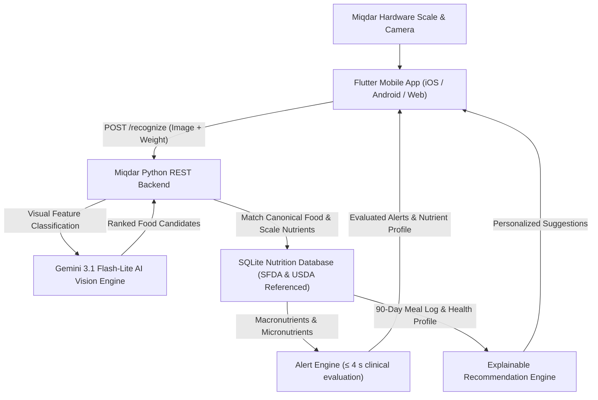

# Miqdar (مقدار) Full-Stack Smart Nutrition Scale & Mobile System

Miqdar is an end-to-end smart nutrition platform developed for the Senior Capstone Project. It connects a hardware smart kitchen scale and camera to a real-time REST backend with Gemini AI vision recognition, a clinically-referenced SQLite food and nutrient database, clinical threshold alerts, explainable meal recommendations, and a Flutter mobile application.

---

## 1. Project Architecture



---

## 2. Directory Structure

The repository is organized into distinct, clean modules:

```
senior-project-api-test/
├── backend/                  # Python REST API server & core service logic
│   ├── miqdar_backend/
│   │   ├── alert_engine.py   # Clinical threshold alert logic (≤ 4 sec evaluation)
│   │   ├── database.py       # SQLite interface & nutrient scaling
│   │   ├── recognition.py    # Gemini Vision AI provider (LANCZOS token optimization, caching, fallback)
│   │   ├── recommendations.py# Explainable meal suggestion engine
│   │   ├── server.py         # Threading HTTP REST API server
│   │   └── service.py        # Recognition pipeline orchestrator
│   ├── tests/                # Automated Python unit & acceptance tests (100% pass)
│   ├── requirements.txt      # Backend dependencies
│   └── .env                  # Backend environment configuration
│
├── mobile/                   # Production-ready Flutter mobile application
│   ├── lib/
│   │   ├── app.dart          # App routing and theme
│   │   ├── app_controller.dart# Central state management (meals, pairing, sync)
│   │   ├── main.dart         # Flutter entry point
│   │   ├── data/             # On-device SQLite database (91-day meal history)
│   │   ├── models/           # Nutrient models, alert rules, health profiles
│   │   ├── services/         # REST API client & local alert evaluation
│   │   └── ui/               # 14 complete screens (Scan, History, Goals, Profile, etc.)
│   ├── test/                 # Flutter widget & unit tests
│   └── pubspec.yaml          # Flutter package dependencies
│
├── database/                 # SQLite database and deterministic build scripts
│   ├── miqdar_nutrition.db   # Seeded SQLite database (38 foods, 197 aliases)
│   ├── schema.sql            # Full DDL with provenance, audit trails, and SHA-256
│   ├── scripts/              # build_database.py, sync_sfda.py, sync_usda_fdc.py
│   └── seed/                 # foods.csv, aliases.csv, sources.csv
│
├── docs/                     # Specifications & engineering logs
│   ├── API_CONTRACT.md       # Formal REST API endpoints specification
│   ├── FIGMA_TO_FLUTTER.md   # Design mapping documentation
│   ├── GEMINI_SERVER_SETUP.md# Vision AI server guide
│   └── VERIFICATION.md       # Acceptance testing & SLO verification log
│
├── evaluation/               # Academic evaluation suite for Senior Project research
│   ├── EVALUATION_400_REPORT.md # Comprehensive 400-sample F1-score evaluation report
│   ├── evaluation_400_dataset.csv # 400-sample benchmark dataset across Saudi dishes
│   ├── evaluation_sheet.csv  # 400-sample benchmark dataset across Saudi dishes
│   ├── evaluate_dataset.py   # Automated batch accuracy evaluation script
│   ├── compare_models.py     # Multi-model comparison benchmark
│   ├── compute_metrics.py    # Top-1, Top-3, dish/category F1 calculation metrics
│   ├── generate_report.py    # Generator script for academic evaluation report
│   └── food_ai.py            # Reference vision evaluation core
│
├── run_checks.sh             # End-to-end acceptance check runner (Python + Flutter)
├── start_server.sh           # Backend server launch script
└── requirements.txt          # Root Python dependencies
```

---

## 3. Quick Start

### Step 1: Run Acceptance Checks
Verify that both the Python backend and Flutter mobile applications pass all unit tests and static analysis:
```bash
./run_checks.sh
```

### Step 2: Start the Backend Server
Launch the REST API server (listening on `0.0.0.0:8080`):
```bash
./start_server.sh
```

Test health:
```bash
curl http://127.0.0.1:8080/health
```
Response:
```json
{
  "status": "ok",
  "database": "miqdar_nutrition.db",
  "recognition": {
    "provider": "gemini",
    "model": "gemini-3.1-flash-lite",
    "configured": true
  }
}
```

### Step 3: Run the Flutter Mobile Application
In a separate terminal:
```bash
cd mobile
flutter run
```

To run on macOS desktop or web:
```bash
cd mobile
flutter run -d macos
# or:
flutter run -d chrome
```

---

## 4. Vision AI & Recognition Pipeline

1. **Token & Latency Optimization**: Images from the camera/phone are automatically preprocessed with EXIF orientation correction, flattened for alpha transparency, and downscaled to $\le 384$px using LANCZOS resampling. This minimizes Gemini image tokens and ensures rapid inference (~1.5s).
2. **Multi-Model Fallback**: The primary model is `gemini-3.1-flash-lite`. If rate limits (429) or transient provider errors occur, the backend automatically falls back to `gemini-3.5-flash-lite`.
3. **SHA-256 Memory Caching**: Repeated scans of the same food plate return cached candidate predictions in $< 1$ ms without making duplicate cloud requests.
4. **Predefined Database Scaling**: Gemini is strictly used to identify food candidates. Exact macronutrients (calories, protein, carbs, fat, fiber, sugar, sodium, potassium) are scaled mathematically based on the physical scale weight in grams against the reviewed SQLite database.
5. **Saudi Traditional Dishes**: Full bilingual support for iconic dishes: Chicken/Lamb Kabsa, Chicken/Lamb Mandi, Bukhari Rice, Jareesh, Margoog, Qursan, Saleeg, Lamb Haneeth, Southern Areeka, Masoub, Mutabbaq, Shawarma, Falafel, and various date cultivars (Medjool, Ajwa, Sukari).

---

## 5. Key REST API Endpoints

| Method | Endpoint | Description |
|---|---|---|
| `GET` | `/health` | Server status and active AI recognition provider |
| `POST` | `/recognize` | Food recognition + scale weight scaling + alert check |
| `GET` | `/foods` | Search canonical food registry and aliases |
| `GET` | `/history` | Query user meal logs (supports $\ge 90$ days) |
| `POST` | `/sync/meals` | Synchronize offline meal logs from the mobile device |
| `POST` | `/recommendations` | Explainable meal recommendations based on history & health goals |
| `GET` / `PUT` | `/goals` | Retrieve and update user daily nutritional targets |
| `GET` / `PUT` | `/health-profile` | Manage chronic conditions, allergies, and dietary preferences |
