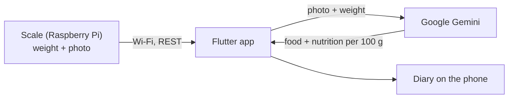

# Miqdar (مقدار)

A smart kitchen scale and app for Saudi and Gulf food. Put food on the scale: it weighs and photographs it, Gemini
identifies it and estimates its nutrition, and the app works out the calories for the exact weight.

Senior project. Raspberry Pi 4B, HX711 load cell, Camera Module 3, 3.5" touchscreen, Flutter app.

> **Working on this project, person or AI agent?** Start with [AGENTS.md](AGENTS.md).
> All documents are listed in [docs/README.md](docs/README.md).



## Run it

**On the Pi, once and after every pull:**
```bash
git clone https://github.com/Abdullah11Kn/Miqdar.git && cd Miqdar && ./install_pi_desktop.sh
```
The scale then starts by itself at boot. The desktop also has icons to start it by hand.

**On the Mac:** put your key in `.env` as `GEMINI_API_KEY=...`, then with the Mac on the same Wi-Fi as the scale:
```bash
./run_simulator.sh
```

**No scale at hand:**
```bash
./start_scale_app.sh --headless --mock                # terminal 1: a simulated scale
./run_simulator.sh http://127.0.0.1:8080              # terminal 2
```

**Checks:** `./run_checks.sh`

## Note on the API key

`run_simulator.sh` builds the key into the app, which suits local testing only: a key inside an installed app can be
extracted. A public release must call Gemini through a server.

Nutrition values are AI estimates, not medical advice.
