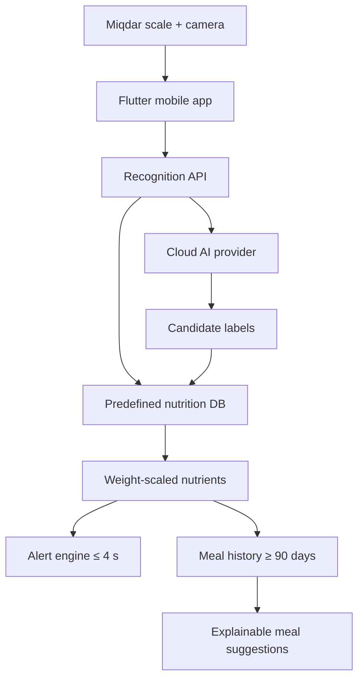

# Miqdar full-stack prototype

This bundle connects the Miqdar Flutter application to a provenance-aware food database, a REST backend with direct Gemini image recognition, local health alerts, transparent meal suggestions, and 90-day history.

## What is implemented

- SQLite nutrition and image schema with source, record ID, verification state, image rights, SHA-256, dataset split, and embedding storage.
- Official SFDA registered-product synchronization for barcode, registration number, brand, trade name, ingredients, warnings, and package weight.
- Official USDA FoodData Central synchronization for exact per-100 g nutrient profiles.
- Rights-gated food-image ingestion and an optional CC BY 4.0 Ajwa/Medjool dataset downloader.
- Direct Gemini 3.1 Flash-Lite image-recognition adapter, plus a deterministic offline provider for demonstrations.
- Explainable meal suggestions that combine configured health considerations, exclusions, remaining goals, and recent-meal variety without presenting medical advice.
- Sequential detection using both frame similarity and positive weight change.
- Health-alert evaluation after recognition, with a measured 4,000 ms service-level check.
- Flutter screens for splash, sign-in, account creation, pairing, home, scan, result, meal detail, history, trends, goals, alerts, profile, and device settings.
- Local SQLite history seeded across 91 days so the 90-day requirement can be tested immediately.

## Architecture



## Run the database and backend

Python 3.11+ and Pillow are required. Copy the example environment file and add your Gemini API key locally:

```bash
cp backend/.env.example backend/.env
# Edit backend/.env and set GEMINI_API_KEY.
python database/scripts/build_database.py --replace
python -m pip install -r backend/requirements.txt
./start_server.sh
```

The server listens on `0.0.0.0:8080` by default. Set `MIQDAR_HOST` or `MIQDAR_PORT` in the environment to change it. If `GEMINI_API_KEY` is omitted, remove `MIQDAR_RECOGNITION_PROVIDER=gemini` or set it to `mock` for the clearly labelled offline demonstrator.

Test health:

```bash
curl http://127.0.0.1:8080/health
curl "http://127.0.0.1:8080/history?days=90"
curl -X POST http://127.0.0.1:8080/recommendations \
  -H "Content-Type: application/json" \
  -d '{"user_id":"demo-user","limit":5}'
```

## Run the Flutter app

This environment did not contain the Flutter SDK, so generated Android/iOS platform wrappers could not be compiled here. The Flutter source, assets, tests, and bootstrap are included.

```bash
cd mobile
./tool/bootstrap_flutter.sh
flutter run --dart-define=MIQDAR_API_URL=http://10.0.2.2:8080
```

If `MIQDAR_API_TOKEN` is set on the server, pass the same value to Flutter with `--dart-define=MIQDAR_API_TOKEN=...`. Use HTTPS and a real identity provider before deployment; the optional bearer token is intended to protect a prototype or controlled demonstration environment.

`10.0.2.2` points from the Android emulator to the host machine. For local HTTP development, add Android Internet permission and permit cleartext traffic only in the debug manifest. Use HTTPS in production. For an iOS simulator, use the host address appropriate to your setup.

## Import official Saudi registered products

The SFDA public listing documents product registration metadata; it does not document a complete nutrition panel. The importer therefore creates products with `sfda_registered_nutrition_pending` until an exact package-label or official composition record is linked.

```bash
export SFDA_API_KEY="configured-locally"
python database/scripts/sync_sfda.py --limit 100 --offset 0
```

Never commit API keys. An official saved API response can be imported offline:

```bash
python database/scripts/sync_sfda.py --from-json sfda-response.json
```

## Verify generic-food nutrients with USDA FoodData Central

The prototype contains one verified USDA record (Medjool dates, FDC 168191) and clearly marked reference seeds for the other demo foods. Replace the reference seeds by running:

```bash
export USDA_FDC_API_KEY="configured-locally"
python database/scripts/sync_usda_fdc.py
```

The script searches only Foundation or SR Legacy records, downloads details, keeps the exact FDC ID, and changes status to `verified_official_record`.

## Prepare food images

Preferred: capture project-owned Saudi food and packaged-product images using `database/reference_images/CAPTURE_GUIDE.md`.

Optional licensed starter for dates:

```bash
python database/scripts/download_uci_dates.py --accept-cc-by-4
python database/scripts/import_reference_images.py
```

The UCI archive is about 298 MB and is intentionally not duplicated in this bundle. The download step requires the team to review and accept CC BY 4.0 attribution. Other discovered datasets are catalogued in `database/seed/image_sources.csv`; sources with non-commercial/no-derivatives or missing licenses are not auto-imported.

## Configure Gemini image recognition

The backend calls Google's `generateContent` REST endpoint with the image inline and requests a constrained JSON candidate list. Set the following without committing secrets:

```bash
export MIQDAR_RECOGNITION_PROVIDER="gemini"
export GEMINI_API_KEY="configured-locally"
export GEMINI_MODEL="gemini-3.1-flash-lite"
```

Gemini only selects candidate labels. The backend maps the selected label to a reviewed database record and performs all mass and nutrient calculations itself. Model output is never accepted as nutrition data.

The optional provider-neutral adapter is still available by setting `MIQDAR_RECOGNITION_PROVIDER=remote`, `MIQDAR_CLOUD_ENDPOINT`, and `MIQDAR_CLOUD_API_KEY`. Its expected response is:

```json
{
  "candidates": [
    {"label": "medjool dates", "confidence": 0.96},
    {"label": "dates", "confidence": 0.03}
  ]
}
```

The backend rejects a result if none of the candidates maps to a predefined food or alias. Nutrition is never invented by the vision provider.

## Acceptance checks

```bash
./run_checks.sh
```

Backend tests cover database integrity, source provenance, 90 distinct history days, post-recognition alert timing, predefined-database mapping, sequential image-plus-weight detection, and the SFDA “nutrition pending” safeguard.

## Important limits

- This is an engineering prototype, not a medical device or a substitute for professional dietary advice.
- Generic foods vary by cultivar and preparation; packaged products vary by label and formulation.
- User thresholds in the app are demonstration settings, not clinical recommendations.
- Health conditions are self-declared planning inputs. The recommendation score is transparent and must not be used to diagnose or treat a condition.
- Kidney-related recommendations require clinician-approved sodium, potassium, fluid, and portion targets.
- The 4-second requirement is measured from recognition completion to alert evaluation, matching the project specification. Cloud-recognition latency is measured separately.
