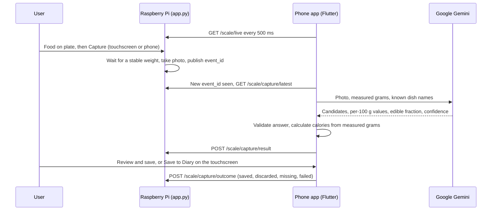

# Miqdar: technical record for Report 3

The complete technical record of the software and integration work done by the ICS team after Report 2. It is source material
for writing Report 3, not the report itself. Use it together with this GitHub repository and the picture supplied.
File paths and commit IDs are given so that any statement can be checked against the code.

**Period:** 12 October to 5 November 2026. Report 2 (the Second Design Notebook) covered 13 September to 11 October 2026.
**Volume of work:** 59 commits in the period, about 16,700 lines of Dart in the app, about 2,400 lines of Python on the Pi, and
153 automated tests.

## Rules for writing the report

1. **Show real engineering work.** Section 10 is the core: each entry gives a problem, its cause, the solution and the result.
2. **Leave out the new visual design.** It is held for the next report. Do not describe the colors, fonts, buttons, floating
   bars, screen layouts or look from the design system. That means leaving out:
   - commits `85d58f5` (first design system), `707a8ef` (black and white design, Thmanyah fonts) and `aeae659` (touchscreen restyle);
   - `docs/DESIGN.md`, `mobile/lib/theme.dart`, `mobile/lib/miqdar_icons.dart`, `mobile/assets/fonts/` and `docs/APP_SCREENS.md`.

   The repository's current code already contains that design, so describe what each screen **does**, as this file does, and
   not how it looks in the code. Do not use a screenshot of the current app or touchscreen unless the team confirms it fits this rule.
3. **Only claim what is recorded.** Section 15 says which requirements are unproven. Do not present any of them as met.
4. **Do not quote the 400-sample evaluation** (`evaluation/EVALUATION_400_REPORT.md`, F1 scores and the like). Its data is placeholder.
5. **Add what this file cannot know.** See section 19: meetings, coach feedback, mechanical and electrical work, and who did what.

## 1. Project and scope

Miqdar (مقدار, "amount") is a smart kitchen scale with a phone app, for Saudi and Gulf food. The user puts food on the plate, the
scale weighs and photographs it, and the app shows the food's calories and nutrients and saves it to a diary.

Team M015, Senior Design II, Term 261, King Fahd University of Petroleum and Minerals.

| Layer | Technology |
|---|---|
| Hardware | Raspberry Pi 4B, HX711 load cell amplifier with a 5 kg cell, Camera Module 3, 3.5" 640×480 DSI touchscreen |
| Scale software | Python 3: HX711 driver, Picamera2, Tkinter touchscreen, `http.server` REST API, threads |
| Phone app | Flutter and Dart with Material 3, `ChangeNotifier` state, SQLite through `sqflite`, English and Arabic |
| AI | Google Gemini REST API with image input and a JSON response schema, on the free plan |
| Older server path | Python backend and a 15-table SQLite nutrition database |
| Tools | Git and GitHub Issues, iOS simulator, `flutter test`, Python `unittest`, Cloudflare tunnel, SSH |

## 2. Where Report 2 ended

- The application was reported complete. The electrical circuits were complete for the current prototype.
- AI testing and response-time troubleshooting were continuing.
- The planned design recognized a food, then looked its nutrition up in a database, with a backend holding the cloud credential.
- Event IDs, stage timing and proof that each meal saves exactly once were proposed but not verified.
- The app had not been connected end to end with a real scale.
- The stated next priority was evidence: linking image, weight, AI result, response time and saved record.

## 3. System architecture now



**Separation of duties:**
- The Pi only weighs and photographs. It needs no AI key.
- The phone holds the AI call, the calculation and the diary.
- Weight is the measured truth. Gemini never decides the grams for a weighed food.

**Three ways the code can run:** the default flow above; `--analyze-on-scale` or `--server`, the older path where the Pi or a
server calls Gemini and uses the database; and `--mock`, a simulated scale with no hardware, which lets every test run without the device.

## 4. Timeline of the work

| Date (2026) | Commits | Work |
|---|---|---|
| 21–22 Oct | `b6e3d21`, `c64c1db` | Integration guide; front-end requirements and full-stack improvements |
| 23 Oct | `5a8f4e3` | App rework: English and Arabic, right-to-left layout, 8-nutrient grid, custom charts, food catalog, local SQLite, offline fallback |
| 25 Oct | `50bbbe8`, `42fa403` | Evaluation tooling and design specifications (its 400-sample data is placeholder) |
| 31 Oct | `7400c47` | Real hardware integrated: HX711 and camera drivers, touchscreen, REST API, app connection |
| 1 Nov | `2664c6f`, `6242a0a`, `3fb9523` | Live weight sync, two-way capture sync, exit screen, tunnel support, automatic reconnection |
| 1 Nov | `856f207`, `2eafaab`, `c0e0ed0` | Multi-level camera fallback, photo preview, first working scale-to-app flow, one-tap launcher, calibration guide |
| 1 Nov | `8607c97` | **Architecture change:** Gemini moved into the app, so no key on the Pi |
| 1 Nov | `ca5d81d`, `645338a`, `5b8c3d2` | Remote control of the Pi from a Mac, over USB-C and Wi-Fi |
| 1 Nov | `c880108`, `28bf700`, `a015833`, `19775fa` | Instant photo with loading state, unsteady weight refusal, speed work, edible fraction, accuracy work |
| 1 Nov | `12bead2`, `d3aabd3` | Core app flow rebuilt around the real scale; Arabic fixed; fake meals removed from real totals |
| 2 Nov | `3b2b262` | Fake screens removed; data made to survive restarts; real connection test; Delete All My Data |
| 2 Nov | `f1a015a`, `43dcd74`, `6ccd34e` | Shared engineering log, start at boot, tunnel off by default, API documentation checked against code, first real-scale test of the rebuilt app |
| 2 Nov | `e6c80e7`, `2fc7a04` | A full brand redesign was tried on the simulator and reverted at the owner's request |
| 4 Nov | `c98fb9c` | Feature plan agreed and published as GitHub issue #1, split into tickets #2 to #13 |
| 4 Nov | `e9ddd1a` | Body profile and calculated daily goal |
| 4 Nov | `7dd96da`, `4b5b441` | Mixed plates on the scale and in the app; weight wobble tolerance; recovery when Gemini fails |
| 4 Nov | `1cc3772` | Logging away from the scale: phone photo, typed description, voice |
| 4 Nov | `e93b6c6` | Quick re-logging, body weight log, meal reminders |
| 4 Nov | `0e19aa4`, `952d1d6` | Fixes from screen checks and a code review; real database upgrade test |
| 5 Nov | `3139f8a`, `0659d88` | Startup logging; Pi update checked on the real scale |
| 5 Nov | `7d54194`, `c1712d4` | Setup for a real iPhone and for Android; plate naming fix |
| 5 Nov | none | First real food captures with the current flow (section 14) |
| 5 Nov | `692e811` | Save to Diary from the touchscreen, confirmed by the phone |

## 5. Scale subsystem (`scale.py`, `hardware.py`, `app.py`)

### 5.1 Load cell driver and calibration

- HX711 connected through `lgpio`: DT on GPIO6, SCK on GPIO5, powered from 3.3 V.
- `scale.py` provides `raw`, `calibrate`, `weigh`, `stream` (logs sample rate and data loss) and `pipeline` modes.
- Two-point calibration against a known mass, stored in `scale_calibration.json`: zero offset 125430 and factor 421.35 counts per
  gram, from a 200 g reference mass on 20 October. Grams = (raw − offset) ÷ factor.
- A background thread reads about 10 samples per second into a thread-safe ring buffer of the last 50 samples.
- The live reading is the **median of the last 5 samples**, which rejects single-sample spikes.

### 5.2 Stable weight algorithm

Calories scale directly with the weight, so a capture must never use a moving number.

1. Only samples taken after the capture request count, so a tap right after placing food cannot return the old weight.
2. Collect a 1-second window with at least 5 samples, and at least 80% of the expected count.
3. Sort the window and drop the highest and lowest 10%, so a brief wobble does not fail the check.
4. Accept if the remaining spread is within ±1 g, and use their mean. Otherwise keep waiting, up to 8 s for a capture.
5. If it never settles on real hardware, refuse with `WEIGHT_NOT_STEADY` rather than guess.

### 5.3 Other weighing behavior

- **Zero (tare):** waits for a stable reading, then makes it the new zero. It reports failure if the plate is moving.
- **Overload:** warns when the load on the sensor passes 4.5 kg (90% of the 5 kg rating).
- **Empty plate:** a capture under 5 g is refused with `EMPTY_SCALE`.
- **Sensor fault:** a dead load cell is reported through `sensor_ok` and `sensor_error`, so it is never shown as a weight.
- **Automatic capture** (`--auto-capture`, off by default): `AutoCaptureMonitor` fires once per placement above 20 g after a 2 s
  settle. It re-arms when the plate clears or the weight changes by 25 g, so a resting plate never triggers again.

### 5.4 Camera pipeline

- Picamera2 with Camera Module 3: still mode at 2304×1296, with an autofocus cycle before each photo. The camera is warmed up at start, so the first photo is fast.
- **Four-level fallback:** `hardware.py` (Picamera2), then `rpicam-still`, then `libcamera-still`, then OpenCV on `/dev/video0`.
  Each level checks that the file exists and is over 1 KB. A held camera is released first, because the command-line tools cannot open it.
- For transport the photo is reduced to at most 1280×960 JPEG at quality 80 and encoded as base64.

### 5.5 Capture pipeline and concurrency

`perform_capture()` is the one pipeline behind the phone, the touchscreen and automatic capture: settle, photograph, publish an event.

- A non-blocking lock allows one capture at a time, because the camera and load cell are shared. A second request gets `CAPTURE_IN_PROGRESS`.
- `capture_state` reports `idle`, `settling`, `capturing` or `analyzing`, so every client can show the same state.
- Each capture publishes an event with a unique `event_id` and its source (`scale`, `phone`, `auto`). Failures are published too, with their photo when there is one.
- Polling stays light: `/scale/live` carries only a summary of the event. The photo is fetched once per new `event_id`.
- A `boot_id` in `/scale/live` changes when the scale restarts, so the app can detect that an unfinished plate was lost.

### 5.6 Mixed plate session on the scale

A plate is a sequence of steps, kept on the Pi. Each step's grams are the **difference** from the previous stable reading, with its own photo and `step_id`.

| Situation | Behavior |
|---|---|
| Added under 5 g | `PLATE_STEP_TOO_SMALL` |
| Plate became 5 g or more lighter | `PLATE_WEIGHT_DROPPED`, so the app offers Undo Last Food or Weigh Again |
| Finish with no new weight | Closes the plate, because the last food was already recorded |
| Plate open | Zero, single Capture and automatic capture all wait (`PLATE_OPEN`) |
| Plate finished, phone has not collected it | `PLATE_OPEN`, until the phone takes it or New Plate drops it |

### 5.7 Touchscreen program

A Tkinter application with a state machine of screens: `weigh`, `analyzing`, `result`, `saved`, `plate_sent`, `error` and `exit_confirm`.

- `draw_screen()` is separate from the window system: it draws through a small painter interface and returns the touch regions.
  The same function therefore draws on the device and in test previews, and unit tests can check which actions a screen offers.
- A 150 ms tick mirrors every capture on the screen, whoever started it (button, phone or automatic). A redraw happens only when the state changes.
- Long work runs on background threads and returns to the interface through `root.after`, so the screen never freezes.
- It shows the address to type into the phone, so the app can be connected without a terminal.

### 5.8 Deployment on the Pi

- `start_all.sh`: what boot and the desktop icons run. It stops an older copy first, because two copies would fight over the GPIO pins and camera, and it logs to `/tmp/miqdar_start.log`.
- `install_pi_desktop.sh`: creates the virtual environment (with `--system-site-packages`, because `lgpio` and `picamera2` come from the system), the desktop icons and the start-at-boot entry.
- `app.py --self-test` checks the load cell and camera; `--install-service` installs a systemd service.
- From a Mac: `connect_pi.sh` opens a terminal on the Pi. `enable_usb_ssh_pi.sh` was built for networking over USB-C, which was later dropped in favor of Wi-Fi (P19).
- `start_cloudflare_tunnel.sh` gives a public address when phone and scale cannot share a network. It is off by default (P15).

## 6. REST API (`app.py`, documented in `docs/API.md`)

| Method and route | Purpose |
|---|---|
| `GET /health` | Service status, recognition provider, scale state |
| `GET /scale/live` | Polled every 500 ms: weight, stability, overload, sensor, capture state, latest capture summary, `save_request`, `cancel_request`, plate, `boot_id` |
| `POST /scale/capture` | Weigh and photograph; optional note |
| `GET /scale/capture/latest` | The full latest event, with photo |
| `POST /scale/capture/result` | The phone reports its analysis, so the touchscreen can show it. Results for an older capture are ignored |
| `POST /scale/capture/outcome` | The phone reports what became of the meal: `saved`, `discarded`, `missing` or `failed`. This also answers `save_request` and `cancel_request` |
| `POST /scale/tare` | Zero |
| `POST /scale/plate/add`, `finish`, `undo`, `cancel` | Mixed plate session |
| `GET /scale/plate/photo?step=N` | One step's photo |
| `POST /scale/simulate`, `/scale/simulate/save` | Simulation only; return 404 on a real scale |
| `POST /recognize`, `POST /meals`, `GET /foods`, `GET /history`, `GET` and `PUT /goals`, `GET` and `PUT /health-profile`, `GET /alerts`, `POST /recommendations` | Database routes (older path, meal ideas, best-effort copies) |

- Errors have one shape: `{"error", "message", "candidates", "event_id"}`, with HTTP status codes (409 busy, 422 refused, 502 and 503 unavailable).
- An optional `MIQDAR_API_TOKEN` protects every route except `/health` and `/scale/live`, through a Bearer header.

## 7. Food recognition and nutrition (`mobile/lib/services/gemini_service.dart`)

### 7.1 The calculation

```
calories = per_100g_edible.calories × edible_fraction × measured_grams ÷ 100
```

The other nutrients follow the same formula. Gemini estimates the first two values; the app does the arithmetic, so the measured weight always counts.

### 7.2 Prompt and response design

- The prompt describes the real setup: a fixed camera over a white platform, hands and background to be ignored, and Saudi and Gulf home cooking expected first.
- It lists the catalog's dish names and requires exactly those names when they apply.
- It asks for up to three ranked candidates with a confidence that reflects real uncertainty (below 0.6 when unclear).
- Each candidate has `name_en`, `name_ar`, `per_100g_edible`, `edible_fraction` and a short `note` of what was assumed, in the app's language.
- It reads brands and nutrition panels on packaged food.
- **Prompt injection defense:** words in the photo are treated only as information about the food, never as instructions.
- The measured grams are given as a clue to what the item is, with an instruction not to calculate totals.
- A user's note is passed as weak context. A user's correction is passed as trusted information.
- A structured response: `responseMimeType` JSON with a JSON schema, and temperature 0.1 for consistency.
- Empty plates and non-food items return `not food`, which is refused rather than given calories.

### 7.3 Validation of AI answers

`_plausible()` rejects physically impossible answers:
- calories per 100 g must be above 0 and at most 950, since nothing has more energy than pure fat;
- protein + carbohydrates + fat must not exceed 105 g per 100 g;
- above 50 kcal, stated calories must agree with 4×protein + 4×carbohydrates + 9×fat within a 50% margin, which allows for fiber and alcohol.

### 7.4 Reliability under load

- Model fallback order: `gemini-3.1-flash-lite`, `gemini-3.5-flash-lite`, `gemini-flash-latest`. Flash-Lite comes first because of free plan limits.
- Weighed photo: 8 s per model and 35 s in total. A slow model is put aside and retried only if the others fail.
- Plates and estimated amounts: 20 s per model and 50 s in total, because a real description took 15 s under load.
- HTTP 400, 404, 429, 500, 502, 503 and 504 move on to the next model. HTTP 429 becomes a specific "out of quota" error.
- If Gemini fails, Search and Manual entry are always one tap away, and a failed analysis can be retried without capturing again.

### 7.5 Mixed plate analysis

One Gemini request is sent at Finish, with all photos in order. Each photo is labelled with the grams measured for that food alone, and
Gemini is told to compare each photo with the one before it to find what was added. It returns one entry per photo and a natural name for the whole plate.

## 8. Phone app features (`mobile/lib`)

The app has about 16,700 lines of Dart. `MiqdarController` (`app_controller.dart`) holds state and the capture flow, and services handle Gemini, the scale, alerts and reminders.

### 8.1 Connection to the scale

- Polls `/scale/live` every 500 ms and shows the live weight.
- Every state is shown in words: connected, not connected, weight sensor not responding, or simulated.
- Reconnects by itself. `normalizeScaleAddress()` turns whatever is typed (`foodscale.local`, an IP address, a tunnel link) into a full URL.
- A Scale screen with a real connection test and the address. Cloudflare error 1033 gets a plain explanation.
- Zero from the phone. Captures started anywhere are followed, using `event_id`, and the last seen ID is stored so a restart does not reopen a saved capture.
- Captures older than 5 minutes are ignored on first connection.

### 8.2 Adding a meal

1. **From the scale:** live weight and Capture, with an optional note for the AI. The photo appears at once with a loading state, then Review.
2. **Mixed plate:** Add Next Food, Finish, Undo Last Food, Cancel Plate.
3. **Phone camera or a photo from the library:** Gemini estimates the food and amount, marked as estimated.
4. **Describe it:** typed text, or voice through `speech_to_text`, which only fills the text field. Also offered when an analysis fails.
5. **Search:** a built-in catalog of 38 foods, searched in English and Arabic and filtered by category, with standard servings.
6. **Recent foods:** the last five, repeated from saved values with no Gemini request.
7. **Manual entry:** copied from a label, with a per-basis scale, and blanks stored as Unknown rather than zero.

### 8.3 Review before saving

- Photo (tap to zoom), name, calories, weight and macronutrients. The source of the values is labelled: official database, typical values, Gemini estimate or entered by hand.
- The weight's source is labelled too: weighed, entered by hand, standard serving or estimated.
- Confidence and Gemini's assumptions are shown, with a plain warning at low confidence.
- Actions: Not Right? Tell Gemini (re-analyzes the same photo with the correction), Change Food, alternatives, Add Side, portion adjustment, meal type, date, note.
- A preview of notices the meal would trigger, before it is saved.
- Save with Undo. An unsaved result stays available from Home.

### 8.4 Mixed plates on the phone

- Review shows the total and a row per food. Each food can be renamed by typing, searched, entered by hand, reweighed (then labelled as entered by hand) or removed.
- **Saved as one meal** with its foods in `meal_items`, and Log Again restores all of them.
- If Gemini fails, the photos and grams are kept, with Ask Gemini Again or Name the Foods Myself. Saving waits until every food has a name.
- A plate with unnamed foods shows Unknown, not 0. A plate reads as an estimate if any of its foods is an estimate.

### 8.5 Save to Diary from the scale's touchscreen

The diary is on the phone, so a Save on the scale cannot save anything by itself. It is built as a request and answer:

1. The touchscreen sets `save_request` to the meal's `event_id`, which the phone sees on its next poll.
2. If the open draft matches, the phone saves it **once**, keeping any meal type and note chosen in Review, and closes Review.
3. The phone posts the outcome, and only then does the touchscreen say Saved, showing what was really saved.
4. If the draft no longer matches, for example the user chose another food on the phone, the phone answers `missing` and the scale says so. **A draft from Search can never be saved by a scale request.**
5. With no answer in 10 s, the scale says so and withdraws the request, so opening the app later does not save by surprise.
6. If the answer is lost, the next poll repeats only the answer, not the save.

Saving or discarding on the phone also tells the scale.

**Cancel:** a single-food capture goes from Capture straight to one Analyzing screen on the scale, then to the result. Once the phone has the photo, that screen offers Cancel. It sets `cancel_request`, and the phone stops analyzing, ignores a late answer, closes its screens and confirms. A capture cancelled before the phone saw it is never analyzed. After 60 s with no result the screen says to check the phone. A plate from Add Next Food keeps its own steps and its own "Plate sent" screen.

### 8.6 Diary and Insights

- Diary: grouped by day with daily totals, search, meal type filters, meal detail with photo, editing, Log Again, deletion with Undo.
- Home: calories and macronutrients against goals, day navigation up to a year back, today's meals, meal ideas.
- Insights over 7, 30 and 90 days: averages over logged days, calorie trend against the goal, calories by macronutrient, per-nutrient progress, and the top meals behind each nutrient.
- Export as CSV, copied to the clipboard.

### 8.7 Goals, notices and meal ideas

- Goals for 8 nutrients, each typed as a target, maximum, minimum, range or track-only, plus a Just Track mode with no goals.
- `AlertService` evaluates each meal against the day's projected totals. It warns above a limit and marks 125% as critical. If a value is missing it says the total is a known subtotal.
- Meal ideas: `POST /recommendations` scores foods against the day's remaining goals and a health profile (diabetes, hypertension, high cholesterol, weight management, kidney disease; vegetarian, vegan; allergens; disliked foods), with exclusion rules and a penalty for repetition.

### 8.8 Body profile and calculated goal (`models/body_profile.dart`)

Required for every real user; skippable only in test builds.

```
resting kcal = 10×weight(kg) + 6.25×height(cm) − 5×age + (5 for men, −161 for women)      (Mifflin-St Jeor)
planned kcal = resting × activity multiplier ± weekly pace × 7700 ÷ 7
calories     = planned, limited to 1200 (women) or 1500 (men) minimum and 4500 maximum, rounded to 50
protein      = 1.6 g per kg       fat = 30% of calories       carbohydrates = the remainder
```

- **Safety rules:** no calculated goal under age 18, or when pregnant or breastfeeding. Pace is at most 0.5 kg a week. A weight loss target cannot be below a BMI of 18.5. The user is told when the minimum was applied.
- Input checks: age 5 to 110, height 100 to 250 cm, weight 20 to 300 kg, and a target in the right direction.
- Goals change only if the user accepts. The profile is not sent to Gemini and is covered by Delete All My Data.

### 8.9 Body weight log and reminders

- Typed weight entries with a chart, in `body_weights`; the kitchen scale cannot weigh a person. A profile weight change joins the log, and an entry updates the profile.
- At 2 kg from the weight behind the current goal, the app offers new goals, which change only if accepted.
- Optional local notifications per meal (`flutter_local_notifications`, `timezone`, `flutter_timezone`), off by default, asking permission only when turned on.

### 8.10 Language and modes

- English and Arabic through `s.tr(en, ar)`, with right-to-left mirroring, Arabic dates and units, and digits kept left to right. Arabic digits typed into fields are normalized.
- Light and dark modes. Language, theme and name are remembered.
- A demo workspace with sample data, held in memory, which never writes to the real diary. There are no accounts, by decision.

## 9. Data layer

### 9.1 On the phone (`data/local_database.dart`, SQLite version 6)

| Version | Migration | Why |
|---|---|---|
| 1 | `goals`, `meals`, `alerts` | Base diary |
| 2 | `health_profile` | Preferences behind meal ideas |
| 3 | New columns: fat and fiber goals, tracking mode, meal notes, weight source, Arabic notices, notice read state | Data that was lost on every restart |
| 4 | `body_profile` | Calculated goals |
| 5 | `meal_items`, with `basis_json` per food | A meal made of several foods; sides are now kept too |
| 6 | `body_weights` | Weight log |

- Every version upgrades in order through `onUpgrade`, and a real test upgrades a version 3 database (`test/database_upgrade_test.dart`).
- Meal photos are kept as files beside the database (`meal_photos/`), and Delete All My Data removes them.
- Unknown nutrients are stored as missing, not zero, and totals carry that through.

### 9.2 On the Pi (`database/`)

`miqdar_nutrition.db` has 15 tables: `source_registry`, `foods`, `food_aliases`, `nutrient_profiles`, `food_images`, `image_embeddings`, `users`, `nutrition_goals`,
`health_profiles`, `devices`, `meals`, `meal_items`, `recognition_events`, `health_alerts`, `sync_runs`.

- 38 foods with provenance states: 37 `reference_seed` and 1 `verified_official_record`.
- Build and import scripts in `database/scripts/`: `build_database.py`, `sync_usda_fdc.py`, `sync_sfda.py`, `download_uci_dates.py`, `import_reference_images.py`.

## 10. Engineering problems solved

Each entry was a real fault or limit found during the work.

### Recognition and accuracy

**P1. Gemini misidentified local dishes.** It read jareesh as an Iranian dish at 95% confidence.
*Cause:* a general model with no local context. *Solution:* the catalog's dish names are put in the prompt, along with the expected cuisine. *Commit:* `8607c97`.
*Limit that remains:* it still confuses similar dishes; one jareesh photo was read as both jareesh and saleeg, so tests must not require an exact dish name.

**P2. Calories counted inedible parts.** Half a pomegranate was given 202 kcal, because the weighed grams include rind.
*Solution:* an `edible_fraction` from Gemini, also covering bones, shells, bottles and packaging. *Result:* about 102 kcal. *Commit:* `a015833`.

**P3. AI answers could be impossible.** *Solution:* the physical checks in section 7.3, so a bad answer is rejected and the next model is tried. *Commit:* `19775fa`.

**P4. A prompt that described nothing about the setup gave weaker estimates.** *Solution:* a prompt written for the real camera view (section 7.2).
*Result:* in an informal check on about 10 photos, calorie error fell from 12.5% to 2.8% (see the limits in section 14). *Commit:* `19775fa`.

**P5. A single stored value per dish does not fit home cooking.** Ingredients and oil vary between households.
*Solution:* Gemini estimates each food from its photo instead of a database lookup. *Trade-off:* values now vary between runs (section 11).

### Speed and availability

**P6. A preview model took up to 26 s** on a photo that stable models answer in 2 to 5 s.
*Solution:* stable models first, with a time limit per model; a slow model is retried only if the others fail. *Commits:* `a015833`, `3b2b262`.

**P7. Full-size photos were being sent to the app and to Gemini.** *Cause:* importing `ImageTk`, which the app never used, failed on the Pi and disabled **all** image processing, silently.
*Solution:* removed the import; photos are reduced before sending. *Commit:* `28bf700`.

**P8. The main model overloaded and the free quota ran out during testing** (about 20 requests a day per model).
*Solution:* model fallback, a specific quota message, retry without capturing again, and Search and Manual entry always available. Test runs were also rationed.

**P9. Waiting with nothing on screen felt like a failure.** *Solution:* the captured photo appears immediately with a loading state, while Gemini runs apart from the live poll, so the weight stays live. *Commit:* `c880108`.

**P10. A real description request took 15 s under load** and hit the time limit. *Solution:* longer limits for requests that estimate an amount (section 7.4). *Commit:* `1cc3772`.

### Weighing correctness

**P11. A hand on the food silently produced wrong calories.** *Cause:* a capture whose weight never settled used the moving reading.
*Solution:* the capture is refused and the user is told why. *Commit:* `28bf700`.

**P12. A brief wobble failed the stability check.** *Solution:* the trimmed window in section 5.2. *Commit:* `7dd96da`. *Limit:* the thresholds are still engineering estimates until tested with real plates.

**P13. A plate could become lighter between steps,** which would make the next food's grams wrong. *Solution:* `PLATE_WEIGHT_DROPPED`, with Undo Last Food or Weigh Again. *Commit:* `952d1d6`.

**P14. A scale restart lost an unfinished plate with no warning,** because plates are held in memory. *Solution:* a `boot_id` that lets the app detect the restart and tell the user. *Commit:* `952d1d6`.

### Security and honesty

**P15. The public tunnel exposed the camera and API with no password.** *Solution:* the tunnel is off by default and needs its own icon; an optional API token was added. *Commit:* `43dcd74`.

**P16. Screens pretended to work.** Sign-in, password reset, pairing, sync, account deletion and device stats did nothing real, and a battery value was invented with no battery sensor.
*Solution:* removed, and replaced with a real connection test and a real Delete All My Data. *Commits:* `3b2b262`, `43dcd74`.

**P17. Sample meals counted in real totals.** *Solution:* removed from storage; they now exist only in a demo held in memory. *Commit:* `12bead2`.

**P18. A plate could read as verified while a food in it was a Gemini estimate,** because it took its labels from its first food. *Solution:* a plate's label now comes from all its foods. *Commit:* `952d1d6`.

### Integration and device

**P19. Networking between the Mac, Pi and phone was unreliable.** USB-C networking stopped answering, and a Mac tool blocked by macOS Local Network privacy showed `No route to host`, which looks like a network fault.
*Solution:* Wi-Fi as the supported path, automatic reconnection, plain error messages, and the scale's address shown on its screen. The Local Network permission a real iPhone needs was added. *Commits:* `3fb9523`, `7d54194`.

**P20. Touchscreen buttons did nothing useful or implied the wrong action.** While the phone was analyzing, the screen offered Capture, and the result screen offered Capture instead of a way to save.
An extra "Photo sent" screen also sat between Capture and the result with no purpose. *Solution:* one Analyzing screen whose only action is a Cancel that really cancels on the phone, and Save to Diary as a confirmed request (section 8.5). *Commit:* `692e811`.

**P21. A photo could be attached to the wrong food in a plate.** *Solution:* photos are told apart by a `step_id`, so Undo cannot shift them. *Commit:* `952d1d6`.

**P22. Starting at boot failed once, with an unknown cause.** *Action so far:* `start_all.sh` now logs its output, to diagnose it on a power cycle. *Status:* open. *Commit:* `3139f8a`.

**P23. A package passed analysis but would not build.** `phosphor_flutter` passes `flutter analyze` but fails on Flutter 3.47, so bundled fonts are used for icons. Lesson recorded: analysis is not a build.

### Data correctness

**P24. Data was lost on every restart:** fat and fiber goals, tracking mode, meal notes and notice state. *Solution:* database version 3. *Commit:* `3b2b262`.

**P25. Sides were lost on saving.** *Solution:* `meal_items`, in database version 5. *Commit:* `4b5b441`.

**P26. A saved capture reopened as new after a restart.** *Solution:* the last seen `event_id` is stored. *Commit:* `3b2b262`.

**P27. A failed Gemini answer could lose the user's work on a plate.** *Solution:* photos and grams are kept, with retry or naming by hand. *Commit:* `4b5b441`.

**P28. Picking a candidate after editing the weight used the old weight, and alerts piled up on each weight change and were saved for discarded drafts.** *Solution:* fixed in `19775fa`.

**P29. The diary date filter removed meals from Home and Insights.** *Solution:* filtering no longer changes the shared meal list. *Commit:* `3b2b262`.

**P30. A hand-named plate kept its first food's name.** *Solution:* it now lists all its foods, and Gemini's name for a plate stays. *Commit:* `c1712d4`.

**P31. A new user could avoid the under-18 goal rule by leaving during the profile.** *Solution:* they stay a new user until it is finished. *Commit:* `952d1d6`.

**P32. Unnamed plate foods counted as 0 kcal.** *Solution:* they show Unknown. *Commit:* `0e19aa4`.

### Language and user-facing faults

**P33. Arabic never really worked.** The layout flipped but the text stayed English, because Arabic was not a registered locale. *Solution:* registered and translated, including food categories, dates and units. *Commits:* `12bead2`, `0e19aa4`.

**P34. A sheet overflowed on a phone screen,** found in screen checks. It was fixed, and those checks became a standard step across language and theme modes.

### Testing process

**P35. A test run wiped real saved meals on the simulator, twice.** *Cause:* `flutter test` reinstalls the app. *Solution:* a rule that integration tests run only on a throwaway simulator, created and deleted for each run.

**P36. A test passed or failed because of its age.** `test_at_least_90_days_are_queryable` failed when seeded data aged to 87 days. *Solution:* it now creates its own dated meals. *Commit:* `0e19aa4`.

**P37. Documents described things that did not exist,** such as routes `/api/analyze` and `/sync/meals`. *Solution:* a new API page checked against the code, and old material archived. *Commit:* `43dcd74`.

## 11. Design decisions and their trade-offs

| Decision | Why | Cost or risk |
|---|---|---|
| Gemini estimates every food | Home-cooked ingredients vary | Values vary between runs: the same sample photos gave 448 and 403 kcal, about 10% |
| Key on the phone side, not the Pi | Simple flow; the Pi needs no secret | A key can be extracted from a build, so local test builds only. **Must move behind a server before release** |
| Pi only weighs and photographs | Clear duties; easy to test | The phone must be reachable for calories to appear |
| Polling every 500 ms, not push | Simple and survives reconnection; the photo stays out of the poll | Constant small traffic; up to 500 ms delay |
| Add Next Food is a button, not automatic detection | Dependable; decided on 4 November | Changes how the detection requirement is read (section 16) |
| One Gemini request per plate | Saves free quota; lets Gemini compare photos | A reasoned choice, not measured against one request per food |
| Diary only on the phone, no accounts | Privacy and simplicity | Removing the app removes the diary |
| Save on the scale needs the phone's answer | The diary is on the phone, and the screen must not claim a save that did not happen | Saving from the scale needs the phone connected |
| Unknown is never shown as 0 | A wrong zero misleads the user | Totals can be partial, and say so |
| Local notifications, not a server | No account or server needed | Depends on phone permissions |

## 12. Privacy and security measures

- The Gemini key is kept in `.env`, ignored by git. GitHub push protection also rejects keys.
- The Privacy & Data screen states that food photos go to Google and that the free plan may use them, what stays on the phone, and that the scale keeps its own photos.
- The body profile is never sent to Gemini.
- Delete All My Data removes the diary, photos, goals, preferences and profile from the phone.
- The tunnel is off by default, and an API token is available.
- Words in a photo cannot instruct the AI (section 7.2).
- Known open risk: the public repository's history contains the Pi hotspot password, which is waiting on a decision. It also must not be repeated in the report.

## 13. Testing

| Suite | Count | Covers |
|---|---|---|
| App unit tests (`mobile/test`) | 103 | `mixed_plate_test` 28, `gemini_service_test` 22, `daily_use_test` 17, `body_profile_test` 16, `scale_sync_test` 14, `meal_recommendation_test` 2, and 1 each for alerts, the database upgrade, nutrition values and scale addresses |
| Python tests (`backend/tests`) | 50 | `test_scale_capture_flow` 35, `test_miqdar` 12, `test_scale_integration` 2, `test_sfda_import` 1 |
| End-to-end tests (`mobile/integration_test`) | 4 | Capture to saved meal, mixed plate, capture from another tab, Save from the scale. All run the real app on an iOS simulator against a simulated scale with **real Gemini** |

All passed on 5 November, along with `flutter analyze` with no issues.

**Methods:**
- A simulated scale (`--mock`) and an injected HTTP client let the failure paths be tested: Gemini overload, lost answers and repeated polls.
- Hardware logic is tested through fake hardware modules. The touchscreen's logic is tested without a window, and its screens through a fake painter.
- Screen checks ran through all four language and theme modes on a throwaway simulator.
- A code review of all the 4 November feature work led to `952d1d6`.
- Work was tracked as GitHub issues #1 to #13.

**Limit:** apart from the checks in section 14, these run against simulated hardware. A pass here does not prove the real scale works.

## 14. Measured results, with their limits

**First real captures on the real scale, 5 November**, from the Pi's own log. Time runs from the photo's timestamp to the phone's result reaching the scale:

| Capture | 1 | 2 | 3 | 4 | 5 | 6 | 7 | 8 |
|---|---|---|---|---|---|---|---|---|
| Seconds | 10 | 17 | 5 | 4 | 13 | 9 | 4 | 3 |

- Median 7 s; 6 of the 8 were within 12 s; the slowest was 17 s.
- **Limits:** a small informal sample on the free plan. It excludes the time to settle before the photo (at least 1 s), and the foods were not logged, so this is not an acceptance test.
- One capture confirmed by photo: an orange flavored biscuit, 34 g, 146 kcal, carbs 19.7 g, protein 1.8 g, fat 6.7 g, sugar 9.1 g, labelled as a Gemini estimate. No reference value was compared, so its accuracy is unknown.

| Other result | Limit |
|---|---|
| Calorie error fell from 12.5% to 2.8% after improving the prompt | About 10 photos (commit `19775fa` says 25, which is wrong). Informal |
| Half a pomegranate: 202 → about 102 kcal | One example of the edible fraction |
| Real scale, 243 g pomegranate, about 21 s | One early capture on the older path; it got faster later |
| Gemini answers typically in 2–5 s; 15 s for a description under load | Observed, not a formal test |
| Simulated scale with real Gemini: 240 g gave 336 kcal (named Saleeg, later Jareesh) and 443.6 kcal (Jareesh) in different runs | Same sample photo and weight, so the estimate itself can move this much between runs |
| Simulated scale with real Gemini: Chicken Kabsa 200 g + Jareesh 120 g, 448 kcal, then 403 kcal on another run | Separate sample photos, not one real plate building up |
| Real scale on 2 and 5 November: connects, reads 0 g, zeroes, sensor OK, no throttling, refuses an empty plate | An empty plate reads about 1.5 g until zeroed |

## 15. Status of the requirements

Targets are from the requirements carried forward in Report 2. **None has a formal acceptance test yet.**

| Requirement | Status | Evidence so far |
|---|---|---|
| Food recognition ≥80% | Not shown | No valid test set. It works on real captures, but with known confusion between similar dishes |
| End-to-end response ≤12 s | Not shown, promising | 6 of 8 informal real captures within 12 s (section 14), not counting settling |
| Added-item logging ≥90% for ≥20 g | Not shown | Works on the simulated scale. Mixed plates are not confirmed on the real scale, and detection is now a button press |
| Calorie error ≤±15% | Not shown | Informal only; needs weighed foods with reference values |
| At least 90 days of history | Partly shown | The app has a 90-day view; an automated test queries 90 days on the older server path |
| Cloud AI and secure REST | Partly shown | Gemini works. Optional token, but plain HTTP on the local network, and the tunnel has no password unless the token is set |

## 16. How this differs from Report 2's plan

| Report 2 | Now | Why |
|---|---|---|
| Recognize, then look up a nutrition database | Gemini estimates nutrition directly; the database path remains an option | P5 |
| Backend holds the cloud credential | Key on the phone side, in local test builds | Simpler flow. **Must change before any public release** |
| Proposed event IDs linking a capture to a result | **Implemented:** `event_id`, repeated events ignored, older results refused | As proposed |
| Proposed: retry must not create a second meal | **Implemented** for Save from the scale, and tested | As proposed |
| Proposed: distinct processing, saved and failed states | **Implemented** on the phone and touchscreen | As proposed |
| Mass difference for each added item | **Implemented** in the plate session | As proposed |
| Automatic detection of each added item | The user presses Add Next Food | Decided on 4 November. **Check against the ≥90% detection requirement** |
| Identical inputs give identical nutrition | Estimates can vary by about 10% | A direct result of using Gemini |
| Stage-by-stage timing log | Not built; only the times in section 14 | Still to do |

## 17. Remaining work and risks

1. **Formal tests with logs:** recognition, response time and calorie error on real foods with weighed reference values. This is the most important next step.
2. **Mixed plates on real food.** Comparing real photos of one plate building up is the main accuracy risk. Issues #4 and #5 stay open until then.
3. **Prove start at boot** with a power cycle and its log (P22).
4. **A real iPhone build,** to test voice, the phone camera and delivered reminders (issues #10 and #13). The last attempt stopped because the phone's Developer Mode was off.
5. **Android build.** The setup is in place, but it has never been built, because this Mac has no Android SDK.
6. **Move the Gemini key behind a server** before any public release.
7. **Gemini billing:** on the free plan by decision for now, at about 20 requests a day per model.
8. **Known design debt,** left on purpose: a plate is stored in two fields, `MiqdarController` keeps growing, and reminder settings are JSON rather than a table.

## 18. Where to find things in the repository

| Topic | Path |
|---|---|
| Change-by-change engineering log, with what was tested | `AGENTS.md` (the Change log section) |
| Touchscreen logic, API and capture pipeline | `app.py` |
| Load cell, stability and camera | `hardware.py`, `scale.py`, `scale_calibration.json` |
| API reference | `docs/API.md` |
| Wiring and calibration | `docs/HARDWARE.md` |
| Technical reference | `docs/TECHNICAL_REFERENCE.md` |
| Capture flow and app state | `mobile/lib/app_controller.dart` |
| Gemini prompts, validation and fallback | `mobile/lib/services/gemini_service.dart` |
| Scale client | `mobile/lib/services/api_service.dart` |
| Goal calculation | `mobile/lib/models/body_profile.dart` |
| Phone database and migrations | `mobile/lib/data/local_database.dart` |
| Tests | `mobile/test`, `mobile/integration_test`, `backend/tests` |
| Older server path and meal idea scoring | `backend/miqdar_backend/`, `database/` |
| Feature specification and tickets | GitHub issues #1 to #13 |

## 19. Not in this file: the team must add

The sources here are the code history and project notes, so they show the software and integration work only, and they do not say who did what.

- Meetings after 11 October: dates, attendance and decisions.
- Coach feedback.
- Mechanical and electrical work after 11 October, including the enclosure, camera arm, power supply, and thermal and overload checks.
- Which team member did which task. Do not assume this from the Git author names.
